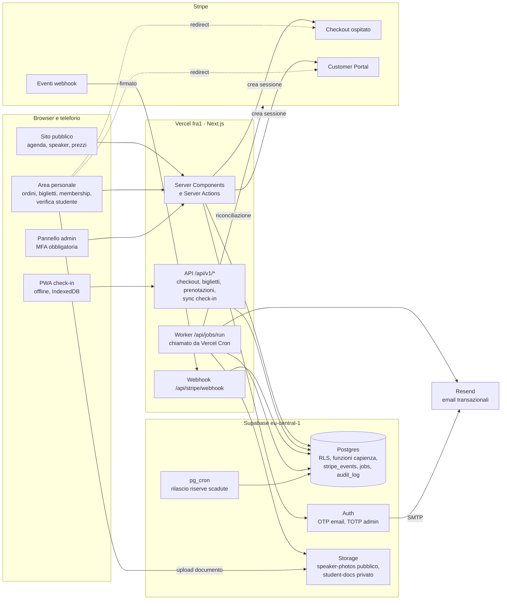

# Architettura informatica

Autore: Giulio Occhipinti. Aggiornato al 05/11/2026.

Documento di progetto, senza codice applicativo. Parte dal brief (`docs/brief.md`); lo schema dati è in
`db/schema.sql`, le decisioni in `docs/decisioni.md`. Le scelte non ancora confermate da Giulio sono marcate
**proposta**.

Etichette di certezza: `[sure]` verificato in questa sessione su fonte primaria, `[likely]` fonte affidabile o
conoscenza consolidata ma non ricontrollata ora, `[uncertain]` da verificare.

Nota sulle fonti: in questa sessione i siti `stripe.com`, `vercel.com` e `supabase.com` non erano raggiungibili
dalla rete dell'ambiente. Il comportamento delle API Stripe e Supabase descritto sotto viene da conoscenza
consolidata (`[likely]`) e va ricontrollato sulla documentazione ufficiale prima di scrivere il codice. I prezzi
vengono da ricerche web su fonti secondarie e sono marcati **non verificati**.

---

## 1. Stack

### Scelta

| Strato | Scelta | Motivo |
|---|---|---|
| Framework | Next.js (App Router), TypeScript | Stesso stack di Eventy: codice e abitudini riusabili; Server Components per le pagine pubbliche veloci, Route Handlers per API e webhook |
| Hosting | Vercel, funzioni nella regione `fra1` (Francoforte) | Vicino al database e agli utenti italiani; anteprime per ogni branch |
| Database | Supabase Postgres, regione `eu-central-1` (Francoforte) | SQL vero: vincoli, transazioni e `CHECK` che impediscono l'overselling; RLS per i permessi; dati in UE |
| Autenticazione | Supabase Auth, accesso con codice via email (OTP), TOTP obbligatorio per gli admin | Nessuna password salvata da noi; MFA nativa con livello `aal2` leggibile nelle policy |
| File | Supabase Storage: bucket pubblico `speaker-photos`, bucket privato `student-docs` | Stesse policy del database; URL firmati brevi per i documenti |
| Pagamenti | Stripe Checkout ospitato, Stripe Billing, Customer Portal | Pagina di pagamento di Stripe: carte, wallet e SCA già gestiti, nessun dato di carta sul nostro sito, nessuna chiave Stripe nel browser |
| Email | Resend (anche come SMTP di Supabase Auth) | API semplice, piano gratuito per partire; alternativa Postmark |
| Job | Tabella `jobs` in Postgres + `pg_cron` (lavori solo SQL) + Vercel Cron che chiama `/api/jobs/run` | Nessun fornitore in più; i lavori pesanti stanno fuori dalle richieste |
| Check-in | PWA dentro lo stesso sito (`/checkin`), funziona offline | Niente app negli store per ora; gira su qualunque telefono dello staff |

Regola sul cookie di sessione (regola 1 del ruolo): Supabase Auth si usa **solo lato server** (`@supabase/ssr` in
Server Components, Server Actions e Route Handlers) con cookie `httpOnly`, `Secure`, `SameSite=Lax`. Nel browser
non c'è un client Supabase autenticato. Che `@supabase/ssr` funzioni bene con cookie `httpOnly` e senza client
browser è `[uncertain]`: va provato nel primo spike di codice.

Regola sulle password (regola 1): con l'accesso via codice email non si salvano password. Se Giulio vorrà anche
la password, Supabase Auth la salva con bcrypt, non scrypt o argon2 `[likely]`: sarebbe una deroga da approvare.

### Alternative scartate

| Area | Alternativa | Perché scartata |
|---|---|---|
| Ticketing | Pretix (open source), Tito, Eventbrite | Pretix ha già check-in, liste d'attesa e Stripe: è l'alternativa seria se i tempi stringono. Scartata perché il brief chiede un sito proprio con membership integrata e prezzi per ruolo; Eventbrite e Tito aggiungono commissioni per biglietto e non gestiscono la membership |
| Framework | SvelteKit, Remix, Laravel | Nessun vantaggio tale da perdere il riuso di Eventy |
| Hosting | Cloudflare Workers, VPS | Workers più economico a grande scala ma con limiti di runtime per SDK Node; il VPS chiede manutenzione |
| Database e auth | Neon + Clerk o Auth.js; Firebase | Due fornitori invece di uno; Firebase non ha vincoli SQL né transazioni comode per la capienza |
| Pagina di pagamento | Payment Element o Embedded Checkout | Più codice e più superficie PCI. Embedded Checkout resta un'opzione futura senza cambiare il resto |
| Vendita | Payment Links | Non permettono di calcolare il prezzo di ruolo lato server |
| Prezzi in Stripe | Un Price per ogni tipo di biglietto × ruolo × finestra | Vedi §4.3: doppia sorgente dei prezzi da tenere allineata |
| Fisco | Merchant of record (Paddle, Lemon Squeezy) | Pensati per prodotti digitali; per biglietti di eventi in presenza non adatti `[uncertain]` |
| Job | Inngest, Trigger.dev, Upstash QStash | Un fornitore in più; da valutare se i job crescono |
| Rate limit | Upstash Redis | Ottimo ma un fornitore in più; per i volumi previsti basta Postgres (`rate_limits`) |
| Check-in | App nativa | Costi e revisioni degli store; la PWA basta. L'app nativa arriverà con le API già pronte (§11) |

---

## 2. Componenti



| Componente | Cosa fa | Chi lo usa |
|---|---|---|
| Sito pubblico | Eventi, agenda per giorni, tracce e sale, sessioni e sottosezioni, speaker, prezzi per ruolo | Tutti |
| Area personale | Carrello con nominativi, ordini, biglietti con QR, cambio nominativo, prenotazione sessioni incluse, membership (rimando al Customer Portal), verifica studente | Utenti registrati |
| Pannello admin | Contenuti dell'agenda, tipi di biglietto e prezzi, capienze, codici sconto, ordini, rimborsi, verifiche studenti, coda "da riconciliare", registro audit | Admin con MFA |
| PWA check-in | Scarica la lista dei biglietti dell'evento, legge i QR, valida offline, sincronizza quando c'è rete | Staff check-in |
| API `/api/v1/*` | Le stesse operazioni dell'area personale e del check-in, in JSON, versionate: serviranno all'app nativa | Sito, PWA, app futura |
| Webhook Stripe | Riceve gli eventi, verifica la firma, li registra una volta sola, aggiorna ordini, posti, biglietti e membership, mette in coda le email | Stripe |
| Email transazionali | Conferma ordine e biglietti, cambio nominativo, membership attivata o pagamento fallito, esito verifica studente, rimborso, promemoria evento, offerta dalla lista d'attesa | Job |
| Job in background | Invio email, riconciliazione Stripe, cancellazione documenti studenti, pulizie, lista d'attesa, rimborsi massivi | Cron |

---

## 3. Ruoli e permessi

Membro e studente **non sono ruoli salvati**: sono stati che si derivano dai dati (`memberships`,
`student_verifications`) nel momento in cui servono. Gli unici ruoli salvati sono `admin` e `checkin_staff`
(tabella `user_roles`, assegnati solo da Giulio). I ruoli non stanno nei metadati utente di Supabase che l'utente
può modificare.

| Ruolo | Come si ottiene | Può |
|---|---|---|
| Visitatore | Nessun login | Leggere eventi pubblicati, agenda, speaker, prezzi (anche quelli membro e studente) |
| Utente registrato | Login con codice email | Comprare a prezzo pubblico, vedere i propri ordini e biglietti, cambiare nominativo entro la scadenza, prenotare sessioni incluse, comprare la membership, chiedere la verifica studente |
| Membro | Membership `active` o `trialing` con periodo in corso | Come sopra, più il prezzo membro |
| Studente in attesa | Richiesta `pending_email` o `pending_review` | Come utente registrato; vede lo stato della richiesta. Niente prezzo studente finché non è approvato (**proposta**) |
| Studente verificato | Verifica `approved` con `valid_until` non passata | Prezzo studente |
| Staff check-in | `user_roles.role = 'checkin_staff'`, eventualmente limitato a un evento | Usare la PWA di check-in di quell'evento; vedere nome e tipo dei biglietti di quell'evento |
| Admin | `user_roles.role = 'admin'`, con TOTP attivo | Tutto il pannello; ogni scrittura richiede sessione `aal2` e finisce nel registro audit |

### 3.1 Ruolo di prezzo, sempre lato server

1. Il carrello mostra prezzi **indicativi** (calcolati lato server alla visualizzazione).
2. Al clic su «Paga» il server, in una Server Action:
   - legge la sessione utente dal cookie e ricarica il profilo dal database (mai dal client);
   - calcola i ruoli ammessi con `price_roles_for(profile_id, at)` dove **`at` è la scadenza della Checkout
     Session** (adesso + 30 minuti): il ruolo deve valere per tutta la finestra di pagamento;
   - per ogni tipo di biglietto prende il prezzo più basso tra i ruoli ammessi (`best_price`). Chi è sia membro
     sia studente paga il minore dei due;
   - applica la regola **proposta** «prezzo di ruolo solo per il biglietto intestato all'acquirente»: gli
     accompagnatori pagano il prezzo pubblico. Senza questa regola un membro potrebbe comprare dieci biglietti
     scontati per altri;
   - valida l'eventuale codice sconto (§4.4);
   - crea l'ordine `pending` con il ruolo «fotografato» (`orders.price_role`, `order_items.price_role`), mette in
     riserva i posti e crea la Checkout Session con gli importi già decisi.
3. Se il totale è diverso da quello mostrato nel carrello, l'utente vede una pagina di riepilogo con il motivo
   prima del redirect a Stripe.

### 3.2 Se la membership scade tra carrello e pagamento

| Momento | Cosa succede |
|---|---|
| Scade mentre l'utente è nel carrello | Al clic su «Paga» il ricalcolo dà il prezzo pubblico; riepilogo con «La tua membership è scaduta: rinnovala o continua a prezzo pubblico» e link al Customer Portal |
| Scade entro i 30 minuti della Checkout Session | Il controllo usa `at` = scadenza della sessione, quindi il prezzo membro non viene concesso; stesso messaggio di rinnovo |
| Rinnovo automatico in corso (periodo appena finito, fattura non ancora pagata) | Rischio di negare il prezzo a un membro in regola per pochi minuti. **Proposta:** tolleranza di 24 ore se `status = 'active'` e `cancel_at_period_end = false` (da aggiungere a `price_roles_for` se Giulio conferma) |
| Membership annullata o rimborsata dopo l'acquisto | Il biglietto resta valido al prezzo pagato: niente conguagli retroattivi (**proposta**) |
| `past_due` (pagamento di rinnovo fallito) | Non vale come membro per nuovi acquisti (**proposta**, domanda aperta) |

Lo stesso schema vale per lo studente con `valid_until`.

Comprare membership e biglietto nella stessa Checkout Session (modalità `subscription` con righe una tantum) è
possibile in Stripe `[likely]` ma complica riserve, rimborsi e fatture: **proposta** di farlo in due passi
(prima la membership, poi il ritorno al carrello con il prezzo membro).

---

## 4. Integrazione Stripe

### 4.1 Oggetti Stripe usati

| Oggetto | Uso |
|---|---|
| Customer | Uno per profilo, creato dal server al primo acquisto, id in `profiles.stripe_customer_id` |
| Product | Uno per tipo di biglietto (`ticket_types.stripe_product_id`) e uno per la membership; creati dal server quando l'admin salva il tipo |
| Price | Solo per la membership: un Price ricorrente (annuale, **proposta**) in `membership_plans.stripe_price_id`. Serve al Customer Portal |
| Checkout Session | `mode=payment` per i biglietti, `mode=subscription` per la membership |
| Coupon + Promotion Code | Specchio dei codici della tabella `discount_codes` |
| Billing Portal Session | Gestione della membership da parte del membro |
| Refund | Solo creati dal nostro pannello (vedi §4.7) |

### 4.2 Checkout dei biglietti

Parametri principali della sessione (bozza, da verificare sulla documentazione API al momento del codice):

```text
mode                    payment
customer                cus_... (sempre, così ricevute e storico sono legati alla persona)
client_reference_id     <order_id>
line_items[]            price_data: { currency: eur, product: <stripe_product_id>, unit_amount: <centesimi> }, quantity
discounts[]             [{ promotion_code: promo_... }]  solo se il server ha validato il codice
allow_promotion_codes   false (il campo codice sulla pagina Stripe salterebbe le nostre regole)
metadata                { order_id, kind: tickets, price_role, env }
payment_intent_data     { metadata: { order_id } }
expires_at              adesso + 30 minuti (minimo consentito da Stripe [likely])
locale                  it
success_url             /ordini/<order_id>?session_id={CHECKOUT_SESSION_ID}
cancel_url              /carrello
Idempotency-Key         checkout-<order_id>
```

- **Metodi di pagamento:** per i biglietti una configurazione dei metodi di pagamento senza metodi a notifica
  differita (es. addebito SEPA), così l'esito è immediato e la riserva dei posti non resta aperta per giorni
  (**proposta**). Il codice gestisce comunque il caso asincrono.
- **Ordini a costo zero** (sconto 100% o sessione gratuita a pagamento zero): si confermano senza passare da
  Stripe, con le stesse funzioni SQL (**proposta**: meno casi limite di una Checkout a zero).
- **Pagina di successo:** non è la prova del pagamento. Mostra lo stato letto dal database; se l'ordine è ancora
  `pending`, il server recupera la sessione da Stripe e chiama **la stessa funzione idempotente** del webhook.
  Così l'utente vede i biglietti subito anche se il webhook tarda.

### 4.3 Prezzi: `price_data`, non un Price per combinazione

**Scelta (proposta):** prezzi dei biglietti passati con `price_data` legato al Product del tipo di biglietto.

| | `price_data` + Product | Price pre-creati (tipo × ruolo × finestra) |
|---|---|---|
| Sorgente del prezzo | Una sola: `ticket_prices` nel nostro database (regola 2 del ruolo) | Due: database e Stripe, da tenere allineate |
| Early bird e cambi di prezzo | Si cambia una riga | Un Price è immutabile: va archiviato e ricreato, e l'id aggiornato |
| Report in Stripe | Per Product (tipo di biglietto); il ruolo sta nei metadata | Per Price |
| Coupon limitati a certi biglietti | Funzionano (`applies_to.products`) `[likely]` | Funzionano |
| Customer Portal | Non serve per i biglietti | Non serve per i biglietti |

La membership invece usa un Price vero, perché il Customer Portal e i rinnovi lo richiedono.

### 4.4 Codici sconto e cumulo con il prezzo di ruolo

Stripe non sa limitare un codice per ruolo né decidere il cumulo con un prezzo che calcoliamo noi. Quindi:

1. Le regole stanno in `discount_codes`: ruoli ammessi, tipi di biglietto, finestre, limiti totali e per
   persona, `combinable_with_role_price`.
2. L'admin crea il codice dal pannello; il server crea in Stripe il Coupon (con `applies_to.products` se limitato)
   e il Promotion Code con lo stesso testo e lo stesso limite di utilizzi.
3. Nel carrello l'utente inserisce il codice nel **nostro** campo; il server lo valida (con rate limit, §8) e lo
   passa a Checkout come `discounts`. Un solo codice per ordine (limite di Checkout `[likely]`).

**Regola di cumulo (proposta):**

| `combinable_with_role_price` | Effetto |
|---|---|
| `false` (default) | Il server calcola sia «prezzo di ruolo» sia «prezzo pubblico − codice» e applica il più basso. Mai entrambi. Se vince il ruolo, il codice non viene consumato e l'utente lo vede scritto |
| `true` | Il codice si applica sopra il prezzo di ruolo (per codici speciali, es. speaker o partner) |

L'importo definitivo dello sconto è quello calcolato da Stripe (`total_details.amount_discount`), salvato in
`orders.discount_cents` alla conferma; un arrotondamento di un centesimo rispetto alla stima è accettato e
registrato.

### 4.5 Membership

- Checkout in `mode=subscription` con il Price della membership, `customer`, `client_reference_id = profile_id`,
  `subscription_data.metadata = { profile_id }`.
- Prima di creare la sessione il server controlla che non ci sia già una membership attiva; se c'è, rimanda al
  Customer Portal.
- **Customer Portal** (sessione creata dal server con `return_url` all'area personale): aggiornare il metodo di
  pagamento, vedere le fatture, annullare a fine periodo. Cambio piano disattivato finché c'è un solo piano.
- `memberships` è una copia locale aggiornata solo dai webhook. Il sito **legge solo questa** (regola 2): Stripe
  resta la fonte, la riconciliazione giornaliera confronta.
- Nelle versioni recenti dell'API Stripe le date del periodo sono state spostate dalla subscription alle sue voci
  (`items.data[].current_period_end`) `[uncertain]`: verificarlo sulla versione API scelta e fissare la versione.

### 4.6 Webhook

Un endpoint per ambiente: `POST /api/stripe/webhook`, runtime Node.js, regione `fra1`.

**Flusso di ogni evento:**

1. Leggere il corpo grezzo (`await request.text()`) e verificare la firma con la libreria Stripe e
   `STRIPE_WEBHOOK_SECRET`; se non torna, risposta 400 e nessuna scrittura.
2. Rifiutare gli eventi con `livemode` diverso dall'ambiente.
3. `INSERT INTO stripe_events ... ON CONFLICT (id) DO NOTHING`. Se l'evento c'era già ed è `processed`, risposta
   200 e fine. È questo che rende innocui i reinvii di Stripe.
4. Elaborare in **una sola transazione**, dentro una funzione SQL chiamata via RPC (supabase-js non apre
   transazioni su più chiamate): aggiornamento di ordine, posti, biglietti o membership e inserimento dei job
   (email) nella stessa transazione.
5. Segnare l'evento `processed` e rispondere 200 in pochi secondi. Niente email o PDF dentro la richiesta
   (regola 3). In caso di errore: `failed`, `last_error`, risposta 500 così Stripe ritenta.

**Ordine degli eventi:** Stripe non garantisce l'ordine `[likely]`. Per subscription e fatture il gestore
**rilegge l'oggetto da Stripe** e salva lo stato attuale, ignorando eventi più vecchi di
`memberships.last_stripe_event_at`.

| Evento | Azione |
|---|---|
| `checkout.session.completed` | Biglietti: se `payment_status = paid` conferma posti, emette i biglietti dai nominativi del carrello, conta l'uso del codice, mette in coda l'email; se `unpaid` ordine `processing` e riserve `awaiting_payment` senza scadenza. Membership: collega subscription e profilo. Controlla che `amount_total` e valuta coincidano con l'ordine, altrimenti segna l'ordine da rivedere |
| `checkout.session.async_payment_succeeded` | Come «pagato» sopra |
| `checkout.session.async_payment_failed` | Ordine `failed`, posti rilasciati, email all'utente |
| `checkout.session.expired` | Ordine `expired`, posti rilasciati, eventuale offerta alla lista d'attesa |
| `charge.refunded` | Aggiorna `refunds`. Se il rimborso non è nato dal pannello: riga `stripe_dashboard`, `needs_review`; rimborso totale → tutti i biglietti dell'ordine `refunded` |
| `refund.updated` / `charge.refund.updated` | Rimborso fallito o annullato → avviso all'admin (nome esatto dell'evento da verificare sulla versione API `[uncertain]`) |
| `charge.dispute.created` / `charge.dispute.closed` | Biglietti `disputed`, avviso all'admin; l'admin decide se bloccare l'ingresso |
| `customer.subscription.created` / `updated` / `deleted` | Rilettura della subscription e aggiornamento di `memberships` |
| `invoice.paid` | Rinnovo riuscito: rilettura della subscription; email di conferma (se non la manda già Stripe) |
| `invoice.payment_failed` | Email «aggiorna il metodo di pagamento» con link al Customer Portal |
| `invoice.payment_action_required` | Email per completare l'autenticazione (SCA) |

Gli altri eventi non vanno abilitati sull'endpoint; se arrivano si salvano come `ignored`.

### 4.7 Riconciliazione

Job giornaliero (e manuale dal pannello):

- Checkout Session completate nelle ultime 72 ore su Stripe ↔ ordini `paid`: mancanze in una coda «da riconciliare».
- Ordini `pending` con sessione scaduta ↔ riserve: rilascio di quelle rimaste.
- Subscription attive su Stripe ↔ `memberships`.
- Rimborsi su Stripe ↔ `refunds`.
- Ricalcolo dei contatori `held` e `confirmed` di ogni pool dai dati reali: una differenza è un bug, va segnalata.
- Eventi Stripe non consegnati: la lista eventi dell'API copre gli ultimi 30 giorni `[likely]`; il job può
  rielaborare quelli mancanti in `stripe_events`.

### 4.8 Rimborsi e cambio nominativo

**Rimborsi (proposta):** si fanno solo dal pannello admin.

1. L'admin sceglie i biglietti; il server calcola l'importo (prezzo pagato meno la quota di sconto) e crea il
   Refund sul PaymentIntent con `metadata = { order_id, ticket_ids, refund_id }` e Idempotency-Key
   `refunds.idempotency_key`.
2. I biglietti passano subito a `refunded` (QR revocato); l'admin sceglie se rimettere in vendita il posto.
3. Il webhook conferma o segnala il fallimento.

Le commissioni Stripe di un pagamento rimborsato non vengono restituite `[likely]`: è un costo. La politica di
rimborso verso i consumatori è una domanda legale aperta.

**Cambio nominativo:** dall'area personale, entro `events.name_change_deadline_hours` dall'inizio. Incrementa
`qr_version` (il QR vecchio non vale più), manda il biglietto al nuovo partecipante, scrive nel registro audit,
massimo 2 cambi per biglietto (**proposta**). I biglietti a prezzo membro o studente non sono cedibili
(**proposta**): si correggono solo errori di battitura tramite admin. Stripe non è coinvolto.

### 4.9 Test e produzione

| | Locale e Preview | Production |
|---|---|---|
| Stripe | Modalità test o sandbox, chiavi test | Chiavi live |
| Supabase | Progetto separato `staging` | Progetto `production` |
| Webhook | `stripe listen` in locale; endpoint di staging con il suo segreto | Endpoint live con il suo segreto |
| Product e Price | Creati da uno script per ambiente (gli id cambiano tra test e live) | Idem |

`orders.livemode` e `stripe_events.livemode` registrano la modalità; il webhook rifiuta quella sbagliata.

### 4.10 Imposte (Stripe Tax o no)

**Non deciso: domanda aperta per la catena legale-fiscale.** L'architettura è pronta per entrambe le strade:
`orders.tax_cents` è vuoto finché non si decide, un flag d'ambiente può accendere `automatic_tax` in Checkout,
la raccolta di indirizzo e partita IVA in Checkout si può attivare. Restano da chiarire: regime IVA dei biglietti
e della membership, obbligo di fattura elettronica (SdI) anche verso privati, eventuali obblighi di biglietteria
per gli eventi, conservazione dei dati degli ordini.

---

## 5. Capienza

### 5.1 Modello

- **Pool di posti** (`capacity_pools`): un insieme di posti con `capacity`, `held` (in riserva) e `confirmed`
  (venduti o prenotati), con il vincolo `held + confirmed <= capacity` nel database.
- Ogni tipo di biglietto consuma un posto in uno o più pool (`ticket_type_pools`). Esempio: pool «Giorno 1» e
  «Giorno 2»; il pass intero consuma entrambi, il giornaliero solo il suo giorno; un workshop a pagamento consuma
  il pool del workshop (e, se si vuole, anche quello del giorno).
- Le sessioni incluse con prenotazione (`access = included_booking`) hanno il loro pool; si prenotano gratis con
  un biglietto valido (`book_session`).

### 5.2 Come si evita l'overselling

1. Alla creazione della Checkout Session il server chiama `hold_order_capacity(order_id, expires_at)` nella stessa
   transazione che crea l'ordine. La funzione fa `UPDATE ... SET held = held + n WHERE held + confirmed + n <= capacity`
   pool per pool, in ordine di id (niente deadlock). Se un pool non basta, errore `sold_out` e nessuna sessione
   Stripe viene creata.
2. La riserva scade 5 minuti dopo la Checkout Session (`expires_at` della sessione = adesso + 30 minuti): non si
   può pagare una sessione dopo che la sua riserva è sparita.
3. `checkout.session.expired` → `release_order_capacity`. Se il webhook si perde, `pg_cron` ogni minuto chiama
   `release_expired_holds`.
4. Pagamento confermato → `confirm_order_capacity` (da `held` a `confirmed`).
5. Pagamento asincrono in corso → riserva `awaiting_payment` senza scadenza, finché arriva l'esito.

Il vincolo `CHECK` è l'ultima difesa: anche con un bug nel codice, il database rifiuta un posto in più. È stato
provato su Postgres 16 in questa sessione: il secondo ordine oltre capienza riceve `sold_out`, la riserva
scaduta viene rilasciata, ridurre la capienza sotto i venduti fallisce `[sure]` (prova locale con dati finti).

### 5.3 Lista d'attesa (opzionale)

Quando un pool libera posti, un job offre il posto al primo in fila (`waitlist_entries`) per un tempo limitato
(es. 12 ore, **proposta**), con un link che crea un ordine riservato a quella persona. Se l'offerta scade, passa
al successivo. Si può attivare dopo il primo evento.

---

## 6. Biglietti e check-in

### 6.1 Biglietto

- Un biglietto per partecipante, con nome ed email (raccolti nel carrello in `order_items.attendees`).
- **QR firmato:** contiene `ticket_id` (UUID casuale), `event_id`, `qr_version` e una firma **Ed25519**. La chiave
  privata sta solo nelle variabili d'ambiente del server; la PWA di check-in ha solo la chiave pubblica. Un QR non
  si indovina (UUID casuale) e non si falsifica (firma). `qr_key_id` permette di ruotare la chiave.
- Il QR non contiene il nome del partecipante: chi fotografa il QR non legge dati personali.
- Codice breve di 8 caratteri (`short_code`) per la ricerca manuale al desk.
- Il biglietto si vede nell'area personale e arriva per email; il wallet Apple o Google è una possibile estensione.

### 6.2 Check-in offline-tollerante

1. Prima dell'evento lo staff fa login nella PWA; il dispositivo scarica per quell'evento: chiave pubblica,
   lista dei biglietti validi (id, versione, nome, tipo, giorni ammessi) e lista dei revocati.
2. Alla lettura del QR la PWA verifica la firma, la versione e i giorni ammessi **in locale**, e registra il
   check-in in IndexedDB con un id generato sul dispositivo.
3. Con la rete, la PWA invia i check-in e scarica gli aggiornamenti (nuovi biglietti, revocati, ingressi fatti da
   altri varchi) ogni 30 secondi circa.
4. Il server ricalcola l'esito (`server_result`); l'indice unico `checkins_one_accepted` ammette un solo ingresso
   per biglietto, giorno e varco. Se due varchi offline hanno accettato lo stesso biglietto, il secondo diventa
   `duplicate` e lo staff riceve un avviso.
5. Un biglietto comprato dopo l'ultima sincronizzazione ha comunque una firma valida: la PWA lo accetta con la
   scritta «non in lista, controlla un documento».

La verifica Ed25519 nel browser c'è nelle versioni recenti dei browser principali `[uncertain]`; altrimenti
serve una libreria (da far controllare con `supply-chain-risk-auditor`). Anche la lettura dei QR su iOS
probabilmente richiede una libreria.

Dopo l'evento la PWA cancella i dati locali; lo staff può cancellarli anche a mano.

---

## 7. Verifica studenti

Due strade, scelte dall'utente:

| Strada | Come funziona | Limite |
|---|---|---|
| Email universitaria | L'utente inserisce l'email; il dominio deve essere nella lista `university_domains`; arriva un link valido 24 ore; del token si salva solo l'hash SHA-256 | Un'email d'ateneo non prova l'iscrizione in corso (ex studenti e personale spesso la conservano) |
| Documento | Caricamento di certificato di iscrizione o libretto (PDF, JPEG o PNG, massimo 5 MB) nel bucket privato `student-docs`, cartella `<user_id>/`; approvazione manuale nel pannello | Lavoro manuale per l'admin |

**Minimizzazione dei dati:**

- Bucket privato; l'utente può solo caricare nella propria cartella, non rileggere né elencare.
- L'admin vede il file solo tramite URL firmato di 60 secondi creato dal server; ogni apertura finisce nel
  registro audit.
- Dopo l'esito un job cancella il file entro 24 ore e scrive `document_deleted_at`; restano solo tipo di
  documento, esito, data, revisore e scadenza.
- Richieste ferme da più di 30 giorni: chiuse come `expired` e file cancellato.
- Controllo del tipo di file dai primi byte, non solo dall'estensione.
- Validità dello sconto: fino al 31 ottobre successivo (fine dell'anno accademico, **proposta**), poi nuova
  verifica.

Informativa privacy, base giuridica e tempi di conservazione: domanda per la catena legale.

---

## 8. Sicurezza

| Tema | Misura |
|---|---|
| RLS | Attiva su tutte le 32 tabelle (controllato in questa sessione su Postgres 16 `[sure]`). Senza policy una tabella è chiusa; scritture su soldi, posti e biglietti solo dal server con `service_role` |
| Funzioni SQL | `security definer` con `search_path` vuoto; `EXECUTE` tolto a `PUBLIC` per le funzioni che spostano posti |
| Chiavi | Chiave segreta Supabase e chiave Stripe solo lato server. Stripe: **chiave limitata** (restricted key) con i soli permessi necessari. Nessuna chiave Stripe nel browser (Checkout ospitato) |
| Chiavi pubbliche | Chiave pubblica QR (pubblica per natura). Se si usa una mappa del luogo, chiave limitata per dominio e API nella console del fornitore (regola 4), oppure un link a OpenStreetMap senza chiave |
| Admin | Login con codice email + TOTP obbligatorio; ogni Route Handler e Server Action admin verifica lato server sessione, ruolo e `aal2` (non solo un middleware); in più le policy RLS richiedono `is_admin_mfa()`. Ruolo admin assegnato solo da Giulio via SQL. Sessioni admin brevi |
| Accesso | Limiti di Supabase Auth sull'invio dei codici; in più `rate_limits` su login, validazione dei codici sconto (contro l'indovinare codici), creazione checkout, upload documenti, sync check-in. Codici sconto di almeno 6 caratteri. Opzionale: Vercel Firewall o una verifica anti-bot sulle pagine più esposte |
| Webhook | Firma verificata, `livemode` controllato, idempotenza su `stripe_events` |
| Segreti | Solo in variabili d'ambiente di Vercel, separate per Preview e Production; `.env.example` con i soli nomi (da creare con il codice): `STRIPE_SECRET_KEY`, `STRIPE_WEBHOOK_SECRET`, `SUPABASE_URL`, `SUPABASE_SECRET_KEY`, `QR_SIGNING_PRIVATE_KEY`, `QR_SIGNING_KEY_ID`, `NEXT_PUBLIC_QR_PUBLIC_KEY`, `RESEND_API_KEY`, `CRON_SECRET`, `APP_ENV` |
| Job | `/api/jobs/run` accetta solo `Authorization: Bearer <CRON_SECRET>` |
| Intestazioni HTTP | CSP restrittiva, HSTS, `frame-ancestors 'none'`, `Referrer-Policy` |
| Log | Niente dati personali nei log applicativi (email mascherate, nessun payload Stripe). `stripe_events.payload` azzerato dopo 90 giorni |
| Audit | `audit_log` solo in aggiunta (un trigger vieta modifiche e cancellazioni, provato `[sure]`): azioni admin, cambi nominativo, rimborsi, esiti verifiche, aperture documenti |
| Backup | Backup giornalieri del piano Pro di Supabase `[uncertain]` sulla durata; PITR a pagamento se serve |
| Account cancellato | Ordini e biglietti non si cancellano a cascata (`on delete restrict`): il profilo si anonimizza. Tempi di conservazione: domanda legale e fiscale |
| Dipendenze | Da far passare a `supply-chain-risk-auditor` prima di aggiungerle: `stripe`, `@supabase/supabase-js`, `@supabase/ssr`, generatore QR, lettore QR, eventuale libreria Ed25519, `resend`, libreria di validazione |

---

## 9. Job in background

| Job | Frequenza | Dove |
|---|---|---|
| Rilascio riserve scadute (`release_expired_holds`) | Ogni minuto | `pg_cron` |
| Coda `jobs`: email, PDF, offerte lista d'attesa, cancellazione documenti | Ogni minuto | Vercel Cron → `/api/jobs/run` |
| Riconciliazione Stripe ↔ database | Ogni giorno, di notte | Vercel Cron |
| Scadenza verifiche studenti, pulizia `rate_limits`, azzeramento payload webhook vecchi | Ogni giorno | `pg_cron` |
| Promemoria evento (7 giorni e 1 giorno prima) | Ogni giorno | Vercel Cron |
| Rimborsi massivi (evento annullato) | Su richiesta admin, a lotti | Coda `jobs` |

Cron di Vercel ogni minuto: disponibile sul piano Pro `[uncertain]`. In alternativa `pg_cron` + `pg_net` chiama la
stessa route.

---

## 10. Costi stimati

Data dei listini: 05/11/2026. **Tutti i prezzi sono non verificati su fonte primaria** (siti ufficiali non
raggiungibili da questa sessione, cifre da fonti secondarie trovate con ricerca web). Da ricontrollare su:
<https://stripe.com/it/pricing>, <https://stripe.com/it/billing/pricing>, <https://stripe.com/it/tax/pricing>,
<https://vercel.com/pricing>, <https://supabase.com/pricing>, <https://resend.com/pricing>.

### 10.1 Listini usati

| Voce | Prezzo usato | Fonte (05/11/2026) |
|---|---|---|
| Stripe, carta standard SEE | 1,5% + 0,25 € | Ricerca web su fonti secondarie, es. [sellfy.com](https://sellfy.com/it/strumenti/calcolatore-commissioni-stripe/); un estratto della pagina ufficiale riportava invece 1,4% + 0,10 €: **in conflitto, da verificare** |
| Stripe, carta extra SEE | circa 3,25% + 0,25 € più 2% se c'è cambio valuta | Fonti secondarie, **non verificato** |
| Stripe Billing (abbonamenti) | 0,7% del volume ricorrente | [flexprice.io](https://flexprice.io/blog/stripe-pricing-breakdown-2026), [withorb.com](https://www.withorb.com/blog/stripe-billing-pricing), **non verificato** |
| Stripe Tax (se adottato) | 0,5% per transazione calcolata | Stesse fonti, **non verificato** |
| Stripe, contestazione | circa 20 € a contestazione | A memoria, **non verificato** |
| Vercel Pro | 20 $/mese, 1 posto di sviluppo, 20 $ di credito d'uso; Hobby non ammesso per uso commerciale | [makerkit.dev](https://makerkit.dev/blog/saas/vercel-cost), risultato di ricerca della documentazione Vercel, **non verificato** |
| Supabase Pro | 25 $/mese per organizzazione, 8 GB di database, 100.000 MAU, 10 $ di crediti di calcolo (istanza Micro); Free con pausa per inattività | [jetadmin.io](https://www.jetadmin.io/blog/supabase-pricing-2026-guide-to-plans-limits-and-real-world-costs/), [schematichq.com](https://schematichq.com/blog/supabase-pricing), **non verificato** |
| Resend | Free 3.000 email/mese (100 al giorno); Pro 20 $/mese per 50.000 | [userjot.com](https://userjot.com/blog/resend-pricing-in-2025), [costbench.com](https://costbench.com/software/email-api/resend/), **non verificato** |

### 10.2 Ipotesi

- Prezzo medio di un ordine: 60 €, un biglietto per ordine (ipotesi prudente: più ordini = più quote fisse).
- 15% dei partecipanti compra la membership a 40 €/anno.
- Tutte carte standard SEE (sotto la sensibilità per le altre).
- Circa 10 email per partecipante all'anno, compresi i codici di accesso.
- Un solo admin con posto di sviluppo su Vercel.

### 10.3 Stima annuale

| Voce | 150 partecipanti | 1.000 partecipanti | 10.000 partecipanti |
|---|---|---|---|
| Incasso lordo (biglietti + membership) | 9.920 € | 66.000 € | 660.000 € |
| Stripe sui biglietti (1,5% + 0,25 €) | 172,50 € | 1.150 € | 11.500 € |
| Stripe sulle membership (carta) | 19,55 € (23 membri) | 127,50 € (150) | 1.275 € (1.500) |
| Stripe Billing 0,7% | 6,44 € | 42 € | 420 € |
| **Totale Stripe** | **≈ 199 €** (2,0%) | **≈ 1.320 €** (2,0%) | **≈ 13.195 €** (2,0%) |
| Stripe Tax, solo se adottato (0,5%) | + 49,60 € | + 330 € | + 3.300 € |
| Vercel Pro | 240 $ | 240 $ | 240 $ (+ eventuale uso oltre il credito nei giorni di apertura vendite) |
| Supabase Pro | 300 $ | 300 $ | 300 $ + eventuale istanza più grande (non stimata) |
| Resend | 0 $ (Free; attenzione al limite di 100 al giorno all'apertura vendite) | 60 $ (Pro nei 3 mesi di picco) | 240 $ (Pro tutto l'anno) |
| **Totale infrastruttura** | **≈ 540 $** | **≈ 600 $** | **≈ 780 $ +** |
| Infrastruttura per partecipante | ≈ 3,60 $ | ≈ 0,60 $ | ≈ 0,08 $ |

- **Sensibilità carte:** ogni ordine pagato con carta extra SEE costa circa 1 € in più; con il 20% di questi ordini
  si aggiungono circa 31 €, 210 € e 2.100 €.
- **Piani gratuiti:** Vercel Hobby è vietato per uso commerciale; Supabase Free va bene solo per lo staging
  (pausa per inattività, niente backup). Quindi già a 150 partecipanti i costi fissi (≈ 540 $) superano le
  commissioni Stripe.
- **Staging:** un secondo progetto nella stessa organizzazione Pro costa calcolo in più `[uncertain]`; proposta:
  staging in un'organizzazione Free separata.
- Restano fuori: dominio, eventuale fatturazione elettronica, consulenze, tempo di sviluppo.

Numeri da passare a `monetization` o alla skill `unit-economics` per il prezzo dei biglietti.

---

## 11. Crescita senza riscritture

| Prossimo passo | Cosa è già pronto | Cosa servirà |
|---|---|---|
| App negli store | API `/api/v1/*` in JSON; Supabase Auth funziona anche nelle app; check-in già separato | Per biglietti di eventi in presenza le regole degli store permettono pagamenti esterni `[uncertain]`; per la membership da verificare. Domanda aperta |
| Altre lingue | Testi in colonne dedicate | Tabelle di traduzione o colonne per lingua; `next-intl` o simile |
| Altre valute e mercati | `currency` per evento, prezzi e ordini | Prezzi per valuta, regole fiscali per paese |
| Più organizzatori | Tutto è legato a `event_id` | Tabella `organizations` e Stripe Connect: costa meno aggiungerla adesso (domanda aperta) |

---

## 12. Rischi e limiti

- 🔴 Prezzi e commissioni non verificati su fonte primaria: la stima dei costi può cambiare. `[uncertain]`
- 🔴 Obblighi fiscali (IVA, fattura elettronica, eventuale biglietteria) non definiti: possono cambiare il flusso di checkout. `[uncertain]`
- 🟡 Comportamenti API Stripe descritti a memoria (scadenza minima Checkout, un solo sconto per sessione, date del periodo spostate sulle voci): da verificare sulla versione API fissata. `[likely]`
- 🟡 Cookie `httpOnly` con `@supabase/ssr` senza client browser: da provare nel primo spike. `[uncertain]`
- 🟡 Email universitaria non prova l'iscrizione in corso: possibile abuso del prezzo studente. `[likely]`
- 🟡 Dati dei partecipanti salvati sui telefoni dello staff per il check-in offline: dispositivo perso = dati esposti fino alla cancellazione.
- 🟡 Un rimborso fatto dalla Dashboard Stripe invece che dal pannello non si collega da solo ai biglietti: va riconciliato a mano.
- 🟡 Doppio ingresso possibile con due varchi offline nello stesso momento: si scopre solo alla sincronizzazione.
- 🟡 Picco all'apertura vendite: limite di 100 email al giorno sul piano Free di Resend; bot sul checkout. `[uncertain]`
- 🟡 Costi fissi superiori alle commissioni sotto le 1.000 persone all'anno.
- 🟡 Sviluppo su misura più lungo di una piattaforma pronta come Pretix.
- 🟢 Overselling: impedito dal vincolo nel database, provato in locale. `[sure]`

---

## 13. Domande aperte per Giulio

1. **Fisco:** regime IVA di biglietti e membership, Stripe Tax sì o no, fattura elettronica, eventuale obbligo di
   biglietteria. Va alla catena `catena-legale-fiscale`.
2. **Rimborsi:** politica verso i partecipanti (fino a quando, quanto, chi paga le commissioni). Anche legale.
3. **Prezzo di ruolo:** solo per il biglietto dell'acquirente (proposta) o per tutti i biglietti dell'ordine?
4. **Membership:** durata e rinnovo (annuale?), prezzo, tolleranza di 24 ore sul rinnovo, `past_due` vale come membro?
5. **Studenti:** basta l'email universitaria o serve sempre il documento? Fino a quando vale la verifica? Chi è
   in attesa può comprare a prezzo pieno e avere poi la differenza?
6. **Codici sconto:** cumulo con il prezzo di ruolo vietato di default (proposta: si applica il migliore dei due)?
7. **Cambio nominativo:** fino a quante ore prima, quante volte, e i biglietti scontati per ruolo sono cedibili?
8. **Metodi di pagamento:** escludere l'addebito SEPA e gli altri metodi a notifica differita per i biglietti?
9. **Lista d'attesa:** serve dal primo evento?
10. **Più organizzatori in futuro:** aggiungere già ora la tabella `organizations`?
11. **App negli store:** in che tempi? Cambia le priorità delle API.
12. **Pretix:** vale la pena confrontarlo davvero prima di sviluppare su misura?
