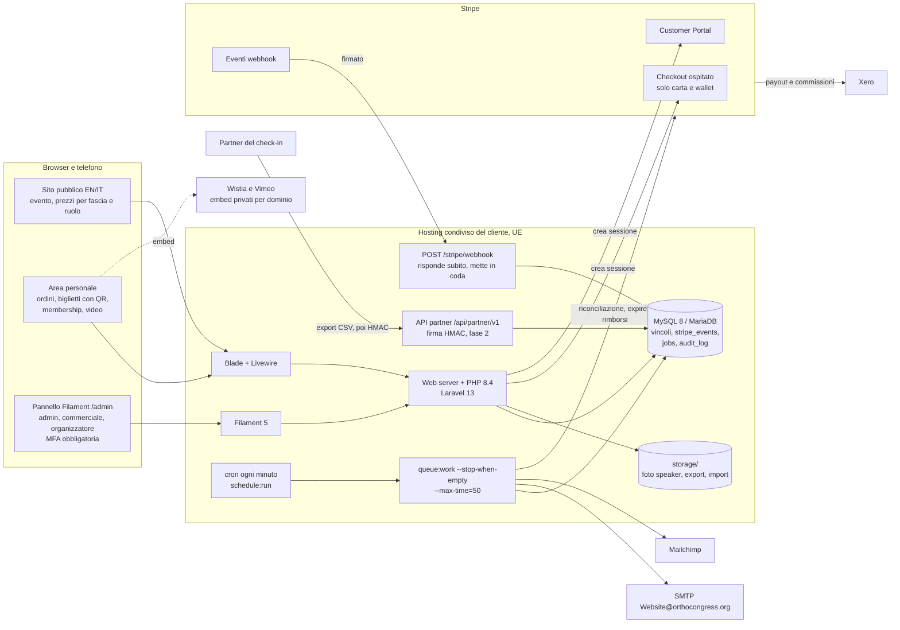

# Architettura informatica

Autore: Giulio Occhipinti. Aggiornato al 06/11/2026 (secondo giro di risposte del cliente).

Documento di progetto, senza codice applicativo. Parte dal brief (`docs/brief.md`) e dalle risposte del cliente
([primo giro](cliente/risposte-2026-11-06.md), [secondo giro](cliente/risposte-2026-11-06-secondo-giro.md)). Il
modello dei dati è in [`db/modello-dati.md`](../db/modello-dati.md), le migrazioni di esempio in
[`db/migrazioni-bozza/`](../db/migrazioni-bozza/), le decisioni in [`docs/decisioni.md`](decisioni.md). La versione
per Next.js + Supabase del 05/11/2026 è superata; il suo schema resta in
[`db/archivio/schema-postgres-supabase.sql`](../db/archivio/schema-postgres-supabase.sql). Le scelte non ancora
confermate da Giulio sono marcate **proposta**.

Etichette di certezza: `[sure]` verificato in questa sessione su fonte primaria o con una prova (la fonte è detta),
`[likely]` fonte affidabile o conoscenza consolidata ma non ricontrollata ora, `[uncertain]` da verificare, `[falsy]`
controllato e risultato falso.

**Nota sulle fonti (06/11/2026, pomeriggio).** Dalla sessione di oggi `stripe.com` e `docs.stripe.com` si leggono
con `curl` attraverso il proxy della sessione (lo strumento di lettura web invece non risolve il nome): i listini
Stripe per la Francia e le pagine sui wallet sono `[sure]`. Composer e Packagist funzionano (scaricando i sorgenti da
git): Laravel è installato davvero in una cartella di prova e le migrazioni bozza girano con il vero `Schema` di
Laravel. `vimeo.com` e `wistia.com` non si aprono (proxy, 403): quello che riguarda i video è `[likely]` o
`[uncertain]`.

---

## 1. Stack

### 1.1 Scelta

Decisione di Giulio del 06/11/2026: **Laravel + Filament sul server del cliente, dati in UE**. Il secondo giro di
risposte precisa il server: **hosting condiviso con accesso SSH e MySQL o MariaDB, gestito da Simone**.

| Strato | Scelta | Motivo |
|---|---|---|
| Linguaggio | **PHP 8.4** (minimo 8.3; dall'11/11/2026 solo 8.4, server del cliente: ADR 0001) | Laravel 13 chiede PHP 8.3+ `[sure]` (`composer.json` di `laravel/framework` 13.40.0, installato il 06/11/2026). L'ultima versione di `spatie/laravel-translatable` (6.15.0) chiede già PHP 8.4 `[sure]` (risoluzione di Composer): con 8.3 si resta alla 6.14 |
| Framework | **Laravel 13** (installata la 13.40.0 `[sure]`; bug fix fino al Q3 2027, sicurezza fino al Q1 2028 `[likely]`, [laravel-news.com](https://laravel-news.com/laravel-13-released)) | Copre l'evento di aprile 2027 con i bug fix |
| Pannello | **Filament 5** (con Livewire 4) | Chiesto dal cliente. Compatibilità con Laravel 13: Composer risolve `filament/filament` 5.11.1 + `livewire/livewire` 4.4.8 su Laravel 13.40 e PHP 8.3 `[sure]` (prova `--dry-run` del 06/11/2026; non ancora avviato) |
| Interfaccia pubblica | **Blade + Livewire 4 + Alpine.js** (§4.1) | Stessa tecnologia di Filament, pagine generate dal server |
| Database | **MySQL 8.0.16+ o MariaDB 10.7+** (§3) | È quello che offre l'hosting. Migrazioni bozza riscritte per MySQL e provate su MySQL 8.0.46 e MariaDB 10.11.14 `[sure]` |
| Pagamenti | Stripe Checkout ospitato, Stripe Billing, Customer Portal, SDK `stripe-php` diretto (risolto 22.1.0 `[sure]`), **senza Laravel Cashier** (§6.1); **solo carta**, wallet compresi (§6.9) | Nessun dato di carta sul sito |
| Coda e job | Laravel Queue con driver `database` + scheduler di Laravel **avviati dal cron ogni minuto**, nessun processo sempre attivo (§8) | L'hosting condiviso non ha Supervisor né systemd |
| Email | SMTP esistente `Website@orthocongress.org`, circa 1.000 email l'ora (dato del cliente), in coda con limite di invio (§9) | Richiesta del cliente |
| Newsletter | **Mailchimp** (account già attivo), solo con consenso (§13.2) | Risposta del cliente |
| File | Disco dell'hosting (`storage/app/public` per le foto degli speaker, `storage/app/private` per export e import) | Niente fornitore in più; nei backup |
| Video | **Wistia e Vimeo già in uso**, embed privati con restrizione di dominio, accesso per ruolo (§12) | Risposta del cliente; nessun servizio video nuovo |
| Accesso | Codice via email per chi compra, password argon2id + TOTP obbligatorio per lo staff (§5) | Regola 1 del ruolo |
| Permessi | Policies di Laravel + `spatie/laravel-permission` (risolto 8.5.0 `[sure]`) (§5.3) | Ruoli admin, commerciale, organizzatore |
| Lingue | **Inglese predefinito**, italiano seconda lingua (§10) | Risposta del cliente |

### 1.2 Alternative scartate

| Area | Alternativa | Perché scartata |
|---|---|---|
| Stack | Next.js su Vercel + Supabase (architettura del 05/11/2026) | **Superata: decisione di Giulio del 06/11/2026** |
| Database | ~~Postgres 16+ come principale~~ | **Superata il 06/11/2026**: l'hosting del cliente offre solo MySQL o MariaDB. Il ramo Postgres delle migrazioni, provato su Postgres 16.15, resta nella storia di git |
| Worker | Supervisor o systemd con `queue:work` sempre attivo | Non disponibili su un hosting condiviso; sostituiti dal cron (§8). Tornano utili se un giorno si passa a un VPS |
| Video | ~~Bunny Stream o api.video~~ | **Superata il 06/11/2026**: i video sono già su Wistia e Vimeo |
| Newsletter | Brevo | Il cliente ha già Mailchimp attivo |
| Interfaccia | Inertia + Vue o React | Due mondi da mantenere; dopo il lancio non c'è un tecnico |
| Interfaccia | Pannello e sito tutti in Filament | Filament è fatto per lo staff; il sito pubblico ha il suo aspetto |
| Pagamenti | Laravel Cashier | §6.1: porta tabelle, webhook e versione API propri |
| Ticketing | pretix, Tito, Eventbrite | Scartati il 05/11/2026 (tutto su misura) |
| Code | Redis + Horizon | Horizon ha bisogno di un processo sempre attivo: non su questo hosting |
| Permessi | `bezhansalleh/filament-shield` | Con tre ruoli fissi è più semplice definirli nel codice |

---

## 2. Componenti



| Componente | Cosa fa | Chi lo usa |
|---|---|---|
| Sito pubblico | Evento, prezzi per fascia e ruolo, membership; in fase 2 programma per giorni e sale, sessioni, speaker; EN e IT | Tutti |
| Area personale | Carrello con nominativi, ordini e ricevute, biglietti con QR, membership (rimando al Customer Portal), video ammessi al proprio ruolo | Chi ha un account |
| Pannello Filament | Evento e date, fasce e prezzi, tipi di biglietto, capienze, codici sconto, ordini, omaggi, membership, export; in fase 2 programma, speaker, import CSV, video | Staff con MFA |
| Webhook Stripe | Verifica la firma, registra l'evento una volta sola, mette in coda l'elaborazione, risponde 200 | Stripe |
| Cron e coda | Ogni minuto: scadenza delle sessioni Stripe, elaborazione degli eventi, email, rimborsi automatici, export; ogni notte la riconciliazione e il backup | Sistema |
| API partner | Elenco dei biglietti validi e revocati per il check-in, richieste firmate (fase 2) | Partner sul posto |

---

## 3. Database

**MySQL 8.0.16+ o MariaDB 10.7+** (decisione del 06/11/2026 dopo le risposte del cliente; minimo di MariaDB portato da
10.6 a 10.7 il 06/11/2026 sera, riga «Identificativi su MariaDB prima della 10.7» qui sotto). Dettaglio di tabelle e
vincoli in [`db/modello-dati.md`](../db/modello-dati.md); prove al §6 di quel file.

| Tema | Come si fa con MySQL / MariaDB | Prova del 06/11/2026 |
|---|---|---|
| `CHECK` (capienza, importi, forma delle chiavi, omaggi) | Applicati da MySQL 8.0.16 e da MariaDB 10.2 `[likely]`; su versioni più vecchie vengono ignorati: **non accettabili** | 🟢 applicati su MySQL 8.0.46 e MariaDB 10.11.14 `[sure]` |
| `CHECK` e valori `NULL` | Un `CHECK` che vale `NULL` passa: ogni confronto su una colonna che può essere vuota porta il suo `is not null` | 🔴→🟢 trovati e corretti due casi (accompagnatore senza limite, omaggio senza motivo) `[sure]` |
| `CHECK` e chiavi esterne | MySQL e MariaDB rifiutano un `CHECK` (e una colonna generata) su una colonna con `ON DELETE SET NULL` o `CASCADE`: le FK usate nei vincoli sono `RESTRICT` | 🟢 errore 3823 su MySQL, 1901 su MariaDB `[sure]` |
| Indici unici «parziali» (una riserva aperta per persona, un prezzo membro per tipo, un accompagnatore per posto, un prezzo per tipo × fascia × ruolo) | **Colonna generata** `STORED` che vale la chiave solo quando la riga è attiva, `NULL` altrimenti, con indice unico (più `NULL` sono ammessi) | 🟢 `[sure]` |
| Identificativi su MariaDB prima della 10.7 | Laravel 13 usa `char(36)` per le colonne `uuid` su MariaDB prima della 10.7 (`MariaDbGrammar::typeUuid`) `[sure]`, e MariaDB rifiuta una colonna generata che dipende da una chiave esterna `char(36)` (errore 1901), mentre la accetta su `UUID` nativo e su `bigint` | 🔴 riprodotto su MariaDB 10.11.14 con colonne `char(36)` `[sure]`; su una 10.6 vera non provato `[likely]`. Quindi **MariaDB 10.7+**, in pratica 10.11 o 11.4 |
| UUID su MariaDB | Laravel 13 crea le colonne `uuid` con il tipo nativo `UUID` di MariaDB: `coalesce(uuid, '-')` fallisce; nelle colonne generate serve `cast(… as char(36))` | 🔴→🟢 trovato e corretto `[sure]` |
| Vincoli di esclusione (fasce sovrapposte, sale sovrapposte) | Non esistono: trigger che legge la tabella (fasce) + Service con `lockForUpdate` sulla riga padre | 🟢 fasce sovrapposte rifiutate `[sure]` |
| Trigger (transizioni di stato, dati fotografati dell'ordine, nominativo immutabile) | `SIGNAL SQLSTATE '45000'` | 🟢 su entrambi `[sure]`; ⚠️ vedi sotto |
| Lock e isolamento | `lockForUpdate()` = `SELECT … FOR UPDATE`; isolamento di default `REPEATABLE READ`: l'`UPDATE` condizionale aspetta il lock e legge l'ultima versione confermata della riga; `DB::transaction($fn, attempts: 3)` contro i deadlock e lock sempre nello stesso ordine (ordine, poi pool per id) | 🟢 ultimo posto e prezzo membro in parallelo `[sure]` |
| DDL | Non transazionale: una migrazione che fallisce a metà lascia le tabelle create. Migrazioni piccole, provate prima in staging, backup prima del deploy | — |
| Date | `datetime` in UTC (non `timestamp`, che ha il limite del 2038 `[likely]`) | — |

⚠️ **Trigger su hosting condiviso.** Con il log binario attivo (predefinito su MySQL 8) un utente senza `SUPER` non
può creare trigger: errore 1419 `[sure]` (provato su MySQL 8.0.46 e su MariaDB 10.11.14 con `--log-bin`, utente con
tutti i permessi sul solo database). Servono **`log_bin_trust_function_creators = 1`** dall'hosting, oppure il log
binario spento (MariaDB lo ha spento di default `[sure]` nella versione provata). Se l'hosting non può, le migrazioni
saltano i trigger con `DB_TRIGGERS_OPTIONAL=true` e un avviso: le 11 difese che dipendono dai trigger (transizioni di
stato, fascia e importi fotografati, nominativo immutabile, fasce sovrapposte, biglietti non cancellabili) restano
nei Service, nelle enum PHP e nei test. **Capienza, prezzo membro, idempotenza dei webhook e biglietti unici non
dipendono dai trigger** e restano nel database comunque `[sure]` (prova senza trigger, `db/modello-dati.md` §6).

**Utenti del database:** l'hosting di solito ne dà uno per database. **Proposta:** se il pannello dell'hosting lo
permette, uno per l'applicazione (solo dati) e uno per le migrazioni (usato dal deploy); altrimenti uno solo, con la
password solo nel `.env`.

---

## 4. Struttura dell'applicazione

### 4.1 Sito pubblico: Blade + Livewire

**Proposta: Blade + Livewire 4**, non Inertia (confronto invariato rispetto al 06/11/2026 mattina: una sola
tecnologia con Filament, HTML dal server, manutenzione da parte di qualunque sviluppatore Laravel).

Il prototipo HTML (`prototipo/`) diventa una serie di componenti Blade. Il sito è **nuovo e separato** su
`orthocongress.org` (dominio da comprare); eas-aligners.com serve solo come esempio di colori e testi.

Rotte principali, con prefisso di lingua: `/{en|it}/`, `/tickets` (`/biglietti`), `/membership`, `/login`,
`/account/...`; in fase 2 `/programme`, `/sessions/{slug}`, `/speakers`, `/speakers/{slug}`. Lingua predefinita
inglese (§10).

### 4.2 Area personale

Una sola area per chi compra: ordini e ricevute, biglietti con QR, membership con link al Customer Portal, profilo e
lingua, consensi, **acquisto di un accompagnatore** dal proprio pass (fase 2, §7.4). Il nominativo del biglietto
**non si cambia** (§6.7). La sezione **video** mostra solo i video ammessi ai ruoli della persona (§12). Ogni pagina
e ogni azione Livewire verifica lato server sessione e Policy (regola 1), non solo il middleware delle rotte.

### 4.3 Pannello Filament

Un solo pannello in `/admin` (**proposta**: elenco di IP ammessi se l'hosting lo permette). Accesso solo a chi ha uno
dei tre ruoli (`User::canAccessPanel()`) e la MFA attiva. Ogni risorsa usa la sua Policy.

| Gruppo nel menu | Risorse | Ruoli | Fase |
|---|---|---|---|
| Evento | Evento (**date modificabili**, finestra di vendita), giorni | organizzatore, admin | 1 |
| Vendita | Tipi di biglietto, **fasce di prezzo** (date modificabili), prezzi per tipo × fascia × ruolo, capienze | organizzatore, admin | 1 |
| Vendita | Codici sconto | commerciale **e** organizzatore, admin | 1 |
| Ordini e soldi | Ordini, biglietti, rimborsi (lettura), membership (lettura), coda «da riconciliare» | commerciale, admin | 1 |
| Ordini e soldi | **Omaggi** per speaker e staff (§7.4) | organizzatore, admin | 1 se gli speaker devono avere il biglietto all'apertura, altrimenti 2 |
| Export | Partecipanti per il partner del check-in, ordini per la contabilità, iscritti con consenso | secondo il contenuto (§13.3) | 1 |
| Programma | Sale (12), tracce, sessioni (~120), interventi, speaker (~30), **import da CSV** (§13.4) | organizzatore, admin | 2 |
| Video | Video Wistia e Vimeo con ruoli ammessi (§12) | organizzatore, admin | 2 |
| Sistema | Utenti dello staff e ruoli, chiavi del partner, registro audit, eventi Stripe, job falliti | admin | 1 |

Testi del pannello in inglese e italiano; campi tradotti con due schede EN/IT per campo (§10).

---

## 5. Accesso, ruoli e permessi

### 5.1 Chi compra: codice via email

**Codice di 6 cifre via email**, nessuna password, account creato al primo accesso (prototipo `accesso.html`). Tabella
`login_codes` (codice salvato come hash, scadenza 10 minuti, 5 tentativi) e `RateLimiter` per email e per IP; dopo
l'accesso `session()->regenerate()`.

Su questo hosting il codice **non passa dalla coda del cron** (arriverebbe fino a un minuto dopo): si manda con un
job `dispatch(...)->afterResponse()`, che Laravel esegue nello stesso processo dopo aver chiuso la risposta, con
`fastcgi_finish_request()` su PHP-FPM o `litespeed_finish_request()` su LiteSpeed `[sure]` (codice di
`symfony/http-foundation` installato). Se l'hosting non ha nessuna delle due, invio diretto nella richiesta (un
secondo circa in più).

Cookie di sessione: `httpOnly`, `Secure`, `SameSite=Lax`, firmato e cifrato con `APP_KEY`; sessioni nel database
(tabella `sessions` di Laravel: per questo le sessioni del programma si chiamano `program_sessions`).

### 5.2 Staff: password argon2id + TOTP obbligatorio

- Login del pannello con password, hash **argon2id** (regola 1). PHP deve essere compilato con argon2: da
  controllare sull'hosting (`php -r "var_dump(defined('PASSWORD_ARGON2ID'));"`); se manca, bcrypt con costo 12 non
  rispetta la regola del ruolo e va segnalato a Giulio.
- **MFA obbligatoria** con app TOTP e codici di recupero, integrata in Filament dalla versione 4 `[likely]`. Sessioni
  dello staff più brevi (2 ore di inattività).
- Limite ai tentativi di accesso del pannello e per IP.

### 5.3 Ruoli e permessi

Allineato al codice il 07/11/2026. `spatie/laravel-permission` con **permessi granulari** definiti in
`sito/app/Enums/StaffRole.php` (risorse con `view`, `create`, `update`, `delete` e azioni come `orders.refund`) e
creati dal seeder `RolesAndPermissionsSeeder`, rilanciabile in produzione. Le Policy controllano solo permessi, mai il
nome del ruolo. L'admin può ritoccare i permessi di commerciale e organizzatore dal pannello (Roles, con audit); il
ruolo admin non si modifica. Membro **non è un ruolo dello staff**: si deriva da `memberships` a ogni acquisto e a
ogni accesso ai video. Matrice completa (51 permessi, generata dal database) e scelte da confermare in
[`docs/tecnico/permessi.md`](tecnico/permessi.md).

| Area (permessi) | admin | commerciale | organizzatore |
|---|---|---|---|
| Evento, date, giorni (`event.*`); in fase 2 sale, tracce, sessioni, speaker, import | ✔ | lettura | ✔ |
| Tipi di biglietto, fasce, prezzi, capienze (`ticket_types.*`, `price_tiers.*`, `ticket_prices.*`, `capacity_pools.*`) | ✔ | lettura | ✔ |
| Codici sconto (`discount_codes.*`; decisione del cliente: li creano entrambi) | ✔ | ✔ | ✔ |
| Codici d'invito per espositori (`invite_codes.*`, fase 2) | ✔ | ✔ | lettura |
| Ordini e biglietti (`orders.view`, `tickets.view`) | ✔ | ✔ | ✔ |
| Importi di ordini, pagamenti, rimborsi (`orders.view_amounts`) | ✔ | ✔ | — |
| Omaggi per speaker e staff (`complimentary.view`, `complimentary.issue`) | ✔ | lettura | ✔ |
| Rimborsi (`orders.refund`) e decisione sugli ordini con importo diverso (`orders.review`) | ✔ | ✔ | — |
| Reinvio di un biglietto per email (`tickets.resend`) | ✔ | ✔ | — |
| **Correzione di un refuso nel nominativo** (`tickets.correct_attendee`, §6.7) | ✔ | — | — |
| Export contabile (`orders.export`) e riconciliazione (`reconciliation.run`); le fatture sono in Stripe e Xero | ✔ | ✔ | — |
| Membership e contestazioni, in lettura (`memberships.view`, `disputes.view`) | ✔ | ✔ | — |
| Prezzo della membership: vedi (`membership_plans.view`) / modifica Price ID (`membership_plans.update`) | ✔ / ✔ | ✔ / — | — |
| Export iscritti alla newsletter con consenso (`consents.export`) | ✔ | ✔ | — |
| Export partecipanti per il check-in (`attendees.export`) | ✔ | ✔ | ✔ |
| Video e ruoli ammessi (`videos.manage`, fase 2) | ✔ | — | ✔ |
| Utenti dello staff, ruoli, registro audit (`staff.*`, `roles.*`, `audit_log.view`) | ✔ | — | — |
| Eliminare (`*.delete`) | — | — | — |

Nessun ruolo elimina: nel pannello le cose si spengono. Chiavi del partner ed eventi Stripe non hanno ancora un
permesso (non c'è una pagina nel pannello). Codici sconto: `DiscountCodePolicy` ammette commerciale e organizzatore;
ogni creazione e modifica va nel registro audit con l'autore (`discount_codes.created_by`).

Il primo admin si crea via SSH con `php artisan eventals:create-admin <email> --name="…" --role=admin`.

### 5.4 Cosa sostituisce l'RLS di Supabase

Invariato: il browser non tocca mai il database; scope `published()`, query dalle relazioni dell'utente, Policy su
ogni modello e azione, UUID non indovinabili, proprietà Livewire `#[Locked]`, test per ogni rotta riservata contro
l'**IDOR**.

---

## 6. Integrazione Stripe

Account Stripe **in Francia**, incasso **in euro** (risposta del cliente del 06/11/2026).

### 6.1 Cashier o SDK diretto

**Proposta invariata: SDK `stripe-php` diretto per tutto, senza Laravel Cashier** (un solo webhook, una sola tabella
di idempotenza, una sola copia dello stato della membership, versione API fissata da noi). Versione API da fissare
nel client e nell'endpoint webhook: quale, `[uncertain]` finché non si legge la versione predefinita di `stripe-php`
22.x. Chiave segreta **limitata** (restricted key) ai soli permessi usati.

### 6.2 Checkout dei biglietti

`CheckoutService`, in `DB::transaction($fn, attempts: 3)`:

1. ricarica utente, tipo di biglietto e prezzi dal database, mai dal browser;
2. legge la **fascia attiva adesso** (§6.3) e la fissa sull'ordine (`orders.price_tier_id`): se la fascia finisce
   durante il pagamento, il prezzo non cambia;
3. calcola il ruolo di prezzo valido **fino alla scadenza della Checkout Session** (adesso + 31 minuti);
4. prezzo membro solo sul biglietto del membro che compra (quantità 1, intestato a lui), al massimo uno per membro,
   evento e tipo anche su più ordini e in qualunque fascia (`member_price_claims`); gli altri biglietti a prezzo
   pubblico;
5. codice sconto calcolato riga per riga dal server (§6.4);
6. se c'è un ordine `pending` della stessa persona: `expire` della sessione precedente e chiusura;
7. crea l'ordine `pending` con ruolo, fascia e importi fotografati (il database non li lascia più cambiare),
   riserva posti e utilizzo del codice;
8. dopo il commit crea la Checkout Session con `Idempotency-Key: checkout-<order_id>` e salva il suo id.

```text
mode                    payment
customer                cus_...
client_reference_id     <order_id>
line_items[]            price_data: { currency: eur, unit_amount: <unit_amount_cents>,
                          product_data: { name: <stripe_line_name nella lingua dell'ordine>, metadata: {...} } },
                        quantity
payment_method_types    [card]                      (solo carta; Apple Pay e Google Pay passano come carta, §6.9)
allow_promotion_codes   false
metadata                { order_id, kind: tickets, price_role, price_tier, discount_code, env }
payment_intent_data     { metadata: { order_id } }
expires_at              adesso + 31 minuti (minimo Stripe 30 minuti [likely])
locale                  en | it (lingua dell'ordine)
invoice_creation        da decidere col cliente a lavoro ultimato (§13.1, §19)
success_url             /{locale}/account/orders/<order_id>?session_id={CHECKOUT_SESSION_ID}
cancel_url              /{locale}/tickets
```

- Ordini a costo zero (codice al 100%): confermati senza Stripe dallo stesso `PaymentService::markPaid()`.
- La pagina di successo non è la prova del pagamento: se l'ordine è ancora `pending`, il server rilegge la sessione
  da Stripe e chiama lo stesso `markPaid()` del webhook. **Su questo hosting è la strada normale**: il webhook viene
  elaborato dal cron entro un minuto, la pagina di successo mostra il biglietto subito.

### 6.3 Prezzi: fasce × ruolo, `price_data`

Fasce **early bird, regular, last minute** per evento, con date modificabili dal pannello (risposta del cliente).

| Regola | Come |
|---|---|
| Una fascia attiva per volta | Le fasce di un evento non si sovrappongono (trigger `price_tiers_no_overlap_*` + lock sull'evento nel Service): a ogni istante al massimo una fascia attiva, quindi una sola per ogni tipo di biglietto (**proposta**: fasce per evento, non per tipo; se un giorno un tipo avrà date sue, si aggiunge `price_tiers.ticket_type_id`) |
| Prezzi | Uno per (tipo di biglietto × fascia × ruolo) in `ticket_prices`; «fascia vuota» = **prezzo base**, valido nelle fasce che non hanno un prezzo loro. Indice unico su tipo, fascia e ruolo |
| Calcolo (`PriceResolver`) | Fascia attiva → prezzo (tipo, fascia, ruolo) → altrimenti prezzo base (tipo, ruolo) → per il membro senza prezzo, lo stesso calcolo col ruolo pubblico → nessun prezzo = non acquistabile |
| Si fissa sull'ordine | `orders.price_tier_id` e `order_items.ticket_price_id` al momento della riserva; importi fotografati, immutabili per trigger |
| Early bird solo membri | È un dato, non codice: esiste il prezzo (pass, early bird, membro) e non (pass, early bird, pubblico) |
| Pannello | Il form calcola il −30% come aiuto, ma salva l'importo in centesimi: una sola sorgente dei prezzi |

Prezzi dell'EAS8 (risposte del cliente):

| Tipo | Pubblico | Membro |
|---|---|---|
| Pass intero, early bird | 695,00 € (prezzo base: l'early bird è solo per i membri) | **276,50 €** (395 − 30%) |
| Pass intero, regular | 695,00 € | 395,00 € |
| Pass intero, last minute | **da definire** (domanda aperta 1) | **da definire** |
| Workshop (10 da 20 posti) | 100,00 € in ogni fascia | nessun prezzo membro: 100,00 € |
| Accompagnatore, espositore | da definire (domanda aperta 4) | nessun prezzo membro |
| Omaggio speaker e staff | 0 € (emesso dal pannello) | — |
| Membership | 200,00 €/anno (Price ricorrente in Stripe) | — |

I biglietti vanno a Stripe con `price_data.product_data` e importo per unità già scontato (invariato); Price vero solo
per la membership, che serve al Customer Portal.

### 6.4 Codici sconto e cumulo

Invariato: nessun Coupon Stripe per i biglietti; regole in `discount_codes`; sconto per unità e per riga; utilizzi
contati con `UPDATE … WHERE redeemed_count < max_redemptions` nella transazione della riserva e restituiti alla
scadenza; sulla riga del membro il migliore tra prezzo membro (anche early bird) e prezzo pubblico scontato, mai
entrambi (salvo codici marcati `combinable_with_role_price`). Li creano commerciale e organizzatore (§5.3).

### 6.5 Membership

- Checkout `mode=subscription` con il Price annuale da 200 €, `client_reference_id = user_id`,
  `subscription_data.metadata = { user_id }`, solo carta. Se la persona è già membro, rimando al Customer Portal.
- **Attiva subito** dopo il pagamento (risposta del cliente): a `checkout.session.completed` con `payment_status =
  paid` il job rilegge la subscription e crea la riga `memberships` attiva; la pagina di successo fa lo stesso in
  modo sincrono (rilegge la sessione da Stripe), così il membro vede i prezzi membro e l'early bird appena torna sul
  sito, senza aspettare il cron. Stessa funzione `MembershipService::activateFromCheckout()`, idempotente.
- 12 mesi dall'acquisto, rinnovo automatico, annullamento dal Customer Portal (decisione del 05/11/2026).
- Vantaggi: prezzo membro, **early bird** (solo membri), video ammessi al ruolo membro.
- `memberships` aggiornata poi solo dagli eventi Stripe, rileggendo la subscription; nelle versioni recenti dell'API
  le date del periodo stanno sulle voci della subscription `[uncertain]`.

### 6.6 Webhook su hosting condiviso

Endpoint `POST /stripe/webhook`, escluso dalla protezione CSRF, uno per ambiente con il suo segreto. **Risponde
subito e mette in coda**:

1. `StripeWebhookController` legge il corpo grezzo e verifica la firma con `\Stripe\Webhook::constructEvent()`;
   firma sbagliata → 400, nessuna scrittura. Rifiuta `livemode` diverso dall'ambiente.
2. In una transazione: `insertOrIgnore` in `stripe_events` e `ProcessStripeEvent::dispatch($id)` sulla coda
   `database`. La riga del job entra nella stessa transazione. Risposta 200 in pochi millisecondi. Un reinvio di
   Stripe trova la riga e risponde 200 senza fare nulla.
3. Il cron di ogni minuto avvia il worker (§8): il job blocca la riga dell'evento, esce se è già `processed`, chiama
   il Service giusto, segna `processed`. Errore → `failed` + `last_error` + nuovo tentativo con attesa crescente;
   all'ultimo tentativo avviso allo staff. La riconciliazione notturna ripesca ciò che manca.

Dentro i Service le regole provate restano: **lock sull'ordine** prima di tutto, poi pool in ordine di id;
transizioni ammesse (enum PHP + trigger); `unique (order_item_id, seq)` sui biglietti; email con `dedupe_key`. Stripe
non garantisce l'ordine degli eventi `[likely]`: per subscription e fatture si rilegge l'oggetto e si ignorano eventi
più vecchi di `memberships.last_stripe_event_at`.

| Evento | Azione |
|---|---|
| `checkout.session.completed` | Biglietti: pagato → `markPaid` (esiti `paid`, `paid_late`, `needs_refund`, `already_done`). Membership: `activateFromCheckout` |
| `checkout.session.expired` | Chiusura `expired`, posti, codice e prenotazioni (prezzo membro, accompagnatore) rilasciati |
| `charge.refunded`, `refund.updated` | Aggiorna `refunds`; rimborsi nati in Dashboard → `needs_review` |
| `charge.dispute.created` / `closed` | Biglietti `disputed`, avviso al commerciale |
| `customer.subscription.created` / `updated` / `deleted` | Rilettura e aggiornamento di `memberships` |
| `invoice.paid`, `invoice.payment_failed`, `invoice.payment_action_required` | Rinnovo, avviso di pagamento fallito, richiesta SCA |

Con solo carta gli eventi `checkout.session.async_payment_*` non dovrebbero arrivare `[likely]`; il codice li gestisce
lo stesso (`markPaid` o chiusura `failed`).

### 6.7 Riconciliazione, rimborsi, nominativo immutabile

- **Riconciliazione notturna** (`ReconcileStripe`): invariata (sessioni completate ↔ ordini `paid`, `needs_refund` ↔
  rimborsi, subscription ↔ `memberships`, ricalcolo di `held` e `confirmed`, eventi non consegnati). Dopo un
  ripristino da backup è anche il modo di recuperare i pagamenti arrivati dopo l'ultimo dump (§14.3).
- **Rimborsi**: nessun rimborso self-service; solo commerciale o admin per evento annullato o ordine pagato senza
  posti; rimborso automatico (`RefundOrderFully`, `Idempotency-Key auto-refund-<id>`) per `needs_refund`. Nella Fase 1
  i rimborsi manuali si fanno dalla Dashboard Stripe e il webhook li registra.
- **Nessun cambio di nome** (risposta del cliente del 06/11/2026): tolti la regola delle 48 ore, la funzione di cambio
  nominativo, `name_change_deadline_hours`, `name_changes_count` e i relativi controlli. Il nominativo nasce dal
  carrello e **non cambia più**: un trigger lo blocca.
- **Proposta: correzione di un refuso, solo admin.** Azione «Correggi nominativo» nel pannello, permesso solo
  all'admin con MFA, motivo obbligatorio, massimo 3 correzioni per biglietto, riga nel registro audit nella stessa
  transazione. Il trigger la ammette solo se nella stessa modifica aumenta il contatore e c'è la firma di chi corregge
  (provato, §6 del modello dati). Se cambia l'email: `qr_version + 1` e biglietto rimandato al nuovo indirizzo; se
  cambia solo il nome il QR resta valido (non contiene il nome). Non è un cambio di intestatario: il pannello avvisa se
  il nuovo nome è molto diverso dal vecchio.

### 6.8 Test e produzione

| | Locale e staging | Produzione |
|---|---|---|
| Stripe | Modalità test o sandbox | Chiavi live dell'account francese |
| Database | MySQL o MariaDB della stessa versione dell'hosting (in locale con Docker, in staging un secondo database sull'hosting) | Database di produzione |
| Webhook | `stripe listen` in locale; endpoint di staging | Endpoint live |
| Email | Mailpit in locale, casella di prova in staging | SMTP del cliente |

### 6.9 Metodi di pagamento: solo carta

Risposta del cliente: **solo carta tramite Stripe**, niente bonifico.

- Apple Pay e Google Pay sono wallet che contengono carte: Stripe applica a quelle carte le stesse regole delle carte
  («Checkout also filters cards in Apple and Google Pay wallets») `[sure]`
  ([docs.stripe.com/payments/checkout/customization/behavior](https://docs.stripe.com/payments/checkout/customization/behavior),
  letto il 06/11/2026) e il listino francese mette i wallet nella stessa voce delle carte («credit and debit cards,
  prepaid cards, and digital wallets») `[sure]` ([stripe.com/en-fr/pricing](https://stripe.com/en-fr/pricing), letto il
  06/11/2026). Rimborsi e contestazioni funzionano come per le carte `[sure]` ([docs.stripe.com/google-pay](https://docs.stripe.com/google-pay)).
- Con Checkout ospitato Apple Pay funziona senza configurazione in più (niente registrazione del dominio, che serve
  solo con Elements o Checkout incorporato) `[sure]` ([docs.stripe.com/apple-pay](https://docs.stripe.com/apple-pay)).
- **Proposta:** `payment_method_types: ['card']` nella sessione, che mostra anche Apple Pay e Google Pay sui
  dispositivi che li hanno `[likely]` (da vedere in modalità test prima del lancio); niente SEPA, Klarna, bonifico.
  Link (il salvataggio dei dati di carta di Stripe) è anch'esso un pagamento con carta, ma ha una voce sua nel listino:
  da lasciare spento finché il cliente non lo chiede.
- Con solo carta il pagamento è sincrono: niente riserve aperte per giorni.

---

## 7. Capienza

### 7.1 Modello

Invariato: pool di posti (`capacity_pools`) con `held + confirmed <= capacity` nel database; ogni tipo di biglietto
consuma uno o più pool (`ticket_type_pools`). Per l'EAS8: un pool per giorno (6.000 posti) consumato dal pass intero
e, **proposta**, anche da espositori, accompagnatori e omaggi (sono persone in sede); un pool per ognuno dei **10
workshop da 20 posti**. Le 12 sale del programma non hanno pool: le sessioni sono comprese nel pass.

### 7.2 Come si evita l'overselling

Stesso flusso provato il 05/11/2026 (Postgres) e il 06/11/2026 (MySQL e MariaDB), in `CapacityService` dentro
`DB::transaction($fn, attempts: 3)`:

1. **Riserva**: lock sull'ordine, poi pool in ordine di id;
   `UPDATE capacity_pools SET held = held + n WHERE id = ? AND held + confirmed + n <= capacity`; 0 righe = esaurito.
2. **Durata**: sessione 31 minuti, riserva 5 minuti in più; sotto i 30 minuti rifiutata.
3. **Una sola riserva aperta per persona** (colonna generata + indice unico).
4. **Limiti per ordine** su tipo e pool (2 sui workshop).
5. **Rilascio solo dopo conferma di Stripe**: webhook `expired` o job `ExpireStaleOrders` (dal cron ogni minuto)
   che legge la sessione. Job fermo = si vende meno, mai due volte.
6. **Conferma con riprenotazione**: pagamento tardivo → riprenota se c'è posto (`paid_late`), altrimenti
   `needs_refund`, nessun biglietto, rimborso automatico in coda nella stessa transazione.

### 7.3 Prove

| Quando | Cosa | Esito |
|---|---|---|
| 05/11/2026 | Funzioni SQL dello schema precedente su Postgres 16, 17 scenari | 🟢 `[sure]` in quella sessione |
| 06/11/2026 mattina | Difese del database delle 4 migrazioni bozza (ramo Postgres) su Postgres 16.15 | 🟢 `[sure]` |
| 06/11/2026 pomeriggio | Le 6 migrazioni bozza riscritte per MySQL, applicate con **Laravel 13.40** (`migrate:fresh` e `rollback`) su **MySQL 8.0.46** e **MariaDB 10.11.14**, 59 prove con dati finti per database, comprese le prove in parallelo (ultimo posto, prezzo membro su due ordini, webhook ripetuto con pagina di successo), la conferma tardiva con e senza posto, le fasce e il nominativo immutabile | 🟢 59/59 su entrambi `[sure]`; dettaglio in [`db/modello-dati.md` §6](../db/modello-dati.md) |
| Da fare | Gli stessi scenari come **test Pest** sui Service PHP, sulla stessa versione di MySQL o MariaDB dell'hosting | — |

### 7.4 Omaggi, accompagnatori, espositori

| Tipo | Regola (**proposta** dove non detto dal cliente) | Nel database |
|---|---|---|
| **Omaggio** speaker e staff (`staff_pass`, canale `panel`) | Emesso dal pannello da organizzatore o admin, a costo zero, per una persona (nome ed email); motivo `speaker`, `staff`, `sponsor`, `other`; **conta nella capienza** con lo stesso aggiornamento condizionale (direttamente su `confirmed`); email con il biglietto; revocabile (ordine `cancelled`, posto liberato); tutto nel registro audit | Ordine con `origin = complimentary`, importi 0, `issued_by` e `comp_reason` obbligatori, nasce già `paid` (non occupa la riserva aperta del beneficiario) — tutto per `CHECK` |
| **Accompagnatore** (`companion`) | Si compra solo da chi ha un **pass valido** (intero o espositore) a suo nome, in un ordine separato dopo il pass (dalla pagina del biglietto: «Aggiungi un accompagnatore»); al massimo **1 per pass** (configurabile fino a 5); sempre prezzo pubblico; nominativo suo; legato al pass (`host_ticket_id`): se il pass viene rimborsato per evento annullato, anche l'accompagnatore; cosa include (cena, area espositiva, sessioni?) è una domanda di prodotto | `companion_claims` con indice unico su (pass, posto) per le prenotazioni attive; `tickets.host_ticket_id` immutabile |
| **Espositore / sponsor** (`exhibitor`) | Tipo di biglietto a pagamento con canale `invite`: visibile e acquistabile solo con un **codice d'invito** creato dal commerciale per azienda (numero di pass del pacchetto, scadenza), contato come i codici sconto; i pass compresi nel pacchetto sponsor si emettono come omaggi con motivo `sponsor` | `ticket_types.channel`; tabella `invite_codes` (fase 2, nel modello dati) |

---

## 8. Code, job e scheduler senza processi sempre attivi

L'hosting condiviso non permette processi sempre attivi (niente Supervisor, systemd, Horizon). Tutto parte da **una
sola riga di cron**:

```text
* * * * * cd /home/<utente>/eas8/current && php artisan schedule:run >> /dev/null 2>&1
```

e nello scheduler di Laravel (`routes/console.php`):

```php
Schedule::command('queue:work --queue=critical,default,low --stop-when-empty --max-time=50 --tries=5 --memory=192')
    ->everyMinute()->withoutOverlapping(5)->runInBackground();
Schedule::job(new ExpireStaleOrders)->everyMinute()->withoutOverlapping();
Schedule::job(new ReconcileStripe)->dailyAt('03:15');
Schedule::command('backup:run --only-db')->hourly();   // §14.3
```

- `--stop-when-empty` e `--max-time` esistono in Laravel 13 `[sure]` (`WorkCommand`, versione installata): il worker
  vuota la coda e si ferma entro 50 secondi, prima del cron successivo; `withoutOverlapping` (lock nella cache
  `database`) evita due worker insieme se un job è lungo.
- Latenza: un job aspetta al massimo circa un minuto. Per questo il **codice di accesso** non passa dalla coda (§5.1)
  e la **pagina di successo** conferma il pagamento da sola (§6.2).
- `queue:restart` al deploy resta utile (un worker partito con il codice vecchio si ferma al job successivo).
- Il timeout per job (`--timeout`) funziona solo con l'estensione `pcntl` nel PHP da riga di comando `[likely]`: da
  controllare sull'hosting; senza, i job devono essere brevi per costruzione (export e rimborsi massivi a lotti).
- Se l'hosting vieta `proc_open` (`disable_functions`), lo scheduler non può avviare i comandi: in quel caso righe di
  cron separate per `queue:work` e per i job programmati (requisito al §14.1).

| Coda | Job | Quando |
|---|---|---|
| `critical` | `ProcessStripeEvent`, `RefundOrderFully` | Entro un minuto |
| `default` | Email di conferma e biglietti, omaggi, avvisi allo staff | Entro un minuto, con limite di invio (§9) |
| `low` | Export, sincronizzazione Mailchimp, import CSV del programma, promemoria | Quando c'è tempo nel minuto |

| Job programmato | Frequenza |
|---|---|
| `ExpireStaleOrders` (sessioni scadute: lettura su Stripe, `expire`, chiusura o conferma) | Ogni minuto |
| `ReconcileStripe` | Ogni notte |
| Backup del database (§14.3) | Ogni ora durante le vendite, poi ogni notte |
| `PruneStripePayloads`, pulizia `login_codes`, export e import scaduti | Ogni giorno |
| Controllo di salute: job falliti, trigger presenti (§3), backup riusciti, ultimo giro del cron | Ogni giorno, con avviso via email |

---

## 9. Email

- Invio dalla casella esistente `Website@orthocongress.org` via SMTP, credenziali solo nel `.env`.
- **Limite: circa 1.000 email l'ora** (dato del cliente). Tutte le email passano dalla coda con il middleware
  `RateLimited` (es. 15 al minuto, regolabile dal `.env`, sotto il limite con margine per i codici di accesso, che
  partono fuori coda).
- **Picco all'apertura delle vendite:** con 1.000 ordini nella prima ora le conferme arrivano fino a circa un'ora dopo;
  il biglietto è comunque visibile subito nell'area personale e sulla pagina di successo. Se non basta, **proposta**:
  fornitore transazionale UE con il dominio `orthocongress.org`.
- SPF, DKIM e DMARC del dominio da impostare appena il dominio è comprato (domanda aperta 3).
- La newsletter **non** passa da questa casella (§13.2).

---

## 10. Lingue (EN, IT)

| Cosa | Come |
|---|---|
| Lingua predefinita | **Inglese** (risposta del cliente), italiano seconda lingua. `APP_LOCALE=en`, `APP_FALLBACK_LOCALE=en` |
| Testi dell'interfaccia | `lang/en.json`, `lang/it.json` e i file pubblicati di Laravel |
| Contenuti | Colonne JSON `{"en": …, "it": …}` con `spatie/laravel-translatable`; nel pannello due schede EN/IT per campo, EN obbligatoria |
| URL | Prefisso `/en/…` e `/it/…`, `hreflang`; la radice `/` porta a `/en/` salvo browser in italiano, poi un cookie |
| Regola di pubblicazione | **Proposta**: si pubblica con il titolo in inglese; l'italiano, se manca, mostra l'inglese |
| Email, PDF, pagina Stripe | Nella lingua dell'acquirente (`users.locale`, `orders.locale`, predefinito `en`) |
| Date e prezzi | Formattati con `intl` nel fuso dell'evento (`Europe/Lisbon`) |

---

## 11. Biglietti, QR e check-in del partner

### 11.1 Biglietto e QR

- Un biglietto nominativo per partecipante, **nominativo immutabile** (§6.7), visibile nell'area personale e mandato
  per email.
- QR firmato **Ed25519** con `ext-sodium` (presente nel PHP di questa sessione `[sure]`; sull'hosting da controllare).
  Il QR contiene `ticket_id`, `qr_version`, `event_id`, `qr_key_id` e la firma; niente nome. Chiave privata solo nel
  `.env`. Codice breve di 8 caratteri senza caratteri ambigui (formato controllato da un `CHECK`).
- Immagine del QR con una libreria (es. `chillerlan/php-qrcode` o `bacon/bacon-qr-code`), da far passare a
  `supply-chain-risk-auditor`.

### 11.2 Check-in fatto dal partner

Il partner **legge il QR** (risposta del cliente).

| Modo | Come | Quando |
|---|---|---|
| **Export CSV** dal pannello | `ticket_id`, `qr_version`, `short_code`, nome, tipo di biglietto (pass, workshop, accompagnatore, espositore, omaggio), giorni ammessi, stato (`valid` / `revoked`). In coda, file privato con scadenza 7 giorni, nel registro audit | Fase 1 |
| **API firmata** `GET /api/partner/v1/events/{event}/tickets?updated_since=…` | Paginata, HMAC-SHA256 con `X-Key-Id`, `X-Timestamp`, `X-Signature`, finestra di 5 minuti, IP ammessi, limite di richieste | Fase 2, se il partner la usa |
| Ritorno degli ingressi | `POST /api/partner/v1/checkins`, idempotente; tabella `checkins` | Fase 2 |

Formato del QR e del CSV da concordare con il partner prima di mandare i biglietti.

---

## 12. Video su Wistia e Vimeo, accesso per ruolo

Risposta del cliente: i video sono **già su Wistia e Vimeo** e vanno associati a ruoli diversi dal pannello; ore non
note. **Nessun servizio video nuovo** (Bunny Stream tolto).

| Tema | Come |
|---|---|
| Tabella | `videos`: `provider` (`wistia`, `vimeo`), `provider_video_id` (unico per fornitore), titolo e descrizione tradotti, congresso (`event_id`, anche passato), raccolta, posizione, `published`; ruoli ammessi in `video_access_roles` (§3.5 del modello dati) |
| Ruoli ammessi | **Proposta**: `public` (tutti), `registered` (chi ha un account), `member` (membership attiva adesso), `attendee` (biglietto valido per il congresso del video), `speaker`, `staff`. Un video può avere più ruoli |
| Controllo | `VideoPolicy::view` lato server a ogni apertura della pagina: almeno uno dei ruoli ammessi. Senza permesso la pagina non contiene né il player né l'id del video |
| Embed | Player ufficiale in `iframe` (`player.vimeo.com`, `fast.wistia.net`). Vimeo: video «nascosto» e incorporabile **solo sui domini indicati** (`orthocongress.org`); Wistia: progetto privato con **restrizione di dominio** `[likely]` (funzioni dei piani a pagamento: da verificare sugli account del cliente `[uncertain]`, pagine dei fornitori non raggiungibili da questa sessione) |
| Limiti | La restrizione di dominio impedisce l'embed su altri siti, non la condivisione dell'accesso o la registrazione dello schermo; niente link firmati a scadenza come con Bunny. Per la protezione più forte servirebbe un servizio con token o DRM, non richiesto |
| Sicurezza | CSP con `frame-src https://player.vimeo.com https://fast.wistia.net` (e i domini indicati dai fornitori); nessuna chiave dei fornitori nel browser; le eventuali chiavi API (per leggere titoli e durate) solo nel `.env` |
| Costi | 0 € in più: gli account esistono già (limiti di banda e di video dei loro piani `[uncertain]`) |

Fase 2. Prima di pubblicare i video servono i permessi dei relatori ripresi → al cliente a lavoro ultimato (§19).

---

## 13. Integrazioni

### 13.1 Fatture: Stripe + Xero

- Stripe può creare una fattura per ogni pagamento di Checkout (`invoice_creation`): «Post-payment invoices» **0,4%
  del totale, massimo 2,00 US$ per fattura** `[sure]` ([stripe.com/en-fr/pricing](https://stripe.com/en-fr/pricing),
  letto il 06/11/2026; prima era `[likely]` senza tetto). Le fatture della membership le crea Billing.
- Xero collegato a Stripe dal lato di Xero `[likely]`; nessun codice nostro nella Fase 1.
- Se le fatture di Stripe bastano lo decide il cliente con il suo commercialista a lavoro ultimato (§19): Checkout ha
  già i parametri per accenderle.

### 13.2 Newsletter con Mailchimp

- **Mailchimp**, account già attivo (risposta del cliente). Integrazione con l'API Marketing via client HTTP di Laravel
  (nessuna libreria in più): job sulla coda `low` che aggiunge o aggiorna il contatto nell'audience con stato
  `pending` (doppia conferma di Mailchimp) solo per chi ha dato il consenso.
- Casella di consenso **non preselezionata** e separata dall'acquisto; ogni consenso o revoca salvato in `consents`
  (testo, versione, data, fonte); disiscrizione da Mailchimp che torna a noi via webhook di Mailchimp (URL segreto e
  ricontrollo del contatto via API prima di aggiornare).
- Chiave API solo nel `.env` (`MAILCHIMP_API_KEY`, `MAILCHIMP_AUDIENCE_ID`, `MAILCHIMP_SERVER_PREFIX`).
- Fase 1: si raccolgono i consensi e si esportano in CSV; Fase 2: sincronizzazione automatica.

### 13.3 Export Google Sheets / Excel

Invariato: azioni di export di Filament (CSV e XLSX, in coda, con notifica), solo ai ruoli ammessi, nel registro
audit, file privati cancellati dopo 7 giorni; in Google Sheets si importa il file.

### 13.4 Import del programma da CSV/Excel

Il programma ha **12 sale in parallelo, circa 120 sessioni e 30 speaker**, con contenuti sparsi tra email e documenti
(risposta del cliente). **Proposta (fase 2):** importazione da foglio con le azioni di import di Filament `[likely]`
(file CSV; da Excel o Google Sheets si salva in CSV).

I modelli dei fogli, con colonne, formati e istruzioni per Excel e Google Sheets, sono in
[`contenuti/modelli/`](../contenuti/modelli/README.md) (06/11/2026): `rooms.csv`, `speakers.csv`, `sessions.csv`,
`session_parts.csv` per il programma; `ticket_types.csv`, `price_tiers.csv`, `ticket_prices.csv` per la configurazione
della vendita (Fase 1). Elenchi di codici separati da `|`; separatore `,` o `;` riconosciuto dall'intestazione (Excel in
italiano o portoghese salva con `;` e la virgola decimale); righe `EXAMPLE-` saltate; i workshop nascono dalle righe di
`sessions.csv` con `paid=yes` (tipo `paid_session`, pool di `seats` posti, prezzo base pubblico 100 €).

- **Idempotente**: la colonna `code` è la chiave esterna del foglio; un secondo import aggiorna, non duplica.
- **Prova a vuoto** prima di scrivere: righe con errori (giorno fuori dall'evento, sala inesistente, orari
  sovrapposti nella stessa sala, speaker sconosciuto) mostrate nel pannello e scaricabili (`failed_import_rows`), niente
  scritto finché non sono a posto.
- In coda (`low`), nel registro audit; modello di foglio scaricabile dal pannello, con due righe d'esempio.
- La sovrapposizione delle sale si controlla nel Service (MySQL non ha vincoli di esclusione).

---

## 14. Hosting condiviso del cliente

Risposta del cliente: **hosting condiviso con accesso SSH e MySQL o MariaDB, gestito da Simone**. Fornitore e paese
non ancora noti (dati in UE richiesti).

### 14.1 Requisiti da verificare prima di iniziare

Le voci si controllano da sole con lo script [`strumenti/verifica-hosting/`](../strumenti/verifica-hosting/README.md)
(06/11/2026): Simone lo lancia via SSH e manda il riepilogo; restano da leggere nel pannello versione PHP del sito, cron
ogni minuto, document root, HTTPS, paese del data center, processi PHP in parallelo e secondo database.

| Voce | Serve | Perché |
|---|---|---|
| PHP | **8.4** (dall'11/11/2026 obbligatoria) sia per il web sia da riga di comando, stessa versione | Laravel 13; `php` da SSH spesso è un'altra versione: va scelta quella giusta nel cron |
| Estensioni | `ctype`, `curl`, `dom`, `fileinfo`, `filter`, `gd` (o `imagick`), `intl`, `mbstring`, `openssl`, `pdo_mysql`, `sodium`, `tokenizer`, `xml`, `xmlreader`, `xmlwriter`, `zip`; `pcntl` da riga di comando e `bcmath` consigliate (`bcmath` è solo un «suggest» delle librerie: Laravel 13 è installato e provato senza `[sure]`) | Laravel, Filament, QR firmati, immagini, export |
| Funzioni | `proc_open`, `proc_get_status` **non** in `disable_functions`; `fastcgi_finish_request` o `litespeed_finish_request` | Scheduler e Composer; invio del codice di accesso dopo la risposta |
| Argon2 | `PASSWORD_ARGON2ID` definito | Password dello staff (regola 1) |
| Composer | Composer 2 sul server, oppure dipendenze installate in CI e caricate | Deploy |
| Cron | Una riga ogni minuto | Coda e job (§8) |
| Document root | Puntabile su `current/public` (o `public_html` come link a `current/public`) | La cartella del progetto, `.env` compreso, non deve essere raggiungibile dal web |
| HTTPS | Certificato (Let's Encrypt automatico dal pannello), redirect da HTTP, HSTS | Cookie `Secure`, Stripe |
| Database | MySQL 8.0.16+ o MariaDB 10.7+ (in pratica 10.11 o 11.4, §3), privilegi `CREATE`, `ALTER`, `INDEX`, `REFERENCES`, `TRIGGER`; **`log_bin_trust_function_creators = 1` o log binario spento** (§3) | Vincoli e trigger di difesa |
| Limiti | `memory_limit` ≥ 256M (web) e ≥ 512M (riga di comando), `max_execution_time` ≥ 60 s (web), `upload_max_filesize` ≥ 20M; nessun limite di tempo sui processi del cron sotto i 60 s; numero di processi contemporanei ≥ 5 | Filament, export, import, worker |
| Disco | ≥ 5 GB liberi | Release, log, backup locali, foto |
| Accessi in uscita | HTTPS verso `api.stripe.com`, Mailchimp, il server SMTP; porta SMTP aperta | Pagamenti, email |
| Posizione | Data center in UE, contratto con accordo sul trattamento dei dati | Dati in UE |
| Carico | Quante richieste PHP in parallelo regge il piano (worker PHP-FPM o LSAPI) | Picco all'apertura delle vendite (§20) |

### 14.2 Deploy via SSH

**Proposta:** GitHub Actions → test Pest su MySQL della stessa versione → `composer install --no-dev
--optimize-autoloader` e build degli asset in CI → copia via SSH (rsync) in `releases/<data>`, link a `shared/.env` e
`shared/storage` → `php artisan migrate --force` (dopo un backup) → `config:cache`, `route:cache`, `view:cache`,
`filament:optimize` → cambio del link `current` → `queue:restart`. Ritorno indietro: link alla release precedente.
Chiave SSH dedicata al deploy, solo nei segreti di GitHub. Migrazioni sempre compatibili con la versione precedente
del codice. Se l'hosting non permette link simbolici nella document root, deploy in una cartella fissa con
`php artisan down` durante la copia (pochi secondi).

### 14.3 Backup del database

Su un hosting condiviso non c'è l'archiviazione continua del log (niente ripristino al minuto):

- **Dump con `mysqldump --single-transaction --routines --triggers`** (o `spatie/laravel-backup`, da far passare a
  `supply-chain-risk-auditor`), compresso e **cifrato**, **ogni ora durante le vendite** e ogni notte dopo;
  database piccolo (pochi MB) `[likely]`.
- Copie **fuori dall'hosting** in un bucket UE compatibile S3 (30 giornalieri + 12 mensili), più i backup
  dell'hosting stesso.
- **Prova di ripristino ogni mese** in staging; dopo un ripristino, `ReconcileStripe` recupera da Stripe i pagamenti
  arrivati dopo l'ultimo dump (Stripe resta la fonte dei pagamenti).
- File (`storage/app`) nello stesso backup.

### 14.4 Monitoraggio, log, aggiornamenti

- Controllo esterno della rotta `/up`; errori con un servizio in UE (Sentry UE o Flare) `[uncertain]`; avvisi via
  email per job falliti, cron fermo, backup mancati, trigger mancanti, certificato in scadenza.
- Log a rotazione giornaliera per 14 giorni, senza dati personali.
- Aggiornamenti di PHP e del sistema: dell'hosting; pacchetti (`composer audit` in CI) ogni mese. **Serve qualcuno che
  lo faccia** dopo il lancio (rischio §20).

---

## 15. Sicurezza

| Tema (OWASP) | Misura in Laravel |
|---|---|
| Controllo degli accessi (IDOR) | Policy su ogni modello e azione Livewire e Filament; query dalle relazioni dell'utente; UUID; proprietà `#[Locked]`; test per ogni rotta riservata |
| Autenticazione | Codice via email per chi compra; argon2id + TOTP per lo staff; `session()->regenerate()`; cookie `httpOnly`, `Secure`, `SameSite=Lax` |
| Limiti ai tentativi | `RateLimiter`: richiesta e verifica del codice, codici sconto e d'invito (10 al minuto), creazione del checkout, API del partner, login del pannello |
| Iniezione SQL | Query builder ed Eloquent con parametri; niente `DB::raw` con input dell'utente |
| XSS | Blade con `{{ }}`; HTML ripulito al salvataggio e all'import; CSP con nonce e `frame-src` limitato ai player video |
| CSRF | Attiva ovunque, esclusi solo il webhook Stripe (firmato), il webhook di Mailchimp (URL segreto) e l'API del partner (firmata) |
| Mass assignment | `$fillable` esplicito; i form Filament salvano solo i campi dichiarati |
| Upload | Foto e CSV caricati solo dallo staff, tipo e dimensione controllati, foto ricodificate senza EXIF, nome casuale, cartella privata per i CSV |
| Segreti | Solo nel `.env` fuori dalla document root, mai nel repository; `.env.example` con i soli nomi: `APP_KEY`, `APP_ENV`, `APP_URL`, `APP_LOCALE`, `DB_*`, `DB_TRIGGERS_OPTIONAL`, `STRIPE_SECRET_KEY`, `STRIPE_WEBHOOK_SECRET`, `STRIPE_API_VERSION`, `QR_SIGNING_PRIVATE_KEY`, `QR_SIGNING_KEY_ID`, `MAIL_*`, `MAIL_RATE_PER_MINUTE`, `MAILCHIMP_API_KEY`, `MAILCHIMP_AUDIENCE_ID`, `MAILCHIMP_SERVER_PREFIX`, `MAILCHIMP_WEBHOOK_SECRET`, `BACKUP_ARCHIVE_PASSWORD`, `BACKUP_S3_*`, `SENTRY_DSN`. Colonne sensibili con cast `encrypted` |
| Configurazione | `APP_DEBUG=false`; HSTS, CSP, `frame-ancestors 'none'`, `Referrer-Policy`, `X-Content-Type-Options`; `.env`, `storage/` e `vendor/` fuori dalla document root |
| Webhook | Firma verificata, `livemode` controllato, idempotenza su `stripe_events` |
| Chiavi lato client | Nessuna chiave Stripe nel browser; i player video non usano chiavi; una mappa del luogo, se c'è, con chiave limitata per dominio e API (regola 4) o un link a OpenStreetMap |
| Registro audit | `audit_log` solo in aggiunta (trigger): azioni dello staff, omaggi, correzioni di nominativo, codici sconto e d'invito, rimborsi, export e import, accessi al pannello |
| Dipendenze | `composer audit` in CI; prima di aggiungerle `supply-chain-risk-auditor` per: `stripe/stripe-php`, `filament/filament`, `spatie/laravel-permission`, `spatie/laravel-translatable`, libreria QR, sanificatore HTML, eventuale `spatie/laravel-backup` e client Sentry |
| Account cancellato | Ordini e biglietti non si cancellano: il profilo si anonimizza |

---

## 16. Costi stimati

### 16.1 Listini usati

| Voce | Prezzo usato | Fonte |
|---|---|---|
| Carta standard SEE (anche in Apple Pay e Google Pay) | 1,5% + 0,25 € | `[sure]` [stripe.com/en-fr/pricing](https://stripe.com/en-fr/pricing), listino Francia letto il 06/11/2026 |
| Carta premium SEE | 2,8% + 0,25 € | `[sure]` stessa pagina |
| Carta del Regno Unito | 2,5% + 0,25 € | `[sure]` stessa pagina |
| Carta internazionale | 3,15% + 0,25 € | `[sure]` stessa pagina |
| Conversione di valuta | +2% se serve la conversione | `[sure]` stessa pagina; con prezzi solo in euro di solito non si applica `[likely]` |
| Stripe Billing (membership) | 0,7% del volume di Billing, a consumo | `[sure]` [stripe.com/en-fr/billing/pricing](https://stripe.com/en-fr/billing/pricing), letto il 06/11/2026 |
| Fatture dopo il pagamento (Checkout) | 0,4% del totale, massimo 2,00 US$ per fattura | `[sure]` [stripe.com/en-fr/pricing](https://stripe.com/en-fr/pricing) |
| Contestazione | 20,00 € per contestazione ricevuta (+ 20,00 € se si risponde e si perde) | `[sure]` stessa pagina |
| Stripe Tax, se adottato | 0,5% per transazione | `[uncertain]` |

Rispetto alla stima della mattina **non cambia nulla nei listini**: le percentuali usate erano già quelle francesi.
Cambiano i prezzi medi (early bird solo per i membri) e la voce fatture (con il tetto di 2 US$). Con questi volumi
Stripe di solito offre prezzi personalizzati: **proposta** di chiederli prima dell'apertura delle vendite `[likely]`.

### 16.2 Ipotesi

- Prezzi: pass 695 € pubblico in ogni fascia (last minute non ancora noto: stimato uguale), membro 276,50 € in early
  bird e 395 € dopo; workshop 100 € per tutti; membership 200 €/anno.
- 30% dei partecipanti è membro; metà dei membri compra in early bird → prezzo medio del pass **587,23 €** (prima
  514,25 €, quando l'early bird valeva per tutti).
- Il 20% compra un workshop nello stesso ordine; un ordine per partecipante + un pagamento di membership per membro.
- Carte: 60% standard SEE, 15% premium SEE, 5% Regno Unito, 20% internazionali → **2,075%** + 0,25 € di media.
- Accompagnatori, espositori e omaggi esclusi (prezzi non noti; gli omaggi non costano commissioni).

### 16.3 Stima annuale di Stripe

| Voce | 150 partecipanti | 1.000 | 6.000 (posti dell'EAS8) | 10.000 |
|---|---|---|---|---|
| Incasso lordo (pass + workshop + membership) | 100.084 € | 667.225 € | 4.003.350 € | 6.672.250 € |
| Commissioni carta (mix sopra) | 2.125 € | 14.170 € | 85.020 € | 141.699 € |
| Stripe Billing 0,7% sulle membership | 63 € | 420 € | 2.520 € | 4.200 € |
| **Totale Stripe base** | **2.188 €** (2,2%) | **14.590 €** (2,2%) | **87.540 €** (2,2%) | **145.899 €** (2,2%) |
| Se tutte le carte fossero standard SEE (senza Billing) | 1.550 € | 10.333 € | 62.000 € | 103.334 € |
| + fatture dopo il pagamento, se si usano (≈ 2 US$ per ordine, sopra i 500 € scatta il tetto) | + ≈ 300 US$ | + ≈ 2.000 US$ | + ≈ 12.000 US$ | + ≈ 20.000 US$ |
| + Stripe Tax 0,5%, se si adotta | + 455 € | + 3.036 € | + 18.217 € | + 30.361 € |

### 16.4 Infrastruttura (al mese, `[uncertain]`: listini non aperti)

| Voce | Stima |
|---|---|
| Hosting condiviso del cliente | Già pagato dal cliente; se a 6.000 posti il piano non regge il picco, un piano superiore o un VPS UE: circa 10–30 € |
| Backup fuori dall'hosting (bucket UE) | 1–5 € |
| Video | 0 € in più (Wistia e Vimeo già pagati dal cliente) |
| Newsletter | 0 € in più (Mailchimp già attivo; il piano cresce con i contatti `[uncertain]`) |
| Errori e monitoraggio esterno | 0–30 € |
| Email | 0 € con la casella esistente |
| Dominio `orthocongress.org` | qualche decina di euro l'anno `[uncertain]` |
| **Totale** | **≈ 1–65 €/mese** |

La voce che pesa è la **manutenzione** (aggiornamenti, Laravel 14 dopo l'evento, controllo dei backup), da
prevedere come contratto. Numeri da passare a `monetization` o alla skill `unit-economics`.

---

## 17. Crescita senza riscritture

| Prossimo passo | Cosa è già pronto | Cosa servirà |
|---|---|---|
| App negli store | API del partner come primo esempio di API versionata; Service separati dalle pagine | Laravel Sanctum, API `/api/v1` per l'area personale |
| Altre lingue | Colonne JSON tradotte e file di lingua | Una lingua in più = una chiave in più |
| Altre valute e mercati | `currency` su evento, prezzi e ordini | Prezzi per valuta, regole fiscali per paese |
| Più eventi l'anno | Tutto è legato a `event_id`, fasce comprese | Niente |
| Più carico | Coda già separata, nessun processo sempre attivo richiesto | VPS UE con worker sempre attivi (Supervisor) e Redis: si cambia solo la configurazione |
| Postgres | Le regole provate su Postgres il 06/11/2026 sono nella storia di git | Un ramo di migrazioni Postgres, se un giorno si lascia l'hosting condiviso |

---

## 18. Fase 1: apertura vendite e Fase 2

Il cliente vuole le vendite **«subito»**, con un dominio ancora da comprare e i contenuti da raccogliere: la prima
versione si taglia al minimo indispensabile per vendere senza perdere soldi né posti.

### 18.1 Fase 1: apertura vendite

| Dentro | Note |
|---|---|
| Pagina evento EN/IT (date, luogo, cosa include il pass, workshop, membership, FAQ) | Contenuti dal cliente; niente programma completo |
| Biglietti con **fasce** (early bird, regular, last minute) **e ruoli** (pubblico, membro), workshop con capienza | Prezzi e date dal pannello |
| **Membership** con Stripe Billing, attiva subito, Customer Portal | Early bird e prezzo membro subito dopo il pagamento |
| **Stripe** solo carta (wallet compresi): Checkout, webhook in coda, scadenze, conferma tardiva, rimborso automatico, riconciliazione | Le regole provate |
| Codici sconto calcolati dal server | Creati da commerciale e organizzatore |
| Accesso con codice via email, area personale con ordini e biglietti | |
| **Email con QR** firmato, in coda con limite di invio | |
| **Filament essenziale**: evento e date, tipi, fasce, prezzi, capienze, codici sconto, ordini (lettura), membership (lettura), utenti dello staff con MFA, registro audit, job falliti | |
| **Export CSV per il partner** del check-in e degli ordini | |
| Raccolta dei consensi alla newsletter (export CSV) | La sincronizzazione arriva in Fase 2 |
| Hosting: deploy via SSH, cron, backup orari, HTTPS, monitoraggio | |
| Test Pest delle regole (capienza, prezzo membro, fasce, webhook, conferma tardiva, IDOR) | Sulla stessa versione di MySQL o MariaDB dell'hosting |

### 18.2 Fase 2

Programma completo (12 sale, ~120 sessioni) e speaker con **import da CSV**; video Wistia e Vimeo per ruolo;
sincronizzazione Mailchimp; omaggi per speaker e staff (in Fase 1 se gli speaker devono avere il biglietto
all'apertura); accompagnatori ed espositori con codici d'invito, se non urgenti; correzione admin del nominativo
(in Fase 1 si fa come operazione tracciata da un admin via SSH, se servisse); API firmata per il partner; pannello
rimborsi; abstract e poster, attestati di partecipazione, crediti formativi (risposta del cliente: nessuna serve
all'apertura delle vendite); lista d'attesa.

### 18.3 Stima della Fase 1

Stima in **settimane-persona** di uno sviluppatore Laravel esperto, con il prototipo e questo documento già pronti.

| Blocco | Settimane-persona |
|---|---|
| Avvio: progetto, verifica dell'hosting (§14.1), deploy via SSH, staging, cron, backup, HTTPS | 1,0 |
| Modello dati e migrazioni della Fase 1, dati di prova | 0,75 |
| Sito pubblico EN/IT (pagina evento, biglietti, membership) dai componenti del prototipo | 1,5 |
| Accesso con codice, area personale (ordini, biglietti, membership) | 1,0 |
| Checkout: fasce, ruoli, prezzo membro, codici sconto, capienza e riserve | 2,0 |
| Webhook, coda, scadenze, conferma tardiva, rimborso automatico, riconciliazione | 1,25 |
| Membership (Billing, attivazione subito, Customer Portal, eventi della subscription) | 0,75 |
| Biglietti con QR firmato ed email in coda | 0,75 |
| Filament essenziale con i tre ruoli, MFA, audit | 1,5 |
| Export per il partner e per la contabilità | 0,25 |
| Test Pest delle regole e dei permessi | 1,25 |
| Prova di carico in staging, Stripe live, DNS ed email del dominio, controllo dei testi con il cliente | 0,75 |
| **Totale** | **≈ 12,75**, con il margine per gli imprevisti dell'hosting e dei contenuti (15%) **≈ 14,5** |

**Intervallo onesto: 12–16 settimane-persona.** Con uno sviluppatore: circa 3–4 mesi di calendario; con due che
lavorano in parallelo (uno su checkout, Stripe e test, uno su sito, area personale e pannello): circa 8–9 settimane di
calendario, perché non tutto si divide.

Ipotesi: hosting conforme ai requisiti del §14.1 senza trattative lunghe (`log_bin_trust_function_creators` e
`proc_open` compresi); dominio comprato e DNS gestibili entro la seconda settimana; testi, prezzi del last minute e
date delle fasce consegnati prima della settimana 4; account Stripe francese già verificato; nessun requisito fiscale
che cambi il checkout (decisione rimandata al cliente, §19); nessuna richiesta nuova durante la Fase 1; un solo
evento; revisione del cliente entro due giorni lavorativi.

Con l'evento l'8 aprile 2027 e un inizio a metà novembre 2026, l'apertura delle vendite cade realisticamente **tra
metà gennaio (due sviluppatori) e metà febbraio-marzo 2027 (uno)**: un early bird che finisce a fine gennaio non è
compatibile. **Proposta** per partire prima: una pagina «registrati per l'apertura delle vendite» con raccolta dei
contatti e del consenso (una settimana di lavoro, sul dominio nuovo), mentre si costruisce la Fase 1.

---

## 19. Fisco e legale (a cura del cliente, a lavoro ultimato)

Decisione di Giulio del 06/11/2026: queste questioni non si affrontano adesso e non generano domande. Le gestiscono il
cliente e il suo commercialista a lavoro ultimato; l'architettura non le presuppone risolte. Promemoria per quel
momento: IVA dell'ingresso a un evento in Portogallo e della membership, fatture Stripe + Xero, condizioni di vendita
(nessun rimborso, **nessun cambio di nome**, correzione dei refusi), trattamento dei dati con il partner del check-in,
Mailchimp (società USA) e Wistia/Vimeo, permessi dei relatori ripresi nei video, tempi di conservazione. Pronti da
configurazione: `orders.tax_cents`, `automatic_tax`, `invoice_creation`, `tax_id_collection`, `billing_details`.

---

## 20. Rischi e limiti

- 🔴 **Tempi**: «vendite subito» contro 12–16 settimane-persona di Fase 1 (§18.3); senza un secondo sviluppatore o
  tagli in più, l'early bird slitta.
- 🔴 Hosting condiviso non ancora verificato: senza `log_bin_trust_function_creators` le difese dei trigger passano al
  solo Service; senza `proc_open` serve un cron per comando; senza `pcntl` niente timeout dei job. `[uncertain]`
- 🔴 Picco all'apertura su hosting condiviso (6.000 posti, workshop da 20 esauriti in minuti): i processi PHP in
  parallelo del piano sono il collo di bottiglia. Prova di carico in staging obbligatoria; piano superiore o VPS se
  non regge. `[uncertain]`
- 🔴 Nessun tecnico dopo il lancio: senza un contratto di manutenzione restano scoperti aggiornamenti e backup.
- 🟡 Coda con un minuto di latenza: conferme e webhook non immediati (la pagina di successo e l'invio fuori coda del
  codice coprono i casi visibili).
- 🟡 Backup orari senza ripristino al minuto: dopo un guasto si recupera dai pagamenti Stripe con la riconciliazione.
- 🟡 Limite di circa 1.000 email l'ora: all'apertura le conferme arrivano fino a un'ora dopo.
- 🟡 Video: la restrizione di dominio di Wistia e Vimeo non impedisce la condivisione dell'accesso; funzioni dei piani
  del cliente da verificare. `[uncertain]`
- 🟡 Dominio da comprare: DNS, SPF, DKIM e certificato prima di mandare la prima email.
- 🟡 Pagamento arrivato a posti finiti: rimborso automatico, commissione Stripe persa `[likely]`.
- 🟢 Overselling, biglietti doppi, secondo prezzo membro, webhook ripetuti: fermati dal database anche con un bug,
  provati su Postgres 16 (05/11 e 06/11/2026) e su **MySQL 8.0.46 e MariaDB 10.11.14** (06/11/2026), anche senza
  trigger. `[sure]`

---

## 21. Domande aperte

**Superate dal terzo giro:** [`docs/domande-simone-terzo-giro.md`](domande-simone-terzo-giro.md) (06/11/2026), con le
domande sull'hosting sostituite dallo script di verifica. La tabella qui sotto resta come storia.

Solo domande tecniche e di prodotto, per Simone (nessuna legale o fiscale: decisione di Giulio, §19).

| # | Tema | Domanda | Cosa cambia |
|---|---|---|---|
| 1 | Last minute | Quanto costa il pass in last minute, per pubblico e membri? Da quando parte? | Prezzi e date della fascia |
| 2 | Apertura vendite | Data realistica di apertura (vedi §18.3) e date esatte delle fasce early bird e regular? Va bene una pagina di preregistrazione nel frattempo? | Calendario, early bird |
| 3 | Dominio | Chi compra `orthocongress.org` e quando? Chi gestisce i DNS? La casella `Website@orthocongress.org` esiste già su un altro dominio? | DNS, email, HTTPS, Stripe |
| 4 | Accompagnatori ed espositori | Prezzo, cosa include l'accompagnatore (sessioni, area espositiva, eventi sociali), quanti per pass (proposta 1); espositori con codice d'invito per azienda (proposta) e quanti pass nel pacchetto sponsor? Servono all'apertura? | Tipi di biglietto, Fase 1 o 2 |
| 5 | Hosting | Fornitore e paese; risultati della lista del §14.1 (PHP 8.4, estensioni, `proc_open`, `pcntl`, document root, `log_bin_trust_function_creators`, processi in parallelo) | Code, trigger, carico |
| 6 | Omaggi | Gli speaker e lo staff devono avere il biglietto già all'apertura delle vendite? Quanti omaggi circa? | Fase 1 o 2, capienza |
| 7 | Video | Quali ruoli vedono quali video (membri, partecipanti, speaker)? I piani Wistia e Vimeo hanno la restrizione di dominio? | Ruoli dei video |
| 8 | Check-in | Formato del QR e del CSV che il partner legge? Userà l'API? | Export |
| 9 | Workshop | I workshop consumano anche il posto del giorno o solo il loro? Si comprano senza pass? | Pool e regole di acquisto |

Decise per default, salvo parere contrario di Simone: 24 ore di tolleranza sul rinnovo della membership; chi è in
ritardo col pagamento resta membro durante i tentativi di Stripe; fasce per evento e non per tipo di biglietto;
accompagnatore comprato dopo il pass, in un ordine separato; massimo 3 correzioni di refusi per biglietto, solo admin;
Link di Stripe spento; niente tabella `organizations` finché c'è un solo organizzatore; tagli del §18.
