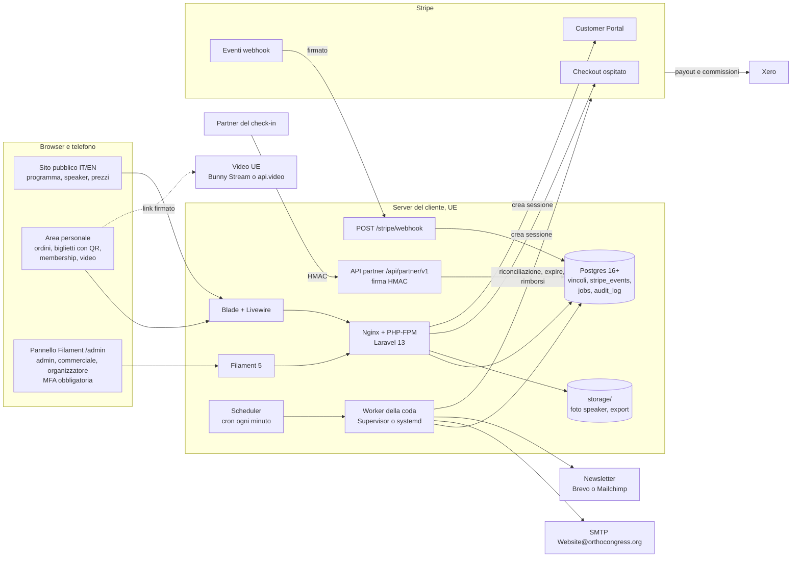

# Architettura informatica

Autore: Giulio Occhipinti. Aggiornato al 06/11/2026.

Documento di progetto, senza codice applicativo. Parte dal brief (`docs/brief.md`) e dalle risposte del cliente
(`docs/cliente/risposte-2026-11-06.md`). Il modello dei dati è in [`db/modello-dati.md`](../db/modello-dati.md), le
migrazioni di esempio in [`db/migrazioni-bozza/`](../db/migrazioni-bozza/), le decisioni in
[`docs/decisioni.md`](decisioni.md). La versione per Next.js + Supabase del 05/11/2026 è superata; il suo schema resta
in [`db/archivio/schema-postgres-supabase.sql`](../db/archivio/schema-postgres-supabase.sql). Le scelte non ancora
confermate da Giulio sono marcate **proposta**.

Etichette di certezza: `[sure]` verificato in questa sessione su fonte primaria (la fonte è detta), `[likely]` fonte
affidabile o conoscenza consolidata ma non ricontrollata ora, `[uncertain]` da verificare, `[falsy]` controllato e
risultato falso.

**Nota sulle fonti (06/11/2026).** Da questa sessione `stripe.com`, `laravel.com` e `filamentphp.com` non si
aprono (nome host non risolto) e l'API di GitHub non è abilitata: l'indicazione che `stripe.com` fosse raggiungibile
è `[falsy]`. Versioni e listini vengono da ricerche web (risultati che citano pagine ufficiali o siti noti, pagine
non aperte): sono al massimo `[likely]` e vanno ricontrollati prima del contratto e del codice. Per aprirle bisogna
abilitare quei domini nelle impostazioni di rete della sessione.

---

## 1. Stack

### 1.1 Scelta

Decisione di Giulio del 06/11/2026: **Laravel + Filament sul server del cliente, dati in UE**.

| Strato | Scelta | Motivo |
|---|---|---|
| Linguaggio | PHP 8.4 (minimo 8.3) | Laravel 13 chiede PHP 8.3+ e supporta 8.3–8.5 `[likely]` ([laravel-news.com](https://laravel-news.com/laravel-13-released), ricerca del 06/11/2026) |
| Framework | **Laravel 13** (13.0.0 del 17/03/2026; bug fix fino al Q3 2027, sicurezza fino al Q1 2028) `[likely]` (stessa fonte; [benjamincrozat.com](https://benjamincrozat.com/laravel-versions)) | Versione corrente; copre l'evento di aprile 2027 con i bug fix. Laravel 12 ha solo correzioni di sicurezza fino al 24/02/2027 `[likely]`: non partire da lì |
| Pannello | **Filament 5** (16/01/2026; stesse funzioni della 4, in più Livewire 4) `[likely]` ([laravel-news.com](https://laravel-news.com/filament-5)) | Chiesto dal cliente; CRUD, tabelle, filtri, export, MFA già pronti. Compatibilità Filament 5 ↔ Laravel 13: `[uncertain]`, da provare con `composer require` nel primo spike |
| Interfaccia pubblica | **Blade + Livewire 4 + Alpine.js** (§4.1) | Stessa tecnologia di Filament: un solo modo di lavorare, pagine generate dal server |
| Database | **Postgres 16+** se il server lo permette, altrimenti MySQL 8.0.16+ / MariaDB 10.6+ (§3) | Vincoli più forti nel database (indici parziali, esclusioni, trigger) |
| Pagamenti | Stripe Checkout ospitato, Stripe Billing, Customer Portal, SDK `stripe-php` diretto, **senza Laravel Cashier** (§6.1) | Nessun dato di carta sul sito; una sola via per webhook e idempotenza |
| Coda e job | Laravel Queue con driver `database` + scheduler di Laravel (un solo cron di sistema) + Supervisor o systemd per i worker (§8) | Sostituisce Vercel Cron e `pg_cron`; il job nasce nella stessa transazione dei dati |
| Email | SMTP esistente `Website@orthocongress.org`, in coda e con limite di invio (§9) | Richiesta del cliente; piano B con un fornitore transazionale UE |
| File | Disco locale del server (`storage/app/public` per le foto degli speaker, `storage/app/private` per gli export) | Niente fornitore in più; nei backup |
| Video | Bunny Stream o api.video, link firmati (§12) | Dati in UE, prezzi a consumo |
| Accesso | Codice via email per chi compra, password argon2id + TOTP obbligatorio per lo staff (§5) | Regola 1 del ruolo |
| Permessi | Policies di Laravel + `spatie/laravel-permission` (§5.3) | Ruoli admin, commerciale, organizzatore chiesti dal cliente |

### 1.2 Alternative scartate

| Area | Alternativa | Perché scartata |
|---|---|---|
| Stack | Next.js su Vercel + Supabase (architettura del 05/11/2026) | **Superata: decisione di Giulio del 06/11/2026** (il cliente vuole Laravel + Filament sul suo server, dati in UE) |
| Interfaccia | Inertia + Vue o React | Due mondi da mantenere (PHP e un framework JavaScript con build); dopo il lancio non c'è un tecnico. Ha senso solo per un'app molto interattiva, che qui non serve |
| Interfaccia | Pannello e sito tutti in Filament | Filament è fatto per lo staff; il sito pubblico deve seguire l'aspetto di eas-aligners.com |
| Pagamenti | Laravel Cashier | Vedi §6.1: utile per la sola membership, ma porta tabelle, webhook e versione API propri |
| Ticketing | pretix, Tito, Eventbrite | Scartati il 05/11/2026 (tutto su misura) |
| Code | Redis + Horizon | Ottimi, ma un servizio in più da gestire; il driver `database` basta per questi volumi. Redis resta un'opzione se il server lo ha già |
| Permessi | `bezhansalleh/filament-shield` | Genera permessi dal pannello: con tre ruoli fissi è più semplice definirli nel codice |
| Accesso | Laravel Breeze | Non è più lo starter kit consigliato da Laravel 12 `[likely]`; ci serve poco: accesso con codice e pannello Filament |

---

## 2. Componenti



| Componente | Cosa fa | Chi lo usa |
|---|---|---|
| Sito pubblico | Evento, programma per giorni, sale e tracce, sessioni e interventi, speaker, prezzi per ruolo, membership; IT e EN | Tutti |
| Area personale | Carrello con nominativi, ordini e ricevute, biglietti con QR, membership (rimando al Customer Portal), video dei congressi passati per i membri | Chi ha un account |
| Pannello Filament | Contenuti, biglietti, tier e prezzi, capienze, codici sconto, ordini, rimborsi, membership, export, registro audit | Staff con MFA |
| Webhook Stripe | Verifica la firma, registra l'evento una volta sola, mette in coda l'elaborazione | Stripe |
| API partner | Elenco dei biglietti validi e revocati per il check-in, richieste firmate | Partner sul posto |
| Worker e scheduler | Eventi Stripe, scadenza delle sessioni, rimborsi automatici, email, export, newsletter, riconciliazione, pulizie | Sistema |

---

## 3. Database

**Proposta:** Postgres 16 o più recente (Postgres 15 è il minimo per `nulls not distinct`) se il server lo
permette; altrimenti MySQL 8.0.16+ o MariaDB 10.6+. Il dettaglio delle differenze è in
[`db/modello-dati.md` §5](../db/modello-dati.md); in breve:

| Tema | Con Postgres | Con MySQL / MariaDB |
|---|---|---|
| `CHECK` (capienza, importi, forma delle chiavi) | Applicati | Applicati da MySQL 8.0.16 `[likely]`; con versioni più vecchie vengono ignorati: **non accettabili** |
| Indici unici parziali (una riserva aperta per persona, un prezzo membro per tipo) | Nativi | Emulati con una **colonna generata** che vale la chiave solo quando la riga è attiva, `NULL` altrimenti, e un indice unico su di essa (esempi nelle migrazioni) |
| Vincoli di esclusione (sale e listini sovrapposti) | Nativi (`btree_gist`) | Solo nel Service, con `lockForUpdate` sulla riga padre |
| Trigger (transizioni di stato, audit solo in aggiunta, cambio nominativo) | PL/pgSQL | Possibili con `SIGNAL`, più limitati `[likely]` |
| Lock | `lockForUpdate()` = `SELECT … FOR UPDATE`; `READ COMMITTED` | Stesso metodo; `REPEATABLE READ` con gap lock: più deadlock, quindi `DB::transaction($fn, attempts: 3)` e lock sempre nello stesso ordine |

Con MySQL le regole restano tutte, ma alcune passano dal database al solo Service: un bug in quel punto non verrebbe
più fermato dal database.

**Utenti del database:** uno per l'applicazione con i soli permessi su dati e sequenze, uno separato per le
migrazioni (usato dal deploy), nessun superutente nell'`.env` dell'app (**proposta**).

---

## 4. Struttura dell'applicazione

### 4.1 Sito pubblico: Blade + Livewire

**Proposta: Blade + Livewire 4**, non Inertia.

| | Blade + Livewire | Inertia + Vue/React |
|---|---|---|
| Linguaggi da sapere | PHP e HTML (Alpine per i ritocchi) | PHP + JavaScript, componenti, build |
| Stessa tecnologia di Filament | Sì | No |
| Pagine pubbliche e motori di ricerca | HTML dal server, veloce senza configurazioni | Serve il rendering lato server per la SEO, un processo Node in più |
| Chi la mantiene dopo il lancio | Qualunque sviluppatore Laravel, anche a ore | Serve anche chi conosce il framework JavaScript |
| Interazioni del carrello (quantità, nominativi, codice sconto) | Coperte bene da Livewire | Più fluide, ma non servono |

Il prototipo HTML (`prototipo/`) diventa una serie di componenti Blade con lo stesso aspetto di eas-aligners.com
(decisione del 06/11/2026); la versione migliorata resta in `proposte/`.

Rotte principali, con prefisso di lingua: `/{it|en}/`, `/programma`, `/sessioni/{slug}`, `/speaker`,
`/speaker/{slug}`, `/biglietti`, `/membership`, `/accesso`, `/account/...`.

### 4.2 Area personale

Una sola area per chi compra (il cliente la chiama «member area»): ordini e ricevute, biglietti con QR, cambio
nominativo (nella prima versione su richiesta allo staff), membership con link al Customer Portal, profilo e lingua,
consensi. La sezione **video** è visibile solo ai membri attivi. Ogni pagina e ogni azione Livewire verifica lato
server sessione e Policy (regola 1), non solo il middleware delle rotte.

### 4.3 Pannello Filament

Un solo pannello in `/admin` (**proposta**: anche su un sottodominio `admin.orthocongress.org` con elenco di IP
ammessi, se il cliente lo vuole). Accesso solo a chi ha uno dei tre ruoli (`User::canAccessPanel()`) e la MFA
attiva. Ogni risorsa usa la sua Policy: menu e pulsanti compaiono solo a chi ha il permesso, e le Policy valgono anche
se qualcuno chiama l'azione direttamente.

| Gruppo nel menu | Risorse | Ruoli |
|---|---|---|
| Programma | Eventi, giorni, sale, tracce, sessioni e interventi, speaker | organizzatore, admin |
| Vendita | Tipi di biglietto, tier e prezzi, capienze, codici sconto | organizzatore (biglietti, tier, prezzi, capienze), commerciale (codici sconto, **proposta**), admin |
| Ordini e soldi | Ordini, biglietti, rimborsi, membership, coda «da riconciliare» | commerciale, admin |
| Member area | Raccolte e video | organizzatore, admin |
| Export | Partecipanti per il check-in, ordini per la contabilità, iscritti alla newsletter | secondo il contenuto (§13.3) |
| Sistema | Utenti dello staff e ruoli, chiavi del partner, registro audit, eventi Stripe | admin |

Testi del pannello in italiano e inglese; campi tradotti con due schede IT/EN per campo (§10).

---

## 5. Accesso, ruoli e permessi

### 5.1 Chi compra: codice via email

Come nella proposta del 05/11/2026 e nel prototipo (`accesso.html`): **codice di 6 cifre via email**, nessuna
password da ricordare, account creato al primo accesso. In Laravel non c'è un pacchetto ufficiale per questo `[likely]`:
è un controller piccolo con la tabella `login_codes` (codice salvato come hash, scadenza 10 minuti, 5 tentativi) e il
`RateLimiter` per email e per IP. Dopo l'accesso `session()->regenerate()`.

Cookie di sessione di Laravel: `httpOnly`, `Secure`, `SameSite=Lax`, firmato e cifrato con `APP_KEY`; sessioni nel
database. È la regola 1 del ruolo.

### 5.2 Staff: password argon2id + TOTP obbligatorio

- Login del pannello Filament con password, hash **argon2id** (`config/hashing.php`, regola 1). PHP deve essere
  compilato con argon2: sul PHP 8.3.6 di questa sessione c'è `[sure]` (`PASSWORD_ARGON2ID` definito); sul server
  del cliente da controllare.
- **MFA obbligatoria** con app TOTP (e codici di recupero), con l'autenticazione a più fattori integrata in Filament
  dalla versione 4 `[likely]`. Sessioni dello staff più brevi (es. 2 ore di inattività).
- Laravel Fortify serve solo se si vuole la 2FA anche fuori da Filament: per ora no (**proposta**). Breeze non serve.
- Limite ai tentativi di accesso del pannello (Filament lo ha `[likely]`) più un limite per IP.

### 5.3 Ruoli e permessi

`spatie/laravel-permission` (licenza MIT `[likely]`, da far passare a `supply-chain-risk-auditor`) con ruoli e
permessi definiti nel codice. Membro **non è un ruolo**: si deriva da `memberships` a ogni acquisto e a ogni accesso ai
video.

| Permesso | admin | commerciale | organizzatore |
|---|---|---|---|
| Eventi, giorni, sale, tracce, sessioni, interventi, speaker | ✔ | lettura | ✔ |
| Tipi di biglietto, tier e prezzi, capienze | ✔ | lettura | ✔ |
| Codici sconto (**proposta**, da confermare col cliente) | ✔ | ✔ | lettura |
| Ordini, pagamenti, biglietti | ✔ | ✔ | lettura senza importi |
| Rimborsi (evento annullato, pagato senza posti) | ✔ | ✔ | — |
| Fatture, export contabili, riconciliazione | ✔ | ✔ | — |
| Cambio nominativo su richiesta | ✔ | ✔ | — |
| Membership (lettura; le modifiche si fanno in Stripe) | ✔ | ✔ | — |
| Video della member area | ✔ | — | ✔ |
| Export partecipanti per il check-in | ✔ | ✔ | ✔ |
| Utenti dello staff, ruoli, chiavi del partner, registro audit, eventi Stripe | ✔ | — | — |

Il primo admin si crea con un comando Artisan sul server (`php artisan staff:create --role=admin`), non da una pagina
pubblica.

### 5.4 Cosa sostituisce l'RLS di Supabase

Con Supabase il browser parlava direttamente con il database, quindi servivano le policy RLS. Qui **il browser non
tocca mai il database**: l'unico client è l'applicazione sul server. Le stesse protezioni diventano:

| Prima (Supabase) | Ora (Laravel) |
|---|---|
| Policy RLS di lettura pubblica (`published`) | Scope Eloquent `published()` nelle query del sito pubblico |
| Policy «l'utente legge i propri ordini e biglietti» | Query sempre dalla relazione (`$request->user()->orders()`) + Policy `view` su ogni modello; ID UUID non indovinabili |
| `is_admin_mfa()` nelle policy di scrittura | Policy + ruolo + MFA di Filament; `canAccessPanel()` |
| `service_role` per le scritture su soldi e posti | Solo i Service scrivono ordini, posti e biglietti; Filament li mostra in sola lettura dove serve (niente modifica a mano dei contatori) |
| `security definer` e `revoke execute` | Utente del database senza privilegi in più (§3) |
| Funzioni SQL per capienza e conferma | Service PHP in transazione + vincoli del database (§7) |

Il rischio nuovo è l'**IDOR** (cambiare un id nell'URL o in una proprietà Livewire per vedere dati di altri): si
chiude con Policy su ogni azione, proprietà Livewire `#[Locked]` per gli id e test automatici per ogni rotta
riservata.

---

## 6. Integrazione Stripe

### 6.1 Cashier o SDK diretto

**Proposta: SDK `stripe-php` diretto per tutto, senza Laravel Cashier.**

| | Laravel Cashier | `stripe-php` diretto |
|---|---|---|
| Membership in abbonamento | Ottimo: Checkout per abbonamenti, Customer Portal, stato della subscription con poche righe | Qualche centinaio di righe in più (tabella `memberships` già progettata) |
| Biglietti una tantum con `price_data` riga per riga | Possibile passando le opzioni della sessione `[uncertain]`, ma Cashier non aggiunge nulla: riserve, sconti e conferma idempotente restano nostri | Naturale |
| Webhook | Ha il suo controller; va esteso per passare da `stripe_events` e dai nostri lock | Un solo endpoint, una sola tabella di idempotenza, un solo flusso |
| Tabelle | Le sue (`subscriptions`, `subscription_items`, colonne su `users`) accanto alle nostre: due copie dello stato | Solo le nostre (regola 2: una sola sorgente da leggere) |
| Versione API Stripe | Fissata da Cashier (Cashier 16: `2025-07-30.basil` `[likely]`, da una PR della documentazione Laravel) e aggiornata con Cashier | La fissiamo noi e la aggiorniamo quando vogliamo |

Cashier conviene se un giorno ci saranno più piani, prove gratuite e cambi di piano. Con un solo piano annuale il
risparmio di codice non vale due modi di gestire Stripe.

Versione API: si fissa nel client (`new StripeClient(['api_key' => …, 'stripe_version' => '…'])`) e nell'endpoint
webhook; quale versione è `[uncertain]` finché non si apre la documentazione. Chiave segreta **limitata** (restricted
key) ai soli permessi usati.

### 6.2 Checkout dei biglietti

Stesso flusso del 05/11/2026, ora in `CheckoutService` (in transazione):

1. ricarica utente e prezzi dal database, mai dal browser;
2. calcola il ruolo di prezzo valido **fino alla scadenza della Checkout Session** (adesso + 31 minuti);
3. prezzo membro solo sul biglietto del membro che compra (quantità 1, intestato a lui), al massimo uno per membro,
   evento e tipo anche su più ordini (`member_price_claims`); gli altri biglietti a prezzo pubblico;
4. codice sconto calcolato riga per riga dal server (§6.4);
5. se c'è un ordine `pending` della stessa persona: `expire` della sessione precedente e chiusura;
6. crea l'ordine `pending` con ruolo e importi fotografati, riserva posti e utilizzo del codice;
7. dopo il commit crea la Checkout Session con `Idempotency-Key: checkout-<order_id>` e salva il suo id.

```text
mode                    payment
customer                cus_...
client_reference_id     <order_id>
line_items[]            price_data: { currency: eur, unit_amount: <unit_amount_cents>,
                          product_data: { name: <stripe_line_name nella lingua dell'ordine>, metadata: {...} } },
                        quantity
allow_promotion_codes   false
metadata                { order_id, kind: tickets, price_role, discount_code, env }
payment_intent_data     { metadata: { order_id } }
expires_at              adesso + 31 minuti (minimo Stripe 30 minuti [likely])
locale                  it | en (lingua dell'ordine)
invoice_creation        da decidere con la catena legale-fiscale (§13.1)
tax_id_collection       da decidere con la catena legale-fiscale
success_url             /{locale}/account/ordini/<order_id>?session_id={CHECKOUT_SESSION_ID}
cancel_url              /{locale}/biglietti
```

- Metodi di pagamento: configurazione senza metodi a notifica differita per i biglietti (**proposta**, domanda
  aperta); il codice gestisce comunque `processing`.
- Ordini a costo zero: confermati senza Stripe dallo stesso `PaymentService::markPaid()`.
- La pagina di successo non è la prova del pagamento: se l'ordine è ancora `pending`, il server rilegge la sessione
  da Stripe e chiama lo stesso `markPaid()` del webhook.

### 6.3 Prezzi: `price_data`, non un Price per combinazione

Invariato: prezzi dei biglietti passati con `price_data.product_data`, importo per unità già scontato; una sola
sorgente dei prezzi (`ticket_prices`). Price vero solo per la membership (200 €/anno, ricorrente annuale), che
serve al Customer Portal.

### 6.4 Codici sconto e cumulo

Invariato rispetto al 05/11/2026: nessun Coupon Stripe per i biglietti; regole in `discount_codes`; sconto per unità
e per riga; utilizzi contati con `UPDATE … WHERE redeemed_count < max_redemptions` nella transazione della riserva e
restituiti alla scadenza; sulla riga del membro il migliore tra prezzo membro e prezzo pubblico scontato, mai
entrambi (salvo codici marcati `combinable_with_role_price`).

### 6.5 Membership

- Checkout `mode=subscription` con il Price annuale da 200 €, `client_reference_id = user_id`,
  `subscription_data.metadata = { user_id }`. Se la persona è già membro, rimando al Customer Portal.
- 12 mesi dall'acquisto, rinnovo automatico, annullamento dal Customer Portal (decisione del 05/11/2026). Rimborso
  della quota: il cliente ha risposto «non so» → catena legale.
- Vantaggi dichiarati dal cliente: prezzo membro, accesso all'early bird (significato da chiarire, §21), video dei
  congressi passati.
- `memberships` aggiornata solo dagli eventi Stripe, rileggendo la subscription; nelle versioni recenti dell'API le
  date del periodo stanno sulle voci della subscription `[uncertain]`.

### 6.6 Webhook

Endpoint `POST /stripe/webhook`, escluso dalla protezione CSRF, uno per ambiente con il suo segreto.

1. `StripeWebhookController` legge il corpo grezzo (`$request->getContent()`) e verifica la firma con
   `\Stripe\Webhook::constructEvent()`; firma sbagliata → 400, nessuna scrittura.
2. Rifiuta `livemode` diverso dall'ambiente.
3. In una transazione: `insertOrIgnore` in `stripe_events` e `ProcessStripeEvent::dispatch($id)` sulla coda
   `database`. La riga del job entra nella stessa transazione: se il processo cade, o ci sono entrambe o nessuna.
   Risposta 200 subito. Un reinvio di Stripe trova la riga e risponde 200 senza fare nulla.
4. Il job blocca la riga dell'evento, esce se è già `processed`, chiama il Service giusto, segna `processed`. Errore →
   `failed` + `last_error` + nuovo tentativo con attesa crescente; all'ultimo tentativo avviso allo staff. La
   riconciliazione notturna ripesca ciò che manca.

Dentro i Service le regole provate restano: **lock sull'ordine** (`lockForUpdate`) prima di tutto, poi pool in
ordine di id; transizioni ammesse (enum PHP + trigger, migrazione `100000`); `unique (order_item_id, seq)` sui
biglietti; email con `dedupe_key`. Stripe non garantisce l'ordine degli eventi `[likely]`: per subscription e
fatture si rilegge l'oggetto e si ignorano eventi più vecchi di `memberships.last_stripe_event_at`.

| Evento | Azione |
|---|---|
| `checkout.session.completed` | Biglietti: pagato → `markPaid` (esiti `paid`, `paid_late`, `needs_refund`, `already_done`); `unpaid` → `markProcessing`. Membership: collega subscription e utente |
| `checkout.session.async_payment_succeeded` / `_failed` | `markPaid` / chiusura `failed` con rilascio di posti e codice |
| `checkout.session.expired` | Chiusura `expired`, posti e codice rilasciati |
| `charge.refunded`, `refund.updated` | Aggiorna `refunds`; rimborsi nati in Dashboard → `needs_review` |
| `charge.dispute.created` / `closed` | Biglietti `disputed`, avviso al commerciale |
| `customer.subscription.created` / `updated` / `deleted` | Rilettura e aggiornamento di `memberships` |
| `invoice.paid`, `invoice.payment_failed`, `invoice.payment_action_required` | Rinnovo, avviso di pagamento fallito, richiesta SCA |

### 6.7 Riconciliazione, rimborsi, cambio nominativo

Invariati rispetto al 05/11/2026, ora come job e Service:

- **Riconciliazione notturna** (`ReconcileStripe`): sessioni completate ↔ ordini `paid`, `needs_refund` ↔ rimborsi,
  `processing` fermi da 7 giorni, subscription ↔ `memberships`, rimborsi ↔ `refunds`, ricalcolo di `held` e
  `confirmed` dai dati reali, eventi non consegnati.
- **Rimborsi**: nessun rimborso self-service; solo commerciale o admin per evento annullato o ordine pagato senza
  posti, con causa obbligatoria; rimborso automatico (job `RefundOrderFully`, `Idempotency-Key auto-refund-<id>`) per
  `needs_refund`. Nella prima versione i rimborsi manuali si fanno dalla Dashboard Stripe e il webhook li registra.
- **Cambio nominativo**: gratuito fino a 48 ore prima dell'inizio dell'evento, mai sui biglietti a prezzo membro, solo
  il nome si corregge sempre; `qr_version + 1`, audit, email al nuovo partecipante. Da far confermare alla catena
  legale.

### 6.8 Test e produzione

| | Locale e staging | Produzione |
|---|---|---|
| Stripe | Modalità test o sandbox | Chiavi live |
| Database | Database separato (staging sullo stesso server o in locale) | Database di produzione |
| Webhook | `stripe listen` in locale; endpoint di staging | Endpoint live |
| Email | Mailpit in locale, casella di prova in staging | SMTP del cliente |

`orders.livemode` e `stripe_events.livemode` registrano la modalità; il webhook rifiuta quella sbagliata.

---

## 7. Capienza

### 7.1 Modello

Invariato: pool di posti (`capacity_pools`) con `held + confirmed <= capacity` nel database; ogni tipo di biglietto
consuma uno o più pool (`ticket_type_pools`). Per l'EAS8: un pool per giorno (6.000 posti, dato del cliente) consumato
dal pass intero; un pool per ogni workshop. Nessun giornaliero per ora.

### 7.2 Come si evita l'overselling

Stesso flusso provato il 05/11/2026, ora in `CapacityService` dentro `DB::transaction()`:

1. **Riserva**: lock sull'ordine, poi pool in ordine di id;
   `UPDATE capacity_pools SET held = held + n WHERE id = ? AND held + confirmed + n <= capacity`; 0 righe = esaurito.
   Errori: `sold_out`, `too_many_for_pool`, `discount_exhausted`, `discount_user_limit`, `hold_too_short`,
   `member_price_limit`. In errore nessuna sessione Stripe.
2. **Durata**: sessione 31 minuti, riserva 5 minuti in più; sotto i 30 minuti rifiutata.
3. **Una sola riserva aperta per persona** (indice unico parziale).
4. **Limiti per ordine** su tipo e pool (es. 2 sui workshop).
5. **Rilascio solo dopo conferma di Stripe**: webhook `expired` o job `ExpireStaleOrders` (ogni minuto) che legge la
   sessione: `open` → `expire` e chiusura; `expired` → chiusura; `complete` → `markPaid`. Job fermo = si vende meno,
   mai due volte.
6. **Conferma con riprenotazione**: riserve convertite; pagamento tardivo → riprenota se c'è posto (`paid_late`),
   altrimenti `needs_refund`, nessun biglietto, rimborso automatico. In PHP il «tutto o niente» del ciclo sui pool è
   una transazione annidata (savepoint).
7. **Pagamento asincrono**: riserva `awaiting_payment` senza scadenza.

### 7.3 Prove

| Quando | Cosa | Esito |
|---|---|---|
| 05/11/2026 | Funzioni SQL dello schema precedente su Postgres 16, 17 scenari (riserva corta, doppia riserva, caso del bug del rilascio cieco, webhook ripetuto e parallelo, pagamento tardivo, sessione diversa, limite per pool, codice sconto, limite prezzo membro, cambio nominativo a 47/49 ore, biglietto membro non cedibile, rimborso senza causa) | 🟢 tutti come atteso `[sure]` in quella sessione |
| 06/11/2026 | Difese del database delle 4 migrazioni bozza (ramo Postgres) su Postgres 16.15 con dati finti, comprese due prove in parallelo (ultimo posto, prezzo membro) | 🟢 tutte come atteso `[sure]`, dettaglio in [`db/modello-dati.md` §6](../db/modello-dati.md) |
| Da fare | Gli stessi 17 scenari come **test Pest** sui Service PHP, su Postgres (e MySQL se scelto), prima del rilascio | — |

---

## 8. Code, job e scheduler

Coda di Laravel con driver `database` (stessa base dati: il job nasce nella stessa transazione dell'ordine o
dell'evento Stripe). Worker `php artisan queue:work` tenuti vivi da Supervisor o systemd, riavviati a ogni deploy
(`queue:restart`). Scheduler: una sola riga di cron `* * * * * php artisan schedule:run`.

| Coda | Job | Quando |
|---|---|---|
| `critical` | `ProcessStripeEvent`, `RefundOrderFully`, email del codice di accesso | Subito |
| `default` | Email di conferma e biglietti, cambio nominativo, avvisi allo staff | Subito, con limite di invio (§9) |
| `low` | Export, sincronizzazione newsletter, promemoria, rimborsi massivi a lotti | Subito, priorità bassa |

| Job programmato | Frequenza |
|---|---|
| `ExpireStaleOrders` (riserve scadute: lettura della sessione su Stripe, `expire`, chiusura o conferma) | Ogni minuto, `withoutOverlapping()` |
| `ReconcileStripe` | Ogni notte |
| `PruneStripePayloads` (payload a `null` dopo 90 giorni), pulizia `login_codes`, export scaduti | Ogni giorno |
| Promemoria evento (7 giorni e 1 giorno prima) | Ogni giorno |
| Controllo dei backup e dei job falliti, con avviso | Ogni giorno |

Ogni job è idempotente (`ShouldBeUnique` dove serve, `dedupe_key` sulle email) e ha tentativi con attesa
crescente. `failed_jobs` è visibile all'admin nel pannello. Redis + Horizon solo se il carico lo chiede.

---

## 9. Email

- Invio dalla casella esistente `Website@orthocongress.org` via SMTP (richiesta del cliente), con mailer Laravel
  `smtp` e credenziali solo nel `.env`.
- **Limiti:** dipendono dal fornitore della casella, non ancora noto. Ordini di grandezza: Google Workspace circa
  2.000 messaggi al giorno per utente, Microsoft 365 circa 10.000 destinatari al giorno e 30 messaggi al minuto
  `[uncertain]`, da verificare sul fornitore reale. Microsoft sta ritirando l'autenticazione di base su SMTP AUTH
  `[uncertain]`: se la casella è su Microsoft 365 potrebbe servire OAuth.
- Tutte le email passano dalla coda con un **limite di invio** (middleware `RateLimited` sui job, per esempio 20 al
  minuto, regolabile dal `.env`). Il codice di accesso va sulla coda `critical` per arrivare in pochi secondi.
- **Picco all'apertura delle vendite:** con 1.000 ordini nella prima ora e 20 email al minuto le conferme arrivano
  fino a circa 50 minuti dopo; il biglietto resta comunque visibile subito nell'area personale. Se non basta,
  **proposta**: email transazionali da un fornitore UE (es. Brevo o Mailjet, Francia) con il dominio
  `orthocongress.org`, costi da verificare `[uncertain]`.
- SPF, DKIM e DMARC del dominio da controllare prima del lancio (oggi `orthocongress.org` dava errore 502 dal
  sito: il DNS è da verificare).
- La newsletter **non** passa da questa casella (§13.2).

---

## 10. Lingue (IT, EN)

| Cosa | Come |
|---|---|
| Testi dell'interfaccia | File di lingua: `lang/it.json`, `lang/en.json` e i file pubblicati di Laravel (`validation.php` ecc.) |
| Contenuti (evento, giorni, sale, tracce, sessioni, interventi, speaker, tipi di biglietto, piani, video) | Colonne JSON `{"it": …, "en": …}` con `spatie/laravel-translatable` (da far passare a `supply-chain-risk-auditor`); nel pannello due schede IT/EN per campo |
| URL | Prefisso `/it/…` e `/en/…`, `hreflang` nelle pagine; la prima visita sceglie dalla lingua del browser, poi un cookie; slug unici per tutte e due le lingue |
| Regola di pubblicazione | **Proposta**: un evento o una sessione si pubblica solo con titolo in tutte e due le lingue; per le bio degli speaker si ammette una sola lingua con riserva sull'inglese |
| Email, PDF, pagina Stripe | Nella lingua dell'acquirente (`users.locale`, `orders.locale`); `locale` di Checkout uguale |
| Date e prezzi | Formattati con `intl` nel fuso dell'evento (`Europe/Lisbon`) |

Lingua predefinita: domanda aperta (congresso internazionale a Lisbona: **proposta** inglese).

---

## 11. Biglietti, QR e check-in del partner

### 11.1 Biglietto e QR

- Un biglietto nominativo per partecipante, visibile nell'area personale e mandato per email.
- QR firmato **Ed25519** con `ext-sodium` di PHP (incluso in PHP, nessuna libreria per la firma; presente nel PHP di
  questa sessione `[sure]`). Il QR contiene `ticket_id`, `qr_version`, `event_id`, `qr_key_id` e la firma; niente
  nome. Chiave privata solo nel `.env` del server; chiave pubblica data al partner. Codice breve di 8 caratteri per il
  desk.
- La generazione dell'immagine del QR richiede una libreria (es. `chillerlan/php-qrcode` o `bacon/bacon-qr-code`), da
  far passare a `supply-chain-risk-auditor`.

### 11.2 Check-in fatto dal partner

Il cliente ha un partner che scansiona i biglietti digitali: la PWA di check-in del 05/11/2026 **non serve più**.
Servono due modi di dargli i biglietti validi:

| Modo | Come | Quando |
|---|---|---|
| **Export CSV** dal pannello | Colonne: `ticket_id`, `qr_version`, `short_code`, nome, tipo di biglietto, giorni ammessi, stato (`valid` / `revoked`). Export in coda, file privato con scadenza 7 giorni, scaricato da un ruolo ammesso, scritto nel registro audit | Prima versione |
| **API firmata** `GET /api/partner/v1/events/{event}/tickets?updated_since=…` | Paginata, restituisce i biglietti nuovi, cambiati e revocati. Ogni richiesta porta `X-Key-Id`, `X-Timestamp` e `X-Signature` = HMAC-SHA256 di metodo, percorso, query, timestamp e hash del corpo con il segreto del partner; rifiutate le richieste con più di 5 minuti di scarto o firma già vista; elenco di IP ammessi; limite di richieste | Quando il partner conferma che la usa |
| Ritorno degli ingressi (facoltativo) | `POST /api/partner/v1/checkins` con id generato dal partner, idempotente; tabella `checkins` | Fase 2 |

Il partner riceve dati personali dei partecipanti: serve un accordo sul trattamento dei dati (art. 28 GDPR) →
catena legale. Formato del QR e del CSV da concordare con il partner prima di stampare o mandare biglietti.

---

## 12. Member area con video dei congressi passati

Accesso: Policy `VideoPolicy::view` = membership attiva in questo momento. Il player riceve un **link firmato con
scadenza breve** (es. 2 ore) creato dal server a ogni apertura della pagina; la chiave per firmare sta solo nel
`.env`. Il link può comunque essere condiviso finché non scade: per una protezione più forte serve il DRM, a
pagamento.

| | **Bunny Stream** (BunnyWay, Slovenia) | **api.video** (Francia) |
|---|---|---|
| Dati in UE | Area di archiviazione principale a Francoforte `[likely]` | Società francese; area dei dati `[uncertain]` |
| Link firmati | Autenticazione a token con scadenza inclusa senza costi `[likely]` | Video privati con token `[likely]` |
| Prezzo | Codifica gratuita; archiviazione circa 0,01 $/GB al mese per regione; consegna Europa e Nord America circa 0,01 $/GB; minimo 1 $/mese `[likely]` ([docs.bunny.net](https://docs.bunny.net/stream/pricing), [bunny.net/pricing/stream](https://bunny.net/pricing/stream/), ricerca del 06/11/2026) | Codifica gratuita; archiviazione da 0,00285–0,003 $/minuto di video al mese; consegna da 0,0017 $/minuto visto `[likely]` ([api.video/pricing](https://api.video/pricing/), ricerca del 06/11/2026) |
| Stima annua (150 ore di video, il 30% dei partecipanti è membro e guarda 3 ore l'anno) | ≈ 100 $ a 1.000 partecipanti, ≈ 220 $ a 10.000 `[uncertain]` | ≈ 420 $ a 1.000, ≈ 1.250 $ a 10.000 `[uncertain]` |

**Proposta: Bunny Stream** (più economico a questo uso, UE). Ipotesi della stima: circa 4,5 GB per ora di video
archiviata con tutte le risoluzioni e 1,5 GB per ora vista `[uncertain]`. Scartati: Vimeo, Mux (USA), YouTube
non in elenco (nessuna protezione), Cloudflare Stream (residenza dei dati in UE non chiara `[uncertain]`).

Prima di pubblicare i video servono i permessi di relatori e pazienti eventualmente ripresi → catena legale.

---

## 13. Integrazioni

### 13.1 Fatture: Stripe Invoicing + Xero

- Stripe può creare una fattura per ogni pagamento di Checkout (`invoice_creation`) e raccogliere partita IVA e
  indirizzo dell'azienda (`tax_id_collection`); le fatture della membership le crea già Billing. Costo di Stripe
  Invoicing Starter: 0,4% per fattura pagata `[likely]` ([support.stripe.com](https://support.stripe.com/questions/stripe-invoicing-pricing?locale=en-GB), ricerca del 06/11/2026); se si applichi anche alle fatture create da Checkout è `[uncertain]`.
- Xero: collegamento a Stripe dal lato di Xero (feed di pagamenti, commissioni e payout) `[likely]`; nessun codice
  nostro nella prima versione.
- **Non deciso:** se le fatture di Stripe bastano per l'organizzatore (soggetto forse francese, evento in Portogallo,
  acquirenti ovunque), numerazione, diciture, IVA, obblighi di fattura elettronica in Francia e Portogallo. Va alla
  catena legale-fiscale e al commercialista del cliente (§19).

### 13.2 Newsletter con consenso

- **Proposta: Brevo** (società francese, dati in UE `[likely]`); Mailchimp possibile se il cliente lo usa già
  (società USA: trasferimento dei dati da valutare con la catena legale).
- Casella di consenso **non preselezionata** e separata dall'acquisto; ogni consenso o revoca salvato in `consents`
  (testo, versione, data, fonte); doppia conferma via email dal fornitore; disiscrizione dal fornitore che torna a noi
  via webhook.
- Sincronizzazione con un job sulla coda `low`, con il client HTTP di Laravel (nessuna libreria in più).
- Se si possono scrivere ai clienti senza consenso esplicito (soft opt-in) lo decide la catena legale.

### 13.3 Export Google Sheets / Excel

- Azioni di export di Filament (CSV e XLSX, in coda, con notifica a fine lavoro) `[likely]`.
- Export con dati personali solo ai ruoli ammessi, scritti nel registro audit, file privati cancellati dopo 7 giorni.
- Google Sheets: nella prima versione si scarica il file e lo si importa in Sheets; un collegamento automatico (API
  Google con account di servizio) solo se serve davvero, perché porta i dati in un altro sistema.

---

## 14. Hosting sul server del cliente (UE)

Il cliente ha un server esistente e i dati devono stare in UE. Tipo di server, fornitore, sistema e chi lo gestisce
**non sono noti** (domanda aperta 1). Requisiti minimi (**proposta**):

| Voce | Minimo | Consigliato per l'apertura delle vendite |
|---|---|---|
| Tipo | VPS o server dedicato con accesso SSH e root (un hosting condiviso senza worker e cron **non basta**) | |
| Sistema | Linux con supporto lungo (es. Ubuntu 24.04 LTS) | |
| CPU / RAM / disco | 2 vCPU, 4 GB, 40 GB SSD | 4 vCPU, 8 GB, 80 GB SSD |
| Software | Nginx, PHP-FPM 8.4 con `bcmath`, `ctype`, `curl`, `intl`, `mbstring`, `openssl`, `pdo_pgsql` (o `pdo_mysql`), `sodium`, `xml`, `zip`, `gd`; Composer; Postgres 16+; Supervisor o systemd; cron | Redis se già presente |
| Posizione | Data center in UE, contratto con accordo sul trattamento dei dati | |

| Tema | Come |
|---|---|
| HTTPS | Certificato Let's Encrypt con rinnovo automatico, HSTS, redirect da HTTP; TLS 1.2+ |
| Backup | Database: dump giornaliero cifrato + archiviazione continua del WAL (es. pgBackRest) per tornare a pochi minuti prima di un guasto; copie fuori dal server in UE (bucket compatibile S3); 30 giornalieri + 12 mensili; **prova di ripristino ogni mese**. File: `storage/app` nello stesso backup |
| Monitoraggio | Controllo esterno della rotta `/up` (salute di Laravel `[likely]`); errori con Sentry in regione UE o Flare `[uncertain]`; Laravel Pulse sul server per richieste lente, code e job falliti; avvisi via email per job falliti, backup mancati, disco quasi pieno, certificato in scadenza |
| Log | Rotazione giornaliera per 14 giorni, nessun dato personale (email mascherate, nessun payload Stripe) |
| Deploy | GitHub Actions: test (Pest su Postgres), build degli asset, poi rilascio via SSH con cartelle per versione e link simbolico (es. Deployer), `migrate --force`, cache di config, rotte e viste, `queue:restart`; ritorno alla versione precedente con un comando. Migrazioni sempre compatibili con la versione precedente del codice |
| Aggiornamenti | Aggiornamenti di sicurezza automatici del sistema; PHP e pacchetti (`composer audit` in CI) ogni mese. **Serve qualcuno che lo faccia**: dopo il lancio il cliente non ha tecnici (rischio §20) |
| Staging | Un secondo sito sullo stesso server o in locale, con database e chiavi Stripe di test |

---

## 15. Sicurezza

| Tema (OWASP) | Misura in Laravel |
|---|---|
| Controllo degli accessi (IDOR) | Policy su ogni modello e ogni azione Livewire e Filament; query dalle relazioni dell'utente; id UUID; proprietà Livewire `#[Locked]`; test per ogni rotta riservata |
| Autenticazione | Codice via email per chi compra; argon2id + TOTP obbligatorio per lo staff; `session()->regenerate()` al login; cookie `httpOnly`, `Secure`, `SameSite=Lax`; sessioni dello staff brevi |
| Limiti ai tentativi | `RateLimiter`: richiesta del codice (es. 3 ogni 10 minuti per email, 10 l'ora per IP), verifica del codice (5 tentativi), codici sconto (10 al minuto), creazione del checkout (5 al minuto per persona), API del partner (60 al minuto), login del pannello |
| Iniezione SQL | Solo query builder ed Eloquent con parametri; niente `DB::raw` con input dell'utente |
| XSS | Blade con `{{ }}`; HTML delle bio e dei testi ricchi ripulito al salvataggio (sanificatore da scegliere e far controllare); CSP con nonce. Livewire e Alpine potrebbero chiedere eccezioni alla CSP `[uncertain]` |
| CSRF | Protezione attiva su tutto, esclusi solo il webhook Stripe (firmato) e l'API del partner (firmata) |
| Mass assignment | `$fillable` esplicito su ogni model; i form Filament salvano solo i campi dichiarati |
| Upload | Foto degli speaker: tipo e dimensione controllati, ricodificate, senza EXIF, nome casuale; caricate solo dallo staff |
| Segreti | Solo nel `.env` sul server, fuori dalla cartella pubblica (la radice web è `public/`), mai nel repository; `.env.example` con i soli nomi: `APP_KEY`, `APP_ENV`, `APP_URL`, `DB_*`, `STRIPE_SECRET_KEY`, `STRIPE_WEBHOOK_SECRET`, `STRIPE_API_VERSION`, `QR_SIGNING_PRIVATE_KEY`, `QR_SIGNING_KEY_ID`, `MAIL_*`, `MAIL_RATE_PER_MINUTE`, `BUNNY_STREAM_LIBRARY_ID`, `BUNNY_STREAM_TOKEN_KEY`, `NEWSLETTER_API_KEY`, `SENTRY_DSN`. Colonne sensibili con cast `encrypted` (segreti del partner, MFA) |
| Configurazione | `APP_DEBUG=false` in produzione; intestazioni HSTS, CSP, `frame-ancestors 'none'`, `Referrer-Policy`, `X-Content-Type-Options` |
| Webhook | Firma verificata, `livemode` controllato, idempotenza su `stripe_events` |
| Chiavi lato client | Nessuna chiave Stripe nel browser (Checkout ospitato). Una mappa del luogo, se c'è, con chiave limitata per dominio e API nella console del fornitore (regola 4) o un link a OpenStreetMap |
| Registro audit | `audit_log` solo in aggiunta (trigger): azioni dello staff, cambi nominativo, rimborsi, export, accessi al pannello, chiavi del partner |
| Dipendenze | `composer audit` in CI; prima di aggiungerle `supply-chain-risk-auditor` per: `stripe/stripe-php`, `filament/filament`, `spatie/laravel-permission`, `spatie/laravel-translatable`, libreria QR, sanificatore HTML, eventuale `spatie/laravel-backup` e client Sentry |
| Account cancellato | Ordini e biglietti non si cancellano: il profilo si anonimizza. Tempi di conservazione: catena legale-fiscale |

---

## 16. Costi stimati

### 16.1 Listini usati (ricerca del 06/11/2026)

`stripe.com` non si apre da questa sessione: i prezzi Stripe vengono da risultati di ricerca che citano il supporto
Stripe e da siti terzi. Da ricontrollare su <https://stripe.com/pricing> per il **paese dell'account Stripe del
cliente** (Francia o Portogallo? domanda aperta 2).

| Voce | Prezzo usato | Fonte |
|---|---|---|
| Carta standard SEE | 1,5% + 0,25 € | `[likely]` [support.stripe.com](https://support.stripe.com/questions/pricing-updates-for-businesses-based-in-the-european-economic-area-(eea)) (via ricerca) |
| Carta premium SEE | 1,9% + 0,25 € | `[uncertain]` siti terzi ([writeupp](https://help.writeupp.com/en/article/what-rate-will-i-pay-with-a-stripe-unified-account-19nqogt/)) |
| Carta del Regno Unito | 2,5% + 0,25 € | `[uncertain]` stessi siti |
| Carta extra SEE | 3,25% + 0,25 € | `[likely]` support.stripe.com (via ricerca) |
| Conversione di valuta | +2% solo se si incassa in una valuta diversa da quella di accredito; con prezzi solo in euro non si applica | `[uncertain]` |
| Stripe Billing (membership) | 0,7% del volume ricorrente | `[likely]` ([flexprice.io](https://flexprice.io/blog/stripe-pricing-breakdown-2026) e altri) |
| Stripe Invoicing Starter | 0,4% per fattura pagata | `[likely]` support.stripe.com (via ricerca) |
| Stripe Tax, se adottato | 0,5% per transazione | `[uncertain]` |
| Contestazione | circa 20 € | `[uncertain]` |

Con questi volumi (milioni di euro l'anno) Stripe di solito offre prezzi personalizzati: **proposta** di chiederli
prima dell'apertura delle vendite `[likely]`.

### 16.2 Ipotesi

- Prezzi reali: pass 695 € pubblico / 395 € membro; early bird −30% (486,50 € / 276,50 €); workshop 100 €;
  membership 200 €/anno; nessun giornaliero.
- 30% dei partecipanti è membro; metà dei pass venduti in early bird; prezzo medio del pass **514,25 €**.
- Il 20% compra un workshop nello stesso ordine.
- Un ordine per partecipante (ipotesi prudente: più ordini = più quote fisse) + un pagamento di membership per membro.
- Carte: 60% standard SEE, 15% premium SEE, 5% Regno Unito, 20% extra SEE → **1,96%** + 0,25 € di media.

### 16.3 Stima annuale di Stripe

| Voce | 150 partecipanti | 1.000 | 6.000 (posti dell'EAS8) | 10.000 (partecipanti l'anno) |
|---|---|---|---|---|
| Incasso lordo (pass + workshop + membership) | 89.138 € | 594.250 € | 3.565.500 € | 5.942.500 € |
| Commissioni carta (mix sopra) | 1.796 € | 11.972 € | 71.834 € | 119.723 € |
| Stripe Billing 0,7% sulle membership | 63 € | 420 € | 2.520 € | 4.200 € |
| **Totale Stripe base** | **1.859 €** (2,09%) | **12.392 €** (2,09%) | **74.354 €** (2,09%) | **123.923 €** (2,09%) |
| Se tutte le carte fossero standard SEE (solo carta) | 1.386 € | 9.239 € | 55.432 € | 92.388 € |
| + Invoicing 0,4% su biglietti e workshop, se si usa | + 321 € | + 2.137 € | + 12.822 € | + 21.370 € |
| + Stripe Tax 0,5%, se si adotta | + 446 € | + 2.971 € | + 17.828 € | + 29.712 € |

### 16.4 Infrastruttura (al mese, `[uncertain]`: nessun listino aperto)

| Voce | Stima |
|---|---|
| Server del cliente | Già pagato dal cliente, costo non noto; se servisse un VPS UE nuovo da 4 vCPU / 8 GB: circa 10–30 € |
| Backup fuori dal server (UE) | 3–10 € |
| Video (Bunny Stream) | 10–20 € |
| Errori e monitoraggio esterno | 0–30 € (piani gratuiti possibili) |
| Email | 0 € con la casella esistente; 10–25 € con un fornitore transazionale |
| **Totale** | **≈ 25–115 €/mese**, dentro il budget di «più di 100 €/mese» |

La voce che pesa davvero è la **manutenzione del server e dell'app** (aggiornamenti di sicurezza, Laravel 14 dopo
l'evento, controllo dei backup): non è nel budget e va prevista come contratto. Le commissioni Stripe superano di
molto l'infrastruttura già a 150 partecipanti. Numeri da passare a `monetization` o alla skill `unit-economics`.

---

## 17. Crescita senza riscritture

| Prossimo passo | Cosa è già pronto | Cosa servirà |
|---|---|---|
| App negli store | API del partner come primo esempio di API versionata; Service separati dalle pagine | Laravel Sanctum per le app, API `/api/v1` per l'area personale |
| Altre lingue | Colonne JSON tradotte e file di lingua | Una lingua in più = una chiave in più |
| Altre valute e mercati | `currency` su evento, prezzi e ordini | Prezzi per valuta, regole fiscali per paese |
| Più eventi l'anno | Tutto è legato a `event_id` | Niente |
| Più organizzatori | | Tabella `organizations` e Stripe Connect (domanda aperta) |
| Più carico | Coda già separata | Redis per cache, sessioni e coda; un secondo server web dietro un bilanciatore |

---

## 18. Prima versione (MVP)

Obiettivo: vendere l'EAS8 senza perdere soldi né posti, con uno staff senza tecnici.

| Resta | Motivo |
|---|---|
| Capienza garantita dal database, rilascio solo con conferma di Stripe | Un posto venduto due volte non si ripara a mano |
| Conferma idempotente con riprenotazione, `needs_refund` e rimborso automatico | Gli errori più cari |
| Membership con Billing e Customer Portal; prezzo membro lato server, uno per membro, evento e tipo | Decisioni di Giulio |
| Codici sconto calcolati dal server | Decisione di Giulio |
| Biglietti nominativi con QR firmato nell'area personale e per email | Il partner li scansiona |
| **Export CSV per il partner del check-in** | Basta per il primo evento |
| Pannello Filament con i tre ruoli e MFA | Richiesta del cliente: dopo il lancio nessun tecnico |
| IT e EN | Richiesta del cliente |
| Video per i membri (elenco + player con link firmato) | È un vantaggio dichiarato della membership |
| Raccolta dei consensi alla newsletter | Si raccolgono dal primo ordine, anche se la sincronizzazione arriva dopo |

| Si taglia | Al suo posto | Quando rimetterlo |
|---|---|---|
| API firmata per il partner | Export CSV | Quando il partner conferma che la usa |
| Sincronizzazione automatica con la newsletter | Export CSV degli iscritti con consenso | Prima della prima campagna |
| Collegamento automatico a Google Sheets | Download XLSX/CSV | Se serve davvero |
| Cambio nominativo self-service | Cambio fatto dal commerciale su richiesta, con audit | Quando le richieste pesano |
| Pannello rimborsi | Dashboard Stripe, registrata dal webhook | Quando i rimborsi parziali diventano frequenti |
| Lista d'attesa | Messaggio «esaurito» ed email di contatto | Dopo il primo esaurito |
| PWA di check-in offline | **Tolta**: il check-in lo fa il partner | — |

---

## 19. Fisco e legale (non deciso)

**Non decido io: va alla catena legale-fiscale (`catena-legale-fiscale`) e al commercialista del cliente, prima dello
sviluppo** (decisione di Giulio, confermata il 06/11/2026).

- Evento in **Portogallo** (Lisbona), organizzatore **forse in Francia** (sede indicata su eas-aligners.com a
  Sanary-sur-Mer; forma giuridica incerta: «società» e «associazione con partita IVA»), **compratori ovunque**
  (privati in Italia, aziende ed enti con fattura, persone UE ed extra UE).
- Per l'ingresso a eventi l'IVA di solito segue il luogo dell'evento anche verso le aziende `[uncertain]`: da
  verificare, con le conseguenze su registrazione IVA in Portogallo, aliquote, fatture e Stripe Tax.
- Da chiarire anche: regime IVA della membership (servizio digitale? accesso ai video?), fatture Stripe + Xero
  bastano, fattura elettronica in Francia e Portogallo, condizioni di vendita (nessun rimborso, cambio nominativo a 48
  ore, quota della membership non rimborsata), privacy (partner del check-in, video, newsletter, conservazione dei
  dati).
- L'architettura è pronta per tutte le strade: `orders.tax_cents` vuoto finché non si decide, `automatic_tax`,
  `invoice_creation` e `tax_id_collection` di Checkout accendibili da configurazione, `billing_details` sull'ordine.

---

## 20. Rischi e limiti

- 🔴 Server del cliente sconosciuto (tipo, sistema, chi lo gestisce, Postgres sì o no): se è un hosting condiviso senza worker e cron, l'architettura non regge così. `[uncertain]`
- 🔴 Nessun tecnico dopo il lancio su un server gestito in proprio: senza un contratto di manutenzione restano scoperti aggiornamenti di sicurezza, backup e incidenti.
- 🔴 Fisco non definito (Portogallo, Francia, compratori ovunque): può cambiare checkout, prezzi lordi o netti e fatture. `[uncertain]`
- 🔴 Listini Stripe, versioni di Laravel e Filament non verificati su fonte primaria in questa sessione: sono al massimo `[likely]`.
- 🟡 La logica delle funzioni SQL provate passa ai Service PHP: le prove vanno rifatte come test Pest prima del rilascio; finché non ci sono, le regole sono provate solo nel database.
- 🟡 Ramo MySQL delle migrazioni non provato (nessun MySQL in questa sessione); con MySQL alcune difese passano al solo Service.
- 🟡 Limiti di invio della casella SMTP all'apertura delle vendite: conferme in ritardo, codici di accesso lenti. `[uncertain]`
- 🟡 Picco di 6.000 posti in poche ore: dimensionare il server e provare il carico in staging prima dell'apertura.
- 🟡 Date incongruenti (8–10 aprile sul sito, 10–14 nel modulo): i pool per giorno dipendono da questo.
- 🟡 Laravel 13 riceve bug fix fino al Q3 2027 `[likely]`: va bene per l'EAS8, poi serve l'aggiornamento.
- 🟡 Link firmati dei video condivisibili finché non scadono; DRM a pagamento.
- 🟡 Dati dei partecipanti al partner del check-in: serve un accordo sul trattamento; formato del QR da concordare in tempo.
- 🟡 Pagamento arrivato a posti finiti: rimborso automatico, commissione Stripe persa. `[likely]`
- 🟢 Overselling, biglietti doppi, secondo prezzo membro: fermati dal database anche con un bug, provati su Postgres 16 il 05/11 e il 06/11/2026. `[sure]`

---

## 21. Domande aperte

1. **Server:** fornitore e paese, VPS o condiviso, sistema, accesso SSH e root, Postgres disponibile, chi lo gestisce e lo aggiorna dopo il lancio?
2. **Stripe:** di che paese e di quale soggetto è l'account verificato? Cambia commissioni e fatture.
3. **Evento:** 8–10 o 10–14 aprile 2027? Nome pubblico «EAS8» o «Orthodontic Congress»?
4. **Early bird:** il −30% vale anche sul prezzo membro e sul workshop? Date della finestra? «Accesso early bird» come vantaggio della membership vuol dire che l'early bird è solo per i membri?
5. **Workshop:** c'è un prezzo membro? Quanti workshop e con quanti posti?
6. **Email:** chi fornisce la casella `Website@orthocongress.org` e con che limiti? Va bene un fornitore transazionale UE se non bastano?
7. **Newsletter:** Brevo o Mailchimp (c'è già un account)?
8. **Check-in:** chi è il partner, che sistema usa, legge QR firmati o solo un elenco, CSV o API?
9. **Video:** quante ore, dove sono oggi i file, ci sono i permessi dei relatori?
10. **Codici sconto:** li gestisce il commerciale (proposta) o l'organizzatore?
11. **Lingua predefinita:** inglese (proposta) o italiano?
12. **Fisco e legale** (§19): da avviare con la catena legale-fiscale e il commercialista, compresa la quota della membership non rimborsata.
13. Restano dal 05/11/2026: tolleranza di 24 ore sul rinnovo, `past_due` vale come membro?, massimo 2 cambi di nominativo, esclusione dell'addebito SEPA per i biglietti, tabella `organizations`, tempi dell'app negli store, conferma dei tagli del §18.
