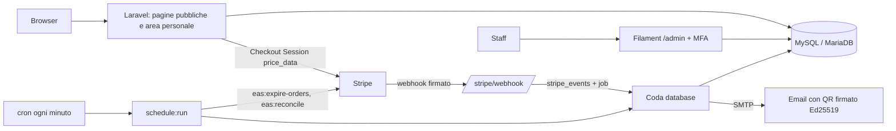

# EAS8 · guida per lo sviluppatore

Autore: Giulio Occhipinti. Aggiornato al 07/11/2026.

Ciao Simone, questo documento è per te come sviluppatore backend: architettura, codice, database, integrazioni,
come provarlo e le poche domande di **struttura** che ci servono. Date, prezzi, testi e quantità **non** sono
domande: sono dati che si inseriscono e si cambiano dal pannello.

## Stato

| Parte | Stato |
|---|---|
| Applicazione Laravel 13 + Filament 5 in `sito/` | 🟢 Fase 1 sviluppata: vendita, pagamenti Stripe, membership, biglietti con QR, pannello a tre ruoli, export |
| Fase 2 | 🟡 Iniziata: programma (12 sale, tracce, sessioni, interventi) e speaker, con import CSV e pagine pubbliche |
| Test | 🟢 304 test Pest su MariaDB 10.11, compresi test in parallelo su posti, prezzo membro e webhook |
| Documentazione tecnica | 🟢 `docs/tecnico/`: database, stati, flussi, regole, permessi, ADR, esercizio |
| Prova con Stripe vero (modalità test) | 🔴 Da fare |
| Installazione sul vostro hosting | 🔴 Da fare |

## Architettura in breve



| Scelta | Dove è spiegata |
|---|---|
| Laravel + Filament su hosting condiviso, code con cron senza processo sempre attivo | `docs/tecnico/adr/0001`, `0008` |
| Regole nel database (CHECK, unici, colonne generate, trigger opzionali) | `adr/0002`, `docs/tecnico/database.md` |
| Prezzi calcolati dal server con `price_data`, sconti senza Coupon Stripe | `adr/0003` |
| Riserve di posti con scadenza, conferma tardiva con riprenotazione o rimborso | `adr/0004`, `docs/tecnico/flussi.md` |
| Webhook in coda con tabella `stripe_events` e lock sull'ordine | `adr/0005` |
| QR firmato Ed25519 con rotazione delle chiavi | `adr/0006` |
| Clienti con codice via email, staff con password + MFA | `adr/0007` |
| 51 permessi granulari, Policy sui permessi | `adr/0010`, `docs/tecnico/permessi.md` |

## Codice

| Dove | Cosa c'è |
|---|---|
| `sito/app/Services/` | Prezzi e fasce, riserve, pagamenti, rimborsi, contestazioni, biglietti e QR, omaggi |
| `sito/app/Services/StripeGateway.php` | L'unico punto che chiama Stripe; nei test `tests/Fakes/FakeStripe.php` |
| `sito/app/Jobs/`, `sito/routes/console.php` | Elaborazione dei webhook, scadenze, rimborsi, riconciliazione notturna |
| `sito/app/Filament/`, `sito/app/Policies/` | Pannello e permessi |
| `sito/database/migrations/` | Schema con i vincoli che proteggono posti e prezzo membro |
| `sito/tests/` | Test Pest; `tests/Concurrency/` lancia processi separati con transazioni vere |
| `docs/tecnico/regole.md` | Ogni regola → dove è garantita (vincolo, trigger, servizio, policy) → test che la prova |

## Database

- **MySQL 8.0.19+ o MariaDB 10.7+.** Niente SQLite, nemmeno nei test.
- Diagramma ER e dizionario dati: `docs/tecnico/database.md`, rigenerabile dopo ogni migrazione con
  `php strumenti/genera-doc-db/genera.php`.
- Macchine a stati di ordini, biglietti, riserve, rimborsi, membership, contestazioni: `docs/tecnico/stati.md`.
- I trigger aggiungono controlli in più; se l'hosting non li permette, `DB_TRIGGERS_OPTIONAL=true` e le regole
  restano nei servizi e nei vincoli.

## Integrazioni

| Integrazione | Come è fatta | Stato |
|---|---|---|
| Stripe Checkout (biglietti) | `price_data`, solo carta (wallet inclusi), Idempotency-Key, metadata con l'id ordine | 🟢 Codice e test con Stripe finto |
| Stripe Billing (membership) | Checkout in modalità subscription, Customer Portal, Price ID modificabile dal pannello | 🟢 Codice e test |
| Webhook Stripe | Firma verificata, `stripe_events`, job in coda; checkout, async payment, refund, refund.failed, dispute, subscription, invoice | 🟢 Codice e test |
| SMTP | Email in coda con limite di invio | 🟢 |
| Check-in del partner | QR firmato verificabile con la chiave pubblica; export CSV dei biglietti validi | 🟢 Export; 🟡 API in Fase 2 |
| Mailchimp | Oggi export CSV dei consensi; sincronizzazione in Fase 2 | 🟡 |
| Xero | Collegato a Stripe dal lato Xero, nessun codice nostro | 🟡 Da verificare |
| Video (Wistia, Vimeo) | Fase 2 | 🔴 |

## Provarlo in locale

```sh
cd sito
composer install
cp .env.example .env && php artisan key:generate   # DB, chiavi Stripe di test, SMTP, chiavi QR
php artisan migrate:fresh --seed                    # dati di prova EAS8
php artisan eas:create-admin                        # primo admin, poi MFA al primo accesso
php artisan test
php artisan serve                                   # sito su :8000, pannello su /admin
stripe listen --forward-to localhost:8000/stripe/webhook
```

Il seeder mette **dati di prova** (date, prezzi, fasce, workshop): servono per far girare il sistema e si cambiano
tutti dal pannello. Dettagli in `sito/README.md`; installazione e manutenzione sull'hosting in
`docs/tecnico/esercizio.md`.

## Domande di struttura

Solo quello che cambia codice, database o installazione. Se non rispondi, vale la proposta.

| # | Domanda | Perché conta | Proposta |
|---|---|---|---|
| 1 | Puoi lanciare `strumenti/verifica-hosting/verifica-hosting.php` via SSH e mandarci il riepilogo? | Versione PHP ed estensioni, MySQL/MariaDB, permesso per i trigger, cron, limiti | Senza riepilogo prepariamo l'installazione sul caso peggiore (trigger spenti) |
| 2 | Come pubblichi oggi le applicazioni Laravel: git via SSH, CI, upload? C'è un ambiente di prova separato? | Script di deploy e migrazioni in produzione | Deploy via SSH con `git pull` e uno script, più un sottodominio di prova |
| 3 | Convenzioni del tuo codice: Pint, PHPStan (livello), CI su GitHub Actions, struttura delle cartelle? | Allineare il codice al tuo modo di lavorare prima che cresca | Pint di default, PHPStan livello 6, CI che lancia i test su MariaDB |
| 4 | Account Stripe: ci dai accesso in modalità test (o le chiavi di test) e chi configura il webhook in produzione? | Prova completa dei pagamenti prima del lancio | Le chiavi stanno solo nel `.env` del server; il webhook lo registri tu |
| 5 | Xero e Stripe sono già collegati? Le fatture oggi partono da Stripe o da Xero? | Decide se serve codice nostro per le fatture | Nessun codice nostro, collegamento dal lato Xero |
| 6 | Il partner del check-in può verificare un QR firmato Ed25519 con una chiave pubblica, o vuole un elenco/API? | Formato del QR inviato per email, da fissare prima di vendere | QR firmato più export CSV |
| 7 | Email: la casella SMTP ha SPF e DKIM sul dominio e quanti invii all'ora regge? | Consegna dei biglietti | Limite di invio in coda già configurabile |
| 8 | Ruoli e permessi: vanno bene admin, commerciale, organizzatore come in `docs/tecnico/permessi.md`, con MFA obbligatoria e nessuno che può eliminare dati? | Modello dei permessi | Sì, come oggi |

## Prima del lancio (lato tecnico)

- Prova completa con Stripe in modalità test (anche Apple Pay e Google Pay) e `stripe listen`.
- Installazione sull'hosting con cron, HTTPS, backup e prova di ripristino (`docs/tecnico/esercizio.md`).
- Lingua nell'indirizzo (`/en/`, `/it/`) e messaggi di validazione in italiano.
- 11 regole senza test, elencate in fondo a `docs/tecnico/regole.md`.

## Fase 2

Iniziata il 07/11/2026 con programma e speaker: tabelle `rooms`, `tracks`, `session_parts`, `speakers`,
`session_speaker`, `session_part_speaker` e colonne nuove di `program_sessions`; sala occupata bloccata da trigger e
da `ProgramService`; import CSV dal pannello nel formato di `contenuti/modelli/`; pagine `/programme` e `/speakers`.
Dettagli in `sito/README.md` (Fase 2) e `docs/tecnico/regole.md` (Programma e speaker).

Restano: prenotazione delle sessioni gratuite a posti limitati, video per ruolo, sincronizzazione Mailchimp, accompagnatori ed
espositori, API per il partner del check-in, abstract, attestati e crediti formativi.

## Come contribuire

- Branch `feat/<descrizione>` o `fix/<descrizione>`, pull request su `main`.
- La CI (`.github/workflows/ci.yml`) gira su ogni pull request e su `main`: `composer audit`, Pint (`vendor/bin/pint
  --test`; `vendor/bin/pint` corregge), PHPStan con Larastan livello 5 (`vendor/bin/phpstan analyse`, zero errori) e i
  test su MariaDB 10.11 e MySQL 8.0. Deve essere verde prima del merge; `composer audit` dopo ogni dipendenza nuova.
- Ambiente locale anche con `docker compose up` in `sito/` (PHP 8.3, MariaDB, Mailpit per le email).
- Deploy e ritorno indietro: `strumenti/deploy/` (`releases/`, `shared/`, link `current`, 5 rilasci). Backup cifrati con
  rotazione e prova di ripristino: `strumenti/backup/`. Passi in `docs/tecnico/esercizio.md` §4 e §8.
- Regole del repository in `CLAUDE.md`, utili anche se lavori con un assistente AI.
