# Database: diagramma ER e dizionario dati

Autore: Giulio Occhipinti.

> File **generato**: non modificarlo a mano. Dopo ogni migrazione, dalla radice del repository:
> `php strumenti/genera-doc-db/genera.php` (dettagli in [`strumenti/genera-doc-db/README.md`](../../strumenti/genera-doc-db/README.md)).
> Le descrizioni delle tabelle stanno in `strumenti/genera-doc-db/descrizioni.php`.

| Generato da | Valore |
|---|---|
| Server | 10.11.14-MariaDB-0ubuntu0.24.04.1 |
| Database | `eas8` |
| Ultima migrazione | `2026_11_09_090000_create_program_tables` |
| Tabelle | 49 |
| Trigger | 11 |

Nota per MySQL: le colonne JSON qui risultano `longtext` con un `CHECK json_valid()` perché il documento è
generato su MariaDB; su MySQL 8 sono di tipo `json`. Le colonne generate `*_key` o `active_*`
emulano gli indici unici parziali di Postgres: valgono `NULL` quando la riga non deve contare, e `NULL` non collide
in un indice unico.

## Indice delle tabelle

| Tabella | A cosa serve |
|---|---|
| [`audit_log`](#audit_log) | Registro audit delle azioni dello staff e dei job, solo inserimento (trigger). |
| [`cache`](#cache) | Cache di Laravel (driver database), anche per il RateLimiter. |
| [`cache_locks`](#cache_locks) | Lock della cache (`withoutOverlapping` dello scheduler). |
| [`capacity_holds`](#capacity_holds) | Posti presi da un ordine su un pool: riserva con scadenza, attesa del pagamento, convertita o rilasciata. |
| [`capacity_pools`](#capacity_pools) | Contatori dei posti: `held + confirmed <= capacity` garantito dal CHECK. |
| [`companion_claims`](#companion_claims) | Accompagnatore legato al pass: al massimo uno per pass (fase 2). |
| [`consents`](#consents) | Consensi registrati (newsletter, condizioni), solo inserimento (trigger). |
| [`discount_codes`](#discount_codes) | Codici sconto calcolati dal server: tipo, valore, validità, ruoli ammessi, limiti di utilizzo. |
| [`discount_code_redemptions`](#discount_code_redemptions) | Utilizzi dei codici per ordine; quelli non rilasciati contano nei limiti. |
| [`discount_code_ticket_types`](#discount_code_ticket_types) | Tipi di biglietto a cui si applica un codice sconto (vuota = tutti). |
| [`disputes`](#disputes) | Contestazioni dei pagamenti (chargeback) lette dai webhook `charge.dispute.*`. |
| [`events`](#events) | Evento (EAS8): nome tradotto, date, valuta, stato, finestra di vendita. |
| [`event_days`](#event_days) | Giorni dell'evento; servono ai pass giornalieri e al programma. |
| [`failed_import_rows`](#failed_import_rows) | Righe di un import con il motivo dell'errore, scaricabili dal pannello. |
| [`failed_jobs`](#failed_jobs) | Job falliti dopo tutti i tentativi: da controllare (`php artisan queue:failed`). |
| [`imports`](#imports) | Import CSV avviati dal pannello (Filament): file, righe totali, riuscite, chi l'ha avviato. |
| [`jobs`](#jobs) | Coda dei job (driver database), vuotata dal cron ogni minuto. |
| [`job_batches`](#job_batches) | Batch di job di Laravel: li usano gli import CSV di Filament. |
| [`login_codes`](#login_codes) | Codici di accesso dei clienti: HMAC del codice, scadenza 10 minuti, tentativi. |
| [`memberships`](#memberships) | Copia locale della subscription Stripe del membro (stato, periodo, annullamento). |
| [`membership_plans`](#membership_plans) | Piano della membership: prezzo mostrato e Price ID Stripe ricorrente. |
| [`member_price_claims`](#member_price_claims) | Prenotazione del prezzo membro: al massimo una attiva per membro, evento e tipo (indice unico). |
| [`migrations`](#migrations) | Migrazioni già eseguite (Laravel). |
| [`model_has_permissions`](#model_has_permissions) | Permessi diretti a un utente (non usati: si passa dai ruoli). |
| [`model_has_roles`](#model_has_roles) | Ruoli assegnati agli utenti dello staff. |
| [`notifications`](#notifications) | Notifiche del pannello salvate nel database (es. fine di un import). |
| [`orders`](#orders) | Ordini: stato, ruolo e fascia fissati alla riserva, importi in centesimi, sessione e PaymentIntent Stripe. |
| [`order_items`](#order_items) | Righe d'ordine con prezzo di listino, sconto unitario, totale e nominativi (JSON). |
| [`password_reset_tokens`](#password_reset_tokens) | Token di reimpostazione della password dello staff (Laravel). |
| [`permissions`](#permissions) | Permessi dello staff (spatie/laravel-permission), creati dal seeder da `App\Enums\StaffRole`. |
| [`price_tiers`](#price_tiers) | Fasce di prezzo dell'evento (early bird, regular, last minute), mai sovrapposte (trigger). |
| [`program_sessions`](#program_sessions) | Sessioni del programma (workshop compresi) con sala, traccia, formato e orari UTC; mai due sovrapposte nella stessa sala (trigger + servizio). Il nome evita lo scontro con `sessions` di Laravel. |
| [`refunds`](#refunds) | Rimborsi Stripe per ordine: importo, causa, origine (auto, staff, dashboard), stato, chiave di idempotenza. |
| [`roles`](#roles) | Ruoli dello staff: admin, commerciale, organizzatore. |
| [`role_has_permissions`](#role_has_permissions) | Permessi di ogni ruolo. |
| [`rooms`](#rooms) | Sale dell'evento (12 per l'EAS8): codice d'import, capienza, piano, ordine nella griglia. |
| [`sent_messages`](#sent_messages) | Email transazionali inviate, con chiave unica per non mandare due volte la stessa. |
| [`sessions`](#sessions) | Sessioni HTTP di Laravel (driver database). |
| [`session_parts`](#session_parts) | Interventi dentro una sessione, in ordine di position. |
| [`session_part_speaker`](#session_part_speaker) | Relatori di un intervento, in ordine. |
| [`session_speaker`](#session_speaker) | Chi parla o modera in una sessione, con ruolo e ordine. |
| [`speakers`](#speakers) | Speaker e moderatori: codice d'import, nome, bio tradotta, foto pubblica senza EXIF, email privata. |
| [`stripe_events`](#stripe_events) | Eventi Stripe ricevuti (id evento = chiave): idempotenza dei webhook e stato dell'elaborazione. |
| [`tickets`](#tickets) | Biglietti nominativi: uno per partecipante, stato, versione del QR, correzioni del nome (trigger). |
| [`ticket_prices`](#ticket_prices) | Prezzo in centesimi per tipo × fascia × ruolo di prezzo (pubblico, membro); fascia nulla = prezzo base. |
| [`ticket_types`](#ticket_types) | Tipi di biglietto (pass intero, giornaliero, workshop, accompagnatore, espositore, staff) con canale e limiti per ordine. |
| [`ticket_type_pools`](#ticket_type_pools) | Quali pool di capienza consuma ogni tipo di biglietto (molti a molti). |
| [`tracks`](#tracks) | Tracce tematiche dell'evento; lo slug dal nome inglese è la chiave della colonna track dell'import. |
| [`users`](#users) | Clienti e staff; lo staff ha password argon2id e MFA, i clienti entrano con il codice via email. |

## Diagramma ER

Solo le colonne chiave (PK, FK, UK) e gli stati; tutte le colonne sono nel dizionario. Escluse le tabelle
tecniche di Laravel: `cache`, `cache_locks`, `jobs`, `job_batches`, `failed_jobs`, `sessions`, `password_reset_tokens`, `migrations`, `imports`, `failed_import_rows`, `notifications`.

```mermaid
erDiagram
    audit_log {
        bigint id PK
        bigint actor_id FK
    }
    capacity_holds {
        uuid id PK
        uuid order_id FK,UK
        uuid pool_id FK,UK
        varchar status
    }
    capacity_pools {
        uuid id PK
        uuid event_id FK,UK
        varchar name UK
    }
    companion_claims {
        uuid id PK
        uuid host_ticket_id FK
        uuid order_id FK
        uuid order_item_id FK,UK
        varchar active_key UK "generata"
    }
    consents {
        uuid id PK
        bigint user_id FK
    }
    discount_codes {
        uuid id PK
        varchar code UK
        uuid event_id FK
        bigint created_by FK
    }
    discount_code_redemptions {
        uuid id PK
        uuid discount_code_id FK
        uuid order_id FK,UK
        bigint user_id FK
    }
    discount_code_ticket_types {
        uuid discount_code_id PK,FK
        uuid ticket_type_id PK,FK
    }
    disputes {
        uuid id PK
        varchar stripe_dispute_id UK
        uuid order_id FK
        varchar status
    }
    events {
        uuid id PK
        varchar slug UK
        varchar status
    }
    event_days {
        uuid id PK
        uuid event_id FK,UK
        date day UK
    }
    login_codes {
        bigint id PK
    }
    memberships {
        uuid id PK
        bigint user_id FK
        uuid plan_id FK
        varchar stripe_subscription_id UK
        varchar status
    }
    membership_plans {
        uuid id PK
        varchar stripe_price_id UK
    }
    member_price_claims {
        uuid id PK
        bigint user_id FK
        uuid event_id FK
        uuid event_day_id FK
        uuid program_session_id FK
        uuid order_id FK
        uuid order_item_id FK,UK
        varchar active_key UK "generata"
    }
    model_has_permissions {
        bigint permission_id PK,FK
        varchar model_type PK
        bigint model_id PK
    }
    model_has_roles {
        bigint role_id PK,FK
        varchar model_type PK
        bigint model_id PK
    }
    orders {
        uuid id PK
        uuid event_id FK
        bigint user_id FK
        varchar status
        uuid price_tier_id FK
        uuid discount_code_id FK
        bigint issued_by FK
        varchar stripe_checkout_session_id UK
        varchar stripe_payment_intent_id UK
        bigint pending_user_id UK "generata"
    }
    order_items {
        uuid id PK
        uuid order_id FK
        uuid ticket_type_id FK
        uuid ticket_price_id FK
    }
    permissions {
        bigint id PK
        varchar name UK
        varchar guard_name UK
    }
    price_tiers {
        uuid id PK
        uuid event_id FK,UK
        varchar code UK
    }
    program_sessions {
        uuid id PK
        uuid event_id FK,UK
        varchar code UK
        uuid event_day_id FK
        uuid room_id FK
        uuid track_id FK
        varchar slug UK
    }
    refunds {
        uuid id PK
        uuid order_id FK
        uuid ticket_id FK
        varchar status
        varchar stripe_refund_id UK
        varchar idempotency_key UK
        bigint requested_by FK
    }
    roles {
        bigint id PK
        varchar name UK
        varchar guard_name UK
    }
    role_has_permissions {
        bigint permission_id PK,FK
        bigint role_id PK,FK
    }
    rooms {
        uuid id PK
        uuid event_id FK,UK
        varchar code UK
    }
    sent_messages {
        bigint id PK
        varchar dedupe_key UK
    }
    session_parts {
        uuid id PK
        uuid program_session_id FK
    }
    session_part_speaker {
        uuid session_part_id PK,FK
        uuid speaker_id PK,FK
    }
    session_speaker {
        uuid id PK
        uuid program_session_id FK,UK
        uuid speaker_id FK,UK
    }
    speakers {
        uuid id PK
        varchar code UK
        varchar slug UK
    }
    stripe_events {
        varchar id PK
        varchar status
    }
    tickets {
        uuid id PK
        uuid event_id FK
        uuid order_id FK
        uuid order_item_id FK,UK
        smallint seq UK
        uuid ticket_type_id FK
        bigint attendee_user_id FK
        uuid host_ticket_id FK
        varchar status
        char short_code UK
        bigint attendee_corrected_by FK
    }
    ticket_prices {
        uuid id PK
        uuid ticket_type_id FK,UK
        uuid price_tier_id FK
        varchar price_role UK
        varchar tier_key UK "generata"
    }
    ticket_types {
        uuid id PK
        uuid event_id FK
        uuid event_day_id FK
        uuid program_session_id FK
    }
    ticket_type_pools {
        uuid ticket_type_id PK,FK
        uuid pool_id PK,FK
    }
    tracks {
        uuid id PK
        uuid event_id FK,UK
        varchar slug UK
    }
    users {
        bigint id PK
        varchar email UK
        varchar stripe_customer_id UK
    }
    users |o--o{ audit_log : "actor_id"
    orders ||--o{ capacity_holds : "order_id"
    capacity_pools ||--o{ capacity_holds : "pool_id"
    events ||--o{ capacity_pools : "event_id"
    tickets ||--o{ companion_claims : "host_ticket_id"
    orders ||--o{ companion_claims : "order_id"
    order_items ||--o| companion_claims : "order_item_id"
    users |o--o{ consents : "user_id"
    users |o--o{ discount_codes : "created_by"
    events |o--o{ discount_codes : "event_id"
    discount_codes ||--o{ discount_code_redemptions : "discount_code_id"
    orders ||--o| discount_code_redemptions : "order_id"
    users ||--o{ discount_code_redemptions : "user_id"
    discount_codes ||--o{ discount_code_ticket_types : "discount_code_id"
    ticket_types ||--o{ discount_code_ticket_types : "ticket_type_id"
    orders ||--o{ disputes : "order_id"
    events ||--o{ event_days : "event_id"
    membership_plans ||--o{ memberships : "plan_id"
    users ||--o{ memberships : "user_id"
    event_days |o--o{ member_price_claims : "event_day_id"
    events ||--o{ member_price_claims : "event_id"
    orders ||--o{ member_price_claims : "order_id"
    order_items ||--o| member_price_claims : "order_item_id"
    program_sessions |o--o{ member_price_claims : "program_session_id"
    users ||--o{ member_price_claims : "user_id"
    permissions ||--o{ model_has_permissions : "permission_id"
    roles ||--o{ model_has_roles : "role_id"
    discount_codes |o--o{ orders : "discount_code_id"
    events ||--o{ orders : "event_id"
    users |o--o{ orders : "issued_by"
    price_tiers |o--o{ orders : "price_tier_id"
    users ||--o{ orders : "user_id"
    orders ||--o{ order_items : "order_id"
    ticket_prices |o--o{ order_items : "ticket_price_id"
    ticket_types ||--o{ order_items : "ticket_type_id"
    events ||--o{ price_tiers : "event_id"
    event_days |o--o{ program_sessions : "event_day_id"
    events ||--o{ program_sessions : "event_id"
    rooms |o--o{ program_sessions : "room_id"
    tracks |o--o{ program_sessions : "track_id"
    orders ||--o{ refunds : "order_id"
    users |o--o{ refunds : "requested_by"
    tickets |o--o{ refunds : "ticket_id"
    permissions ||--o{ role_has_permissions : "permission_id"
    roles ||--o{ role_has_permissions : "role_id"
    events ||--o{ rooms : "event_id"
    program_sessions ||--o{ session_parts : "program_session_id"
    session_parts ||--o{ session_part_speaker : "session_part_id"
    speakers ||--o{ session_part_speaker : "speaker_id"
    program_sessions ||--o{ session_speaker : "program_session_id"
    speakers ||--o{ session_speaker : "speaker_id"
    users |o--o{ tickets : "attendee_corrected_by"
    users |o--o{ tickets : "attendee_user_id"
    events ||--o{ tickets : "event_id"
    tickets |o--o{ tickets : "host_ticket_id"
    orders ||--o{ tickets : "order_id"
    order_items ||--o{ tickets : "order_item_id"
    ticket_types ||--o{ tickets : "ticket_type_id"
    price_tiers |o--o{ ticket_prices : "price_tier_id"
    ticket_types ||--o{ ticket_prices : "ticket_type_id"
    event_days |o--o{ ticket_types : "event_day_id"
    events ||--o{ ticket_types : "event_id"
    program_sessions |o--o{ ticket_types : "program_session_id"
    capacity_pools ||--o{ ticket_type_pools : "pool_id"
    ticket_types ||--o{ ticket_type_pools : "ticket_type_id"
    events ||--o{ tracks : "event_id"
```



## Dizionario dati

### `audit_log`

Registro audit delle azioni dello staff e dei job, solo inserimento (trigger).

| Colonna | Tipo | Null | Default | Note |
|---|---|---|---|---|
| `id` | bigint(20) unsigned | no |  | PK; auto_increment |
| `occurred_at` | datetime | no | `current_timestamp()` |  |
| `actor_id` | bigint(20) unsigned | sì |  |  |
| `actor_type` | varchar(20) | no |  |  |
| `action` | varchar(100) | no |  |  |
| `entity_type` | varchar(100) | sì |  |  |
| `entity_id` | varchar(36) | sì |  |  |
| `ip` | varchar(45) | sì |  |  |
| `user_agent` | varchar(500) | sì |  |  |
| `data` | json (longtext) | sì |  |  |

- **Chiave primaria:** `id`
- **Indici:** `audit_log_actor_id_occurred_at_index` (actor_id, occurred_at); `audit_log_entity_type_entity_id_index` (entity_type, entity_id)
- **FK** `actor_id` → `users.id` ON DELETE RESTRICT, ON UPDATE RESTRICT (`audit_log_actor_id_foreign`)
- **CHECK** `audit_log_actor_type_valid`: `actor_type in ('staff','user','system')`
- **Trigger** `audit_log_no_delete` (BEFORE DELETE)
- **Trigger** `audit_log_no_update` (BEFORE UPDATE)

<details><summary>Corpo di <code>audit_log_no_delete</code></summary>

```sql
begin
  signal sqlstate '45000' set message_text = 'audit_log_append_only';
end
```

</details>

<details><summary>Corpo di <code>audit_log_no_update</code></summary>

```sql
begin
  signal sqlstate '45000' set message_text = 'audit_log_append_only';
end
```

</details>

### `cache`

Cache di Laravel (driver database), anche per il RateLimiter.

| Colonna | Tipo | Null | Default | Note |
|---|---|---|---|---|
| `key` | varchar(255) | no |  | PK |
| `value` | mediumtext | no |  |  |
| `expiration` | bigint(20) | no |  |  |

- **Chiave primaria:** `key`
- **Indici:** `cache_expiration_index` (expiration)

### `cache_locks`

Lock della cache (`withoutOverlapping` dello scheduler).

| Colonna | Tipo | Null | Default | Note |
|---|---|---|---|---|
| `key` | varchar(255) | no |  | PK |
| `owner` | varchar(255) | no |  |  |
| `expiration` | bigint(20) | no |  |  |

- **Chiave primaria:** `key`
- **Indici:** `cache_locks_expiration_index` (expiration)

### `capacity_holds`

Posti presi da un ordine su un pool: riserva con scadenza, attesa del pagamento, convertita o rilasciata.

| Colonna | Tipo | Null | Default | Note |
|---|---|---|---|---|
| `id` | uuid | no |  | PK |
| `order_id` | uuid | no |  |  |
| `pool_id` | uuid | no |  |  |
| `quantity` | int(11) | no |  |  |
| `status` | varchar(20) | no | `'active'` |  |
| `expires_at` | datetime | sì |  |  |
| `released_at` | datetime | sì |  |  |
| `release_reason` | varchar(200) | sì |  |  |
| `created_at` | datetime | sì |  |  |
| `updated_at` | datetime | sì |  |  |

- **Chiave primaria:** `id`
- **Unico** `capacity_holds_order_id_pool_id_unique`: `order_id`, `pool_id`
- **Indici:** `capacity_holds_expiry_idx` (status, expires_at); `capacity_holds_pool_id_foreign` (pool_id)
- **FK** `order_id` → `orders.id` ON DELETE CASCADE, ON UPDATE RESTRICT (`capacity_holds_order_id_foreign`)
- **FK** `pool_id` → `capacity_pools.id` ON DELETE RESTRICT, ON UPDATE RESTRICT (`capacity_holds_pool_id_foreign`)
- **CHECK** `capacity_holds_active_expires`: `status <> 'active' or expires_at is not null`
- **CHECK** `capacity_holds_quantity_positive`: `quantity > 0`
- **CHECK** `capacity_holds_released_dated`: `status <> 'released' or released_at is not null`
- **CHECK** `capacity_holds_status_valid`: `status in ('active','awaiting_payment','converted','released')`

### `capacity_pools`

Contatori dei posti: `held + confirmed <= capacity` garantito dal CHECK.

| Colonna | Tipo | Null | Default | Note |
|---|---|---|---|---|
| `id` | uuid | no |  | PK |
| `event_id` | uuid | no |  |  |
| `name` | varchar(120) | no |  |  |
| `capacity` | int(11) | no |  |  |
| `held` | int(11) | no | `0` |  |
| `confirmed` | int(11) | no | `0` |  |
| `max_per_order` | int(11) | sì |  |  |
| `created_at` | datetime | sì |  |  |
| `updated_at` | datetime | sì |  |  |

- **Chiave primaria:** `id`
- **Unico** `capacity_pools_event_id_name_unique`: `event_id`, `name`
- **FK** `event_id` → `events.id` ON DELETE RESTRICT, ON UPDATE RESTRICT (`capacity_pools_event_id_foreign`)
- **CHECK** `capacity_pools_counters_valid`: `capacity >= 0 and held >= 0 and confirmed >= 0 and (max_per_order is null or max_per_order > 0)`
- **CHECK** `capacity_pools_no_oversell`: `held + confirmed <= capacity`

### `companion_claims`

Accompagnatore legato al pass: al massimo uno per pass (fase 2).

| Colonna | Tipo | Null | Default | Note |
|---|---|---|---|---|
| `id` | uuid | no |  | PK |
| `host_ticket_id` | uuid | no |  |  |
| `slot` | tinyint(3) unsigned | no |  |  |
| `order_id` | uuid | no |  |  |
| `order_item_id` | uuid | no |  |  |
| `created_at` | datetime | no | `current_timestamp()` |  |
| `released_at` | datetime | sì |  |  |
| `release_reason` | varchar(200) | sì |  |  |
| `active_key` | varchar(50) | sì |  | generata (stored): `case when released_at is null then concat(host_ticket_id,'\|',slot) end` |

- **Chiave primaria:** `id`
- **Unico** `companion_claims_one_per_slot`: `active_key`
- **Unico** `companion_claims_order_item_id_unique`: `order_item_id`
- **Indici:** `companion_claims_host_ticket_id_foreign` (host_ticket_id); `companion_claims_order_id_foreign` (order_id)
- **FK** `host_ticket_id` → `tickets.id` ON DELETE RESTRICT, ON UPDATE RESTRICT (`companion_claims_host_ticket_id_foreign`)
- **FK** `order_id` → `orders.id` ON DELETE RESTRICT, ON UPDATE RESTRICT (`companion_claims_order_id_foreign`)
- **FK** `order_item_id` → `order_items.id` ON DELETE RESTRICT, ON UPDATE RESTRICT (`companion_claims_order_item_id_foreign`)
- **CHECK** `companion_claims_slot_valid`: `slot between 1 and 5`

### `consents`

Consensi registrati (newsletter, condizioni), solo inserimento (trigger).

| Colonna | Tipo | Null | Default | Note |
|---|---|---|---|---|
| `id` | uuid | no |  | PK |
| `user_id` | bigint(20) unsigned | sì |  |  |
| `email` | varchar(254) | no |  |  |
| `purpose` | varchar(30) | no | `'newsletter'` |  |
| `granted` | tinyint(1) | no |  |  |
| `source` | varchar(30) | no |  |  |
| `locale` | varchar(5) | no | `'en'` |  |
| `text_version` | varchar(30) | no |  |  |
| `ip` | varchar(45) | sì |  |  |
| `user_agent` | varchar(500) | sì |  |  |
| `occurred_at` | datetime | no | `current_timestamp()` |  |

- **Chiave primaria:** `id`
- **Indici:** `consents_email_purpose_occurred_at_index` (email, purpose, occurred_at); `consents_user_id_foreign` (user_id)
- **FK** `user_id` → `users.id` ON DELETE RESTRICT, ON UPDATE RESTRICT (`consents_user_id_foreign`)
- **CHECK** `consents_purpose_valid`: `purpose = 'newsletter'`
- **CHECK** `consents_source_valid`: `source in ('checkout','account','signup_form','import')`
- **Trigger** `consents_no_delete` (BEFORE DELETE)
- **Trigger** `consents_no_update` (BEFORE UPDATE)

<details><summary>Corpo di <code>consents_no_delete</code></summary>

```sql
begin
  signal sqlstate '45000' set message_text = 'consents_append_only';
end
```

</details>

<details><summary>Corpo di <code>consents_no_update</code></summary>

```sql
begin
  signal sqlstate '45000' set message_text = 'consents_append_only';
end
```

</details>

### `discount_codes`

Codici sconto calcolati dal server: tipo, valore, validità, ruoli ammessi, limiti di utilizzo.

| Colonna | Tipo | Null | Default | Note |
|---|---|---|---|---|
| `id` | uuid | no |  | PK |
| `code` | varchar(40) | no |  |  |
| `description` | varchar(500) | sì |  |  |
| `event_id` | uuid | sì |  |  |
| `discount_type` | varchar(10) | no |  |  |
| `percent_off` | tinyint(3) unsigned | sì |  |  |
| `amount_off_cents` | int(10) unsigned | sì |  |  |
| `currency` | char(3) | no | `'eur'` |  |
| `eligible_roles` | json (longtext) | sì |  |  |
| `combinable_with_role_price` | tinyint(1) | no | `0` |  |
| `applies_to_membership` | tinyint(1) | no | `0` |  |
| `max_redemptions` | int(10) unsigned | sì |  |  |
| `per_user_limit` | int(10) unsigned | sì |  |  |
| `redeemed_count` | int(10) unsigned | no | `0` |  |
| `valid_from` | datetime | sì |  |  |
| `valid_to` | datetime | sì |  |  |
| `active` | tinyint(1) | no | `1` |  |
| `created_by` | bigint(20) unsigned | sì |  |  |
| `created_at` | datetime | sì |  |  |
| `updated_at` | datetime | sì |  |  |

- **Chiave primaria:** `id`
- **Unico** `discount_codes_code_unique`: `code`
- **Indici:** `discount_codes_created_by_foreign` (created_by); `discount_codes_event_id_foreign` (event_id)
- **FK** `created_by` → `users.id` ON DELETE RESTRICT, ON UPDATE RESTRICT (`discount_codes_created_by_foreign`)
- **FK** `event_id` → `events.id` ON DELETE RESTRICT, ON UPDATE RESTRICT (`discount_codes_event_id_foreign`)
- **CHECK** `discount_codes_code_format`: `code regexp '^[A-Z0-9_-]{3,40}$'`
- **CHECK** `discount_codes_currency_lower`: `currency = lcase(currency)`
- **CHECK** `discount_codes_redemptions_valid`: `max_redemptions is null or redeemed_count <= max_redemptions`
- **CHECK** `discount_codes_shape`: `discount_type = 'percent' and percent_off is not null and percent_off between 1 and 100 and amount_off_cents is null or discount_type = 'amount' and amount_off_cents is not null and amount_off_cents > 0 and percent_off is null`
- **CHECK** `discount_codes_window`: `valid_from is null or valid_to is null or valid_to > valid_from`

### `discount_code_redemptions`

Utilizzi dei codici per ordine; quelli non rilasciati contano nei limiti.

| Colonna | Tipo | Null | Default | Note |
|---|---|---|---|---|
| `id` | uuid | no |  | PK |
| `discount_code_id` | uuid | no |  |  |
| `order_id` | uuid | no |  |  |
| `user_id` | bigint(20) unsigned | no |  |  |
| `created_at` | datetime | no | `current_timestamp()` |  |
| `released_at` | datetime | sì |  |  |
| `release_reason` | varchar(200) | sì |  |  |

- **Chiave primaria:** `id`
- **Unico** `discount_code_redemptions_order_id_unique`: `order_id`
- **Indici:** `discount_code_redemptions_discount_code_id_user_id_index` (discount_code_id, user_id); `discount_code_redemptions_user_id_foreign` (user_id)
- **FK** `discount_code_id` → `discount_codes.id` ON DELETE RESTRICT, ON UPDATE RESTRICT (`discount_code_redemptions_discount_code_id_foreign`)
- **FK** `order_id` → `orders.id` ON DELETE RESTRICT, ON UPDATE RESTRICT (`discount_code_redemptions_order_id_foreign`)
- **FK** `user_id` → `users.id` ON DELETE RESTRICT, ON UPDATE RESTRICT (`discount_code_redemptions_user_id_foreign`)

### `discount_code_ticket_types`

Tipi di biglietto a cui si applica un codice sconto (vuota = tutti).

| Colonna | Tipo | Null | Default | Note |
|---|---|---|---|---|
| `discount_code_id` | uuid | no |  | PK |
| `ticket_type_id` | uuid | no |  | PK |

- **Chiave primaria:** `discount_code_id`, `ticket_type_id`
- **Indici:** `discount_code_ticket_types_ticket_type_id_foreign` (ticket_type_id)
- **FK** `discount_code_id` → `discount_codes.id` ON DELETE CASCADE, ON UPDATE RESTRICT (`discount_code_ticket_types_discount_code_id_foreign`)
- **FK** `ticket_type_id` → `ticket_types.id` ON DELETE RESTRICT, ON UPDATE RESTRICT (`discount_code_ticket_types_ticket_type_id_foreign`)

### `disputes`

Contestazioni dei pagamenti (chargeback) lette dai webhook `charge.dispute.*`.

| Colonna | Tipo | Null | Default | Note |
|---|---|---|---|---|
| `id` | uuid | no |  | PK |
| `stripe_dispute_id` | varchar(255) | no |  |  |
| `order_id` | uuid | no |  |  |
| `stripe_charge_id` | varchar(255) | sì |  |  |
| `amount_cents` | int(11) | no |  |  |
| `currency` | char(3) | no |  |  |
| `reason` | varchar(50) | sì |  |  |
| `status` | varchar(30) | no |  |  |
| `evidence_due_by` | datetime | sì |  |  |
| `closed_at` | datetime | sì |  |  |
| `created_at` | datetime | sì |  |  |
| `updated_at` | datetime | sì |  |  |

- **Chiave primaria:** `id`
- **Unico** `disputes_stripe_dispute_id_unique`: `stripe_dispute_id`
- **Indici:** `disputes_order_id_foreign` (order_id)
- **FK** `order_id` → `orders.id` ON DELETE RESTRICT, ON UPDATE RESTRICT (`disputes_order_id_foreign`)

### `events`

Evento (EAS8): nome tradotto, date, valuta, stato, finestra di vendita.

| Colonna | Tipo | Null | Default | Note |
|---|---|---|---|---|
| `id` | uuid | no |  | PK |
| `slug` | varchar(100) | no |  |  |
| `title` | json (longtext) | no |  |  |
| `summary` | json (longtext) | sì |  |  |
| `description` | json (longtext) | sì |  |  |
| `status` | varchar(20) | no | `'draft'` |  |
| `timezone` | varchar(64) | no | `'Europe/Lisbon'` |  |
| `starts_on` | date | no |  |  |
| `ends_on` | date | no |  |  |
| `venue_name` | varchar(200) | sì |  |  |
| `venue_address` | varchar(500) | sì |  |  |
| `currency` | char(3) | no | `'eur'` |  |
| `sales_open_at` | datetime | sì |  |  |
| `sales_close_at` | datetime | sì |  |  |
| `created_at` | datetime | sì |  |  |
| `updated_at` | datetime | sì |  |  |

- **Chiave primaria:** `id`
- **Unico** `events_slug_unique`: `slug`
- **CHECK** `events_currency_lower`: `currency = lcase(currency)`
- **CHECK** `events_dates_valid`: `ends_on >= starts_on`
- **CHECK** `events_sales_window`: `sales_open_at is null or sales_close_at is null or sales_close_at > sales_open_at`
- **CHECK** `events_status_valid`: `status in ('draft','published','cancelled','archived')`

### `event_days`

Giorni dell'evento; servono ai pass giornalieri e al programma.

| Colonna | Tipo | Null | Default | Note |
|---|---|---|---|---|
| `id` | uuid | no |  | PK |
| `event_id` | uuid | no |  |  |
| `day` | date | no |  |  |
| `label` | json (longtext) | sì |  |  |
| `created_at` | datetime | sì |  |  |
| `updated_at` | datetime | sì |  |  |

- **Chiave primaria:** `id`
- **Unico** `event_days_event_id_day_unique`: `event_id`, `day`
- **FK** `event_id` → `events.id` ON DELETE RESTRICT, ON UPDATE RESTRICT (`event_days_event_id_foreign`)

### `failed_import_rows`

Righe di un import con il motivo dell'errore, scaricabili dal pannello.

| Colonna | Tipo | Null | Default | Note |
|---|---|---|---|---|
| `id` | bigint(20) unsigned | no |  | PK; auto_increment |
| `data` | json (longtext) | no |  |  |
| `import_id` | bigint(20) unsigned | no |  |  |
| `validation_error` | text | sì |  |  |
| `created_at` | timestamp | sì |  |  |
| `updated_at` | timestamp | sì |  |  |

- **Chiave primaria:** `id`
- **Indici:** `failed_import_rows_import_id_foreign` (import_id)
- **FK** `import_id` → `imports.id` ON DELETE CASCADE, ON UPDATE RESTRICT (`failed_import_rows_import_id_foreign`)

### `failed_jobs`

Job falliti dopo tutti i tentativi: da controllare (`php artisan queue:failed`).

| Colonna | Tipo | Null | Default | Note |
|---|---|---|---|---|
| `id` | bigint(20) unsigned | no |  | PK; auto_increment |
| `uuid` | varchar(255) | no |  |  |
| `connection` | varchar(255) | no |  |  |
| `queue` | varchar(255) | no |  |  |
| `payload` | longtext | no |  |  |
| `exception` | longtext | no |  |  |
| `failed_at` | timestamp | no | `current_timestamp()` |  |

- **Chiave primaria:** `id`
- **Unico** `failed_jobs_uuid_unique`: `uuid`
- **Indici:** `failed_jobs_connection_queue_failed_at_index` (connection, queue, failed_at)

### `imports`

Import CSV avviati dal pannello (Filament): file, righe totali, riuscite, chi l'ha avviato.

| Colonna | Tipo | Null | Default | Note |
|---|---|---|---|---|
| `id` | bigint(20) unsigned | no |  | PK; auto_increment |
| `completed_at` | timestamp | sì |  |  |
| `file_name` | varchar(255) | no |  |  |
| `file_path` | varchar(255) | no |  |  |
| `importer` | varchar(255) | no |  |  |
| `processed_rows` | int(10) unsigned | no | `0` |  |
| `total_rows` | int(10) unsigned | no |  |  |
| `successful_rows` | int(10) unsigned | no | `0` |  |
| `user_id` | bigint(20) unsigned | no |  |  |
| `created_at` | timestamp | sì |  |  |
| `updated_at` | timestamp | sì |  |  |

- **Chiave primaria:** `id`
- **Indici:** `imports_user_id_foreign` (user_id)
- **FK** `user_id` → `users.id` ON DELETE CASCADE, ON UPDATE RESTRICT (`imports_user_id_foreign`)

### `jobs`

Coda dei job (driver database), vuotata dal cron ogni minuto.

| Colonna | Tipo | Null | Default | Note |
|---|---|---|---|---|
| `id` | bigint(20) unsigned | no |  | PK; auto_increment |
| `queue` | varchar(255) | no |  |  |
| `payload` | longtext | no |  |  |
| `attempts` | smallint(5) unsigned | no |  |  |
| `reserved_at` | int(10) unsigned | sì |  |  |
| `available_at` | int(10) unsigned | no |  |  |
| `created_at` | int(10) unsigned | no |  |  |

- **Chiave primaria:** `id`
- **Indici:** `jobs_queue_index` (queue)

### `job_batches`

Batch di job di Laravel: li usano gli import CSV di Filament.

| Colonna | Tipo | Null | Default | Note |
|---|---|---|---|---|
| `id` | varchar(255) | no |  | PK |
| `name` | varchar(255) | no |  |  |
| `total_jobs` | int(11) | no |  |  |
| `pending_jobs` | int(11) | no |  |  |
| `failed_jobs` | int(11) | no |  |  |
| `failed_job_ids` | longtext | no |  |  |
| `options` | mediumtext | sì |  |  |
| `cancelled_at` | int(11) | sì |  |  |
| `created_at` | int(11) | no |  |  |
| `finished_at` | int(11) | sì |  |  |

- **Chiave primaria:** `id`

### `login_codes`

Codici di accesso dei clienti: HMAC del codice, scadenza 10 minuti, tentativi.

| Colonna | Tipo | Null | Default | Note |
|---|---|---|---|---|
| `id` | bigint(20) unsigned | no |  | PK; auto_increment |
| `email` | varchar(254) | no |  |  |
| `code_hash` | char(64) | no |  |  |
| `attempts` | tinyint(3) unsigned | no | `0` |  |
| `expires_at` | datetime | no |  |  |
| `used_at` | datetime | sì |  |  |
| `created_at` | datetime | no | `current_timestamp()` |  |

- **Chiave primaria:** `id`
- **Indici:** `login_codes_email_index` (email)

### `memberships`

Copia locale della subscription Stripe del membro (stato, periodo, annullamento).

| Colonna | Tipo | Null | Default | Note |
|---|---|---|---|---|
| `id` | uuid | no |  | PK |
| `user_id` | bigint(20) unsigned | no |  |  |
| `plan_id` | uuid | no |  |  |
| `stripe_subscription_id` | varchar(255) | no |  |  |
| `stripe_customer_id` | varchar(255) | no |  |  |
| `status` | varchar(30) | no |  |  |
| `current_period_start` | datetime | sì |  |  |
| `current_period_end` | datetime | sì |  |  |
| `cancel_at_period_end` | tinyint(1) | no | `0` |  |
| `canceled_at` | datetime | sì |  |  |
| `ended_at` | datetime | sì |  |  |
| `activated_at` | datetime | sì |  |  |
| `last_stripe_event_at` | datetime | sì |  |  |
| `created_at` | datetime | sì |  |  |
| `updated_at` | datetime | sì |  |  |

- **Chiave primaria:** `id`
- **Unico** `memberships_stripe_subscription_id_unique`: `stripe_subscription_id`
- **Indici:** `memberships_plan_id_foreign` (plan_id); `memberships_user_id_status_current_period_end_index` (user_id, status, current_period_end)
- **FK** `plan_id` → `membership_plans.id` ON DELETE RESTRICT, ON UPDATE RESTRICT (`memberships_plan_id_foreign`)
- **FK** `user_id` → `users.id` ON DELETE RESTRICT, ON UPDATE RESTRICT (`memberships_user_id_foreign`)
- **CHECK** `memberships_status_valid`: `status in ('incomplete','incomplete_expired','trialing','active','past_due','canceled','unpaid','paused')`

### `membership_plans`

Piano della membership: prezzo mostrato e Price ID Stripe ricorrente.

| Colonna | Tipo | Null | Default | Note |
|---|---|---|---|---|
| `id` | uuid | no |  | PK |
| `name` | json (longtext) | no |  |  |
| `stripe_price_id` | varchar(255) | sì |  |  |
| `amount_cents` | int(10) unsigned | no |  |  |
| `currency` | char(3) | no | `'eur'` |  |
| `billing_interval` | varchar(10) | no | `'year'` |  |
| `active` | tinyint(1) | no | `1` |  |
| `created_at` | datetime | sì |  |  |
| `updated_at` | datetime | sì |  |  |

- **Chiave primaria:** `id`
- **Unico** `membership_plans_stripe_price_id_unique`: `stripe_price_id`
- **CHECK** `membership_plans_currency_lower`: `currency = lcase(currency)`
- **CHECK** `membership_plans_interval_valid`: `billing_interval in ('month','year')`

### `member_price_claims`

Prenotazione del prezzo membro: al massimo una attiva per membro, evento e tipo (indice unico).

| Colonna | Tipo | Null | Default | Note |
|---|---|---|---|---|
| `id` | uuid | no |  | PK |
| `user_id` | bigint(20) unsigned | no |  |  |
| `event_id` | uuid | no |  |  |
| `kind` | varchar(20) | no |  |  |
| `event_day_id` | uuid | sì |  |  |
| `program_session_id` | uuid | sì |  |  |
| `order_id` | uuid | no |  |  |
| `order_item_id` | uuid | no |  |  |
| `created_at` | datetime | no | `current_timestamp()` |  |
| `released_at` | datetime | sì |  |  |
| `release_reason` | varchar(200) | sì |  |  |
| `active_key` | varchar(200) | sì |  | generata (stored): `case when released_at is null then concat_ws('\|',user_id,event_id,kind,coalesce(cast(event_day_id as char(36) charset utf8mb4),'-'),coalesce(cast(program_session_id as char(36) charset utf8mb4),'-')) end` |

- **Chiave primaria:** `id`
- **Unico** `member_price_claims_one_active`: `active_key`
- **Unico** `member_price_claims_order_item_id_unique`: `order_item_id`
- **Indici:** `member_price_claims_event_day_id_foreign` (event_day_id); `member_price_claims_event_id_foreign` (event_id); `member_price_claims_order_id_index` (order_id); `member_price_claims_program_session_id_foreign` (program_session_id); `member_price_claims_user_id_foreign` (user_id)
- **FK** `event_day_id` → `event_days.id` ON DELETE RESTRICT, ON UPDATE RESTRICT (`member_price_claims_event_day_id_foreign`)
- **FK** `event_id` → `events.id` ON DELETE RESTRICT, ON UPDATE RESTRICT (`member_price_claims_event_id_foreign`)
- **FK** `order_id` → `orders.id` ON DELETE CASCADE, ON UPDATE RESTRICT (`member_price_claims_order_id_foreign`)
- **FK** `order_item_id` → `order_items.id` ON DELETE CASCADE, ON UPDATE RESTRICT (`member_price_claims_order_item_id_foreign`)
- **FK** `program_session_id` → `program_sessions.id` ON DELETE RESTRICT, ON UPDATE RESTRICT (`member_price_claims_program_session_id_foreign`)
- **FK** `user_id` → `users.id` ON DELETE RESTRICT, ON UPDATE RESTRICT (`member_price_claims_user_id_foreign`)
- **CHECK** `member_price_claims_kind_shape`: `kind = 'full_pass' and event_day_id is null and program_session_id is null or kind = 'day_pass' and event_day_id is not null and program_session_id is null or kind = 'paid_session' and event_day_id is null and program_session_id is not null`

### `migrations`

Migrazioni già eseguite (Laravel).

| Colonna | Tipo | Null | Default | Note |
|---|---|---|---|---|
| `id` | int(10) unsigned | no |  | PK; auto_increment |
| `migration` | varchar(255) | no |  |  |
| `batch` | int(11) | no |  |  |

- **Chiave primaria:** `id`

### `model_has_permissions`

Permessi diretti a un utente (non usati: si passa dai ruoli).

| Colonna | Tipo | Null | Default | Note |
|---|---|---|---|---|
| `permission_id` | bigint(20) unsigned | no |  | PK |
| `model_type` | varchar(255) | no |  | PK |
| `model_id` | bigint(20) unsigned | no |  | PK |

- **Chiave primaria:** `permission_id`, `model_id`, `model_type`
- **Indici:** `model_has_permissions_model_id_model_type_index` (model_id, model_type)
- **FK** `permission_id` → `permissions.id` ON DELETE CASCADE, ON UPDATE RESTRICT (`model_has_permissions_permission_id_foreign`)

### `model_has_roles`

Ruoli assegnati agli utenti dello staff.

| Colonna | Tipo | Null | Default | Note |
|---|---|---|---|---|
| `role_id` | bigint(20) unsigned | no |  | PK |
| `model_type` | varchar(255) | no |  | PK |
| `model_id` | bigint(20) unsigned | no |  | PK |

- **Chiave primaria:** `role_id`, `model_id`, `model_type`
- **Indici:** `model_has_roles_model_id_model_type_index` (model_id, model_type)
- **FK** `role_id` → `roles.id` ON DELETE CASCADE, ON UPDATE RESTRICT (`model_has_roles_role_id_foreign`)

### `notifications`

Notifiche del pannello salvate nel database (es. fine di un import).

| Colonna | Tipo | Null | Default | Note |
|---|---|---|---|---|
| `id` | uuid | no |  | PK |
| `type` | varchar(255) | no |  |  |
| `notifiable_type` | varchar(255) | no |  |  |
| `notifiable_id` | bigint(20) unsigned | no |  |  |
| `data` | text | no |  |  |
| `read_at` | timestamp | sì |  |  |
| `created_at` | timestamp | sì |  |  |
| `updated_at` | timestamp | sì |  |  |

- **Chiave primaria:** `id`
- **Indici:** `notifications_notifiable_type_notifiable_id_index` (notifiable_type, notifiable_id)

### `orders`

Ordini: stato, ruolo e fascia fissati alla riserva, importi in centesimi, sessione e PaymentIntent Stripe.

| Colonna | Tipo | Null | Default | Note |
|---|---|---|---|---|
| `id` | uuid | no |  | PK |
| `event_id` | uuid | no |  |  |
| `user_id` | bigint(20) unsigned | no |  |  |
| `buyer_email` | varchar(254) | no |  |  |
| `status` | varchar(20) | no | `'pending'` |  |
| `review_reason` | varchar(30) | sì |  |  |
| `origin` | varchar(20) | no | `'checkout'` |  |
| `price_role` | varchar(10) | no |  |  |
| `price_tier_id` | uuid | sì |  |  |
| `currency` | char(3) | no | `'eur'` |  |
| `subtotal_cents` | int(11) | no |  |  |
| `discount_cents` | int(11) | no | `0` |  |
| `total_cents` | int(11) | no |  |  |
| `tax_cents` | int(11) | sì |  |  |
| `discount_code_id` | uuid | sì |  |  |
| `issued_by` | bigint(20) unsigned | sì |  |  |
| `comp_reason` | varchar(20) | sì |  |  |
| `stripe_checkout_session_id` | varchar(255) | sì |  |  |
| `stripe_payment_intent_id` | varchar(255) | sì |  |  |
| `checkout_expires_at` | datetime | sì |  |  |
| `discount_reserved` | tinyint(1) | no | `0` |  |
| `paid_at` | datetime | sì |  |  |
| `livemode` | tinyint(1) | no |  |  |
| `stripe_amount_total_cents` | int(11) | sì |  |  |
| `locale` | varchar(5) | no | `'en'` |  |
| `created_at` | datetime | sì |  |  |
| `updated_at` | datetime | sì |  |  |
| `pending_user_id` | bigint(20) unsigned | sì |  | generata (stored): `case when status = 'pending' then user_id end` |

- **Chiave primaria:** `id`
- **Unico** `orders_one_pending_per_user`: `pending_user_id`
- **Unico** `orders_stripe_checkout_session_id_unique`: `stripe_checkout_session_id`
- **Unico** `orders_stripe_payment_intent_id_unique`: `stripe_payment_intent_id`
- **Indici:** `orders_discount_code_id_foreign` (discount_code_id); `orders_event_id_origin_status_index` (event_id, origin, status); `orders_issued_by_foreign` (issued_by); `orders_open_idx` (status, checkout_expires_at); `orders_price_tier_id_foreign` (price_tier_id); `orders_user_id_created_at_index` (user_id, created_at)
- **FK** `discount_code_id` → `discount_codes.id` ON DELETE RESTRICT, ON UPDATE RESTRICT (`orders_discount_code_id_foreign`)
- **FK** `event_id` → `events.id` ON DELETE RESTRICT, ON UPDATE RESTRICT (`orders_event_id_foreign`)
- **FK** `issued_by` → `users.id` ON DELETE RESTRICT, ON UPDATE RESTRICT (`orders_issued_by_foreign`)
- **FK** `price_tier_id` → `price_tiers.id` ON DELETE RESTRICT, ON UPDATE RESTRICT (`orders_price_tier_id_foreign`)
- **FK** `user_id` → `users.id` ON DELETE RESTRICT, ON UPDATE RESTRICT (`orders_user_id_foreign`)
- **CHECK** `orders_amounts_valid`: `subtotal_cents >= 0 and discount_cents >= 0 and total_cents >= 0 and total_cents = subtotal_cents - discount_cents and (tax_cents is null or tax_cents >= 0)`
- **CHECK** `orders_comp_shape`: `origin = 'complimentary' and total_cents = 0 and subtotal_cents = 0 and discount_code_id is null and stripe_checkout_session_id is null and issued_by is not null and comp_reason is not null and comp_reason in ('speaker','staff','sponsor','other') and status in ('paid','cancelled') or origin = 'checkout' and issued_by is null and comp_reason is null`
- **CHECK** `orders_currency_lower`: `currency = lcase(currency)`
- **CHECK** `orders_origin_valid`: `origin in ('checkout','complimentary')`
- **CHECK** `orders_paid_has_date`: `status <> 'paid' or paid_at is not null`
- **CHECK** `orders_price_role_valid`: `price_role in ('public','member')`
- **CHECK** `orders_status_valid`: `status in ('pending','processing','paid','expired','failed','needs_refund','cancelled','partially_refunded','refunded','needs_review')`
- **Trigger** `orders_guard` (BEFORE UPDATE)

<details><summary>Corpo di <code>orders_guard</code></summary>

```sql
begin
  if new.status <> old.status and concat(old.status, '>', new.status) not in ('pending>paid','pending>processing','pending>expired','pending>cancelled','pending>failed','pending>needs_refund','processing>paid','processing>failed','processing>needs_refund','expired>paid','failed>paid','cancelled>paid','expired>needs_refund','failed>needs_refund','cancelled>needs_refund','paid>partially_refunded','paid>refunded','partially_refunded>refunded','needs_refund>refunded','paid>cancelled','pending>needs_review','processing>needs_review','expired>needs_review','failed>needs_review','cancelled>needs_review','needs_review>paid','needs_review>needs_refund','needs_review>refunded') then
    signal sqlstate '45000' set message_text = 'order_invalid_transition';
  end if;
  if old.status = 'paid' and new.status = 'cancelled' and old.origin <> 'complimentary' then
    signal sqlstate '45000' set message_text = 'order_invalid_transition';
  end if;
  if not (new.origin <=> old.origin) or not (new.price_role <=> old.price_role)
     or not (new.price_tier_id <=> old.price_tier_id) or not (new.user_id <=> old.user_id)
     or not (new.event_id <=> old.event_id) or not (new.subtotal_cents <=> old.subtotal_cents)
     or not (new.discount_cents <=> old.discount_cents) or not (new.total_cents <=> old.total_cents) then
    signal sqlstate '45000' set message_text = 'order_snapshot_immutable';
  end if;
end
```

</details>

### `order_items`

Righe d'ordine con prezzo di listino, sconto unitario, totale e nominativi (JSON).

| Colonna | Tipo | Null | Default | Note |
|---|---|---|---|---|
| `id` | uuid | no |  | PK |
| `order_id` | uuid | no |  |  |
| `ticket_type_id` | uuid | no |  |  |
| `quantity` | int(11) | no |  |  |
| `price_role` | varchar(10) | no |  |  |
| `list_unit_amount_cents` | int(11) | no |  |  |
| `unit_discount_cents` | int(11) | no | `0` |  |
| `unit_amount_cents` | int(11) | no |  |  |
| `total_cents` | int(11) | no |  |  |
| `stripe_line_name` | varchar(250) | no |  |  |
| `ticket_price_id` | uuid | sì |  |  |
| `attendees` | json (longtext) | no |  |  |
| `created_at` | datetime | sì |  |  |
| `updated_at` | datetime | sì |  |  |

- **Chiave primaria:** `id`
- **Indici:** `order_items_order_id_index` (order_id); `order_items_ticket_price_id_foreign` (ticket_price_id); `order_items_ticket_type_id_foreign` (ticket_type_id)
- **FK** `order_id` → `orders.id` ON DELETE CASCADE, ON UPDATE RESTRICT (`order_items_order_id_foreign`)
- **FK** `ticket_price_id` → `ticket_prices.id` ON DELETE RESTRICT, ON UPDATE RESTRICT (`order_items_ticket_price_id_foreign`)
- **FK** `ticket_type_id` → `ticket_types.id` ON DELETE RESTRICT, ON UPDATE RESTRICT (`order_items_ticket_type_id_foreign`)
- **CHECK** `order_items_amounts_valid`: `quantity between 1 and 50 and list_unit_amount_cents >= 0 and unit_discount_cents >= 0 and unit_discount_cents <= list_unit_amount_cents and unit_amount_cents = list_unit_amount_cents - unit_discount_cents and total_cents = unit_amount_cents * quantity`
- **CHECK** `order_items_attendees_match`: `json_type(attendees) = 'ARRAY' and json_length(attendees) = quantity`
- **CHECK** `order_items_member_qty_one`: `price_role <> 'member' or quantity = 1`
- **CHECK** `order_items_price_role_valid`: `price_role in ('public','member')`

### `password_reset_tokens`

Token di reimpostazione della password dello staff (Laravel).

| Colonna | Tipo | Null | Default | Note |
|---|---|---|---|---|
| `email` | varchar(255) | no |  | PK |
| `token` | varchar(255) | no |  |  |
| `created_at` | timestamp | sì |  |  |

- **Chiave primaria:** `email`

### `permissions`

Permessi dello staff (spatie/laravel-permission), creati dal seeder da `App\Enums\StaffRole`.

| Colonna | Tipo | Null | Default | Note |
|---|---|---|---|---|
| `id` | bigint(20) unsigned | no |  | PK; auto_increment |
| `name` | varchar(255) | no |  |  |
| `guard_name` | varchar(255) | no |  |  |
| `created_at` | timestamp | sì |  |  |
| `updated_at` | timestamp | sì |  |  |

- **Chiave primaria:** `id`
- **Unico** `permissions_name_guard_name_unique`: `name`, `guard_name`

### `price_tiers`

Fasce di prezzo dell'evento (early bird, regular, last minute), mai sovrapposte (trigger).

| Colonna | Tipo | Null | Default | Note |
|---|---|---|---|---|
| `id` | uuid | no |  | PK |
| `event_id` | uuid | no |  |  |
| `code` | varchar(30) | no |  |  |
| `name` | json (longtext) | no |  |  |
| `starts_at` | datetime | no |  |  |
| `ends_at` | datetime | no |  |  |
| `active` | tinyint(1) | no | `1` |  |
| `position` | smallint(5) unsigned | no | `0` |  |
| `created_at` | datetime | sì |  |  |
| `updated_at` | datetime | sì |  |  |

- **Chiave primaria:** `id`
- **Unico** `price_tiers_event_id_code_unique`: `event_id`, `code`
- **Indici:** `price_tiers_event_id_starts_at_index` (event_id, starts_at)
- **FK** `event_id` → `events.id` ON DELETE RESTRICT, ON UPDATE RESTRICT (`price_tiers_event_id_foreign`)
- **CHECK** `price_tiers_code_format`: `code regexp '^[a-z_]{2,30}$'`
- **CHECK** `price_tiers_window`: `ends_at > starts_at`
- **Trigger** `price_tiers_no_overlap_insert` (BEFORE INSERT)
- **Trigger** `price_tiers_no_overlap_update` (BEFORE UPDATE)

<details><summary>Corpo di <code>price_tiers_no_overlap_insert</code></summary>

```sql
begin
  if exists (select 1 from price_tiers t
             where t.event_id = new.event_id and t.id <> new.id and t.active and new.active
               and t.starts_at < new.ends_at and new.starts_at < t.ends_at) then
    signal sqlstate '45000' set message_text = 'price_tier_overlap';
  end if;
end
```

</details>

<details><summary>Corpo di <code>price_tiers_no_overlap_update</code></summary>

```sql
begin
  if exists (select 1 from price_tiers t
             where t.event_id = new.event_id and t.id <> new.id and t.active and new.active
               and t.starts_at < new.ends_at and new.starts_at < t.ends_at) then
    signal sqlstate '45000' set message_text = 'price_tier_overlap';
  end if;
end
```

</details>

### `program_sessions`

Sessioni del programma (workshop compresi) con sala, traccia, formato e orari UTC; mai due sovrapposte nella stessa sala (trigger + servizio). Il nome evita lo scontro con `sessions` di Laravel.

| Colonna | Tipo | Null | Default | Note |
|---|---|---|---|---|
| `id` | uuid | no |  | PK |
| `event_id` | uuid | no |  |  |
| `code` | varchar(30) | no |  |  |
| `event_day_id` | uuid | sì |  |  |
| `room_id` | uuid | sì |  |  |
| `track_id` | uuid | sì |  |  |
| `slug` | varchar(150) | no |  |  |
| `title` | json (longtext) | no |  |  |
| `abstract` | json (longtext) | sì |  |  |
| `format` | varchar(20) | no | `'lecture'` |  |
| `access` | varchar(20) | no | `'included'` |  |
| `starts_at` | datetime | sì |  |  |
| `ends_at` | datetime | sì |  |  |
| `published` | tinyint(1) | no | `0` |  |
| `created_at` | datetime | sì |  |  |
| `updated_at` | datetime | sì |  |  |

- **Chiave primaria:** `id`
- **Unico** `program_sessions_event_id_code_unique`: `event_id`, `code`
- **Unico** `program_sessions_event_id_slug_unique`: `event_id`, `slug`
- **Indici:** `program_sessions_event_day_id_foreign` (event_day_id); `program_sessions_room_id_starts_at_index` (room_id, starts_at); `program_sessions_track_id_foreign` (track_id)
- **FK** `event_day_id` → `event_days.id` ON DELETE RESTRICT, ON UPDATE RESTRICT (`program_sessions_event_day_id_foreign`)
- **FK** `event_id` → `events.id` ON DELETE RESTRICT, ON UPDATE RESTRICT (`program_sessions_event_id_foreign`)
- **FK** `room_id` → `rooms.id` ON DELETE RESTRICT, ON UPDATE RESTRICT (`program_sessions_room_id_foreign`)
- **FK** `track_id` → `tracks.id` ON DELETE RESTRICT, ON UPDATE RESTRICT (`program_sessions_track_id_foreign`)
- **CHECK** `program_sessions_access_valid`: `access in ('included','included_booking','paid')`
- **CHECK** `program_sessions_code_format`: `code regexp '^[A-Za-z0-9-]{1,30}$'`
- **CHECK** `program_sessions_format_valid`: `format in ('plenary','keynote','lecture','panel','workshop','symposium','course','break','social')`
- **CHECK** `program_sessions_room_has_times`: `room_id is null or starts_at is not null and ends_at is not null`
- **CHECK** `program_sessions_times_valid`: `starts_at is null or ends_at is null or ends_at > starts_at`
- **Trigger** `program_sessions_no_room_overlap_insert` (BEFORE INSERT)
- **Trigger** `program_sessions_no_room_overlap_update` (BEFORE UPDATE)

<details><summary>Corpo di <code>program_sessions_no_room_overlap_insert</code></summary>

```sql
begin
  if new.room_id is not null and exists (select 1 from program_sessions s
             where s.room_id = new.room_id and s.id <> new.id
               and s.starts_at < new.ends_at and new.starts_at < s.ends_at) then
    signal sqlstate '45000' set message_text = 'program_session_room_overlap';
  end if;
end
```

</details>

<details><summary>Corpo di <code>program_sessions_no_room_overlap_update</code></summary>

```sql
begin
  if new.room_id is not null and exists (select 1 from program_sessions s
             where s.room_id = new.room_id and s.id <> new.id
               and s.starts_at < new.ends_at and new.starts_at < s.ends_at) then
    signal sqlstate '45000' set message_text = 'program_session_room_overlap';
  end if;
end
```

</details>

### `refunds`

Rimborsi Stripe per ordine: importo, causa, origine (auto, staff, dashboard), stato, chiave di idempotenza.

| Colonna | Tipo | Null | Default | Note |
|---|---|---|---|---|
| `id` | uuid | no |  | PK |
| `order_id` | uuid | no |  |  |
| `ticket_id` | uuid | sì |  |  |
| `amount_cents` | int(11) | no |  |  |
| `currency` | char(3) | no | `'eur'` |  |
| `cause` | varchar(30) | sì |  |  |
| `reason` | varchar(500) | sì |  |  |
| `status` | varchar(20) | no | `'pending'` |  |
| `source` | varchar(20) | no |  |  |
| `stripe_refund_id` | varchar(255) | sì |  |  |
| `idempotency_key` | varchar(100) | sì |  |  |
| `needs_review` | tinyint(1) | no | `0` |  |
| `requested_by` | bigint(20) unsigned | sì |  |  |
| `created_at` | datetime | sì |  |  |
| `updated_at` | datetime | sì |  |  |

- **Chiave primaria:** `id`
- **Unico** `refunds_idempotency_key_unique`: `idempotency_key`
- **Unico** `refunds_stripe_refund_id_unique`: `stripe_refund_id`
- **Indici:** `refunds_order_id_foreign` (order_id); `refunds_requested_by_foreign` (requested_by); `refunds_ticket_id_foreign` (ticket_id)
- **FK** `order_id` → `orders.id` ON DELETE RESTRICT, ON UPDATE RESTRICT (`refunds_order_id_foreign`)
- **FK** `requested_by` → `users.id` ON DELETE RESTRICT, ON UPDATE RESTRICT (`refunds_requested_by_foreign`)
- **FK** `ticket_id` → `tickets.id` ON DELETE RESTRICT, ON UPDATE RESTRICT (`refunds_ticket_id_foreign`)
- **CHECK** `refunds_amount_positive`: `amount_cents > 0`
- **CHECK** `refunds_cause_required`: `source = 'dashboard' or cause is not null`
- **CHECK** `refunds_source_valid`: `source in ('auto','staff','dashboard')`

### `roles`

Ruoli dello staff: admin, commerciale, organizzatore.

| Colonna | Tipo | Null | Default | Note |
|---|---|---|---|---|
| `id` | bigint(20) unsigned | no |  | PK; auto_increment |
| `name` | varchar(255) | no |  |  |
| `guard_name` | varchar(255) | no |  |  |
| `created_at` | timestamp | sì |  |  |
| `updated_at` | timestamp | sì |  |  |

- **Chiave primaria:** `id`
- **Unico** `roles_name_guard_name_unique`: `name`, `guard_name`

### `role_has_permissions`

Permessi di ogni ruolo.

| Colonna | Tipo | Null | Default | Note |
|---|---|---|---|---|
| `permission_id` | bigint(20) unsigned | no |  | PK |
| `role_id` | bigint(20) unsigned | no |  | PK |

- **Chiave primaria:** `permission_id`, `role_id`
- **Indici:** `role_has_permissions_role_id_foreign` (role_id)
- **FK** `permission_id` → `permissions.id` ON DELETE CASCADE, ON UPDATE RESTRICT (`role_has_permissions_permission_id_foreign`)
- **FK** `role_id` → `roles.id` ON DELETE CASCADE, ON UPDATE RESTRICT (`role_has_permissions_role_id_foreign`)

### `rooms`

Sale dell'evento (12 per l'EAS8): codice d'import, capienza, piano, ordine nella griglia.

| Colonna | Tipo | Null | Default | Note |
|---|---|---|---|---|
| `id` | uuid | no |  | PK |
| `event_id` | uuid | no |  |  |
| `code` | varchar(30) | no |  |  |
| `name` | json (longtext) | no |  |  |
| `capacity` | int(10) unsigned | no |  |  |
| `floor` | smallint(6) | sì |  |  |
| `position` | smallint(5) unsigned | no | `0` |  |
| `created_at` | datetime | sì |  |  |
| `updated_at` | datetime | sì |  |  |

- **Chiave primaria:** `id`
- **Unico** `rooms_event_id_code_unique`: `event_id`, `code`
- **FK** `event_id` → `events.id` ON DELETE RESTRICT, ON UPDATE RESTRICT (`rooms_event_id_foreign`)
- **CHECK** `rooms_capacity_positive`: `capacity > 0`
- **CHECK** `rooms_code_format`: `code regexp '^[A-Za-z0-9-]{1,30}$'`

### `sent_messages`

Email transazionali inviate, con chiave unica per non mandare due volte la stessa.

| Colonna | Tipo | Null | Default | Note |
|---|---|---|---|---|
| `id` | bigint(20) unsigned | no |  | PK; auto_increment |
| `dedupe_key` | varchar(200) | no |  |  |
| `mailable` | varchar(100) | no |  |  |
| `to_hash` | char(64) | no |  |  |
| `sent_at` | datetime | no | `current_timestamp()` |  |

- **Chiave primaria:** `id`
- **Unico** `sent_messages_dedupe_key_unique`: `dedupe_key`

### `sessions`

Sessioni HTTP di Laravel (driver database).

| Colonna | Tipo | Null | Default | Note |
|---|---|---|---|---|
| `id` | varchar(255) | no |  | PK |
| `user_id` | bigint(20) unsigned | sì |  |  |
| `ip_address` | varchar(45) | sì |  |  |
| `user_agent` | text | sì |  |  |
| `payload` | longtext | no |  |  |
| `last_activity` | int(11) | no |  |  |

- **Chiave primaria:** `id`
- **Indici:** `sessions_last_activity_index` (last_activity); `sessions_user_id_index` (user_id)

### `session_parts`

Interventi dentro una sessione, in ordine di position.

| Colonna | Tipo | Null | Default | Note |
|---|---|---|---|---|
| `id` | uuid | no |  | PK |
| `program_session_id` | uuid | no |  |  |
| `position` | smallint(5) unsigned | no |  |  |
| `title` | json (longtext) | no |  |  |
| `abstract` | json (longtext) | sì |  |  |
| `starts_at` | datetime | sì |  |  |
| `ends_at` | datetime | sì |  |  |
| `created_at` | datetime | sì |  |  |
| `updated_at` | datetime | sì |  |  |

- **Chiave primaria:** `id`
- **Indici:** `session_parts_program_session_id_position_index` (program_session_id, position)
- **FK** `program_session_id` → `program_sessions.id` ON DELETE CASCADE, ON UPDATE RESTRICT (`session_parts_program_session_id_foreign`)
- **CHECK** `session_parts_times_valid`: `starts_at is null or ends_at is null or ends_at > starts_at`

### `session_part_speaker`

Relatori di un intervento, in ordine.

| Colonna | Tipo | Null | Default | Note |
|---|---|---|---|---|
| `session_part_id` | uuid | no |  | PK |
| `speaker_id` | uuid | no |  | PK |
| `position` | smallint(5) unsigned | no | `0` |  |

- **Chiave primaria:** `session_part_id`, `speaker_id`
- **Indici:** `session_part_speaker_speaker_id_index` (speaker_id)
- **FK** `session_part_id` → `session_parts.id` ON DELETE CASCADE, ON UPDATE RESTRICT (`session_part_speaker_session_part_id_foreign`)
- **FK** `speaker_id` → `speakers.id` ON DELETE RESTRICT, ON UPDATE RESTRICT (`session_part_speaker_speaker_id_foreign`)

### `session_speaker`

Chi parla o modera in una sessione, con ruolo e ordine.

| Colonna | Tipo | Null | Default | Note |
|---|---|---|---|---|
| `id` | uuid | no |  | PK |
| `program_session_id` | uuid | no |  |  |
| `speaker_id` | uuid | no |  |  |
| `role` | varchar(20) | no | `'speaker'` |  |
| `position` | smallint(5) unsigned | no | `0` |  |
| `created_at` | datetime | sì |  |  |
| `updated_at` | datetime | sì |  |  |

- **Chiave primaria:** `id`
- **Unico** `session_speaker_program_session_id_speaker_id_unique`: `program_session_id`, `speaker_id`
- **Indici:** `session_speaker_speaker_id_index` (speaker_id)
- **FK** `program_session_id` → `program_sessions.id` ON DELETE CASCADE, ON UPDATE RESTRICT (`session_speaker_program_session_id_foreign`)
- **FK** `speaker_id` → `speakers.id` ON DELETE RESTRICT, ON UPDATE RESTRICT (`session_speaker_speaker_id_foreign`)
- **CHECK** `session_speaker_role_valid`: `role in ('speaker','moderator')`

### `speakers`

Speaker e moderatori: codice d'import, nome, bio tradotta, foto pubblica senza EXIF, email privata.

| Colonna | Tipo | Null | Default | Note |
|---|---|---|---|---|
| `id` | uuid | no |  | PK |
| `code` | varchar(30) | no |  |  |
| `slug` | varchar(150) | no |  |  |
| `honorific` | varchar(20) | sì |  |  |
| `first_name` | varchar(100) | no |  |  |
| `last_name` | varchar(100) | no |  |  |
| `affiliation` | varchar(200) | sì |  |  |
| `country` | char(2) | sì |  |  |
| `bio` | json (longtext) | sì |  |  |
| `photo_path` | varchar(255) | sì |  |  |
| `website` | varchar(500) | sì |  |  |
| `links` | json (longtext) | sì |  |  |
| `email` | varchar(255) | sì |  |  |
| `created_at` | datetime | sì |  |  |
| `updated_at` | datetime | sì |  |  |

- **Chiave primaria:** `id`
- **Unico** `speakers_code_unique`: `code`
- **Unico** `speakers_slug_unique`: `slug`
- **Indici:** `speakers_last_name_first_name_index` (last_name, first_name)
- **CHECK** `speakers_code_format`: `code regexp '^[A-Za-z0-9-]{1,30}$'`
- **CHECK** `speakers_country_format`: `country is null or country regexp '^[A-Za-z]{2}$'`

### `stripe_events`

Eventi Stripe ricevuti (id evento = chiave): idempotenza dei webhook e stato dell'elaborazione.

| Colonna | Tipo | Null | Default | Note |
|---|---|---|---|---|
| `id` | varchar(255) | no |  | PK |
| `type` | varchar(100) | no |  |  |
| `livemode` | tinyint(1) | no |  |  |
| `api_version` | varchar(40) | sì |  |  |
| `stripe_created_at` | datetime | no |  |  |
| `received_at` | datetime | no | `current_timestamp()` |  |
| `status` | varchar(20) | no | `'received'` |  |
| `attempts` | int(11) | no | `0` |  |
| `last_error` | text | sì |  |  |
| `ignored_reason` | varchar(100) | sì |  |  |
| `processed_at` | datetime | sì |  |  |
| `object_id` | varchar(255) | sì |  |  |
| `payload` | json (longtext) | sì |  |  |

- **Chiave primaria:** `id`
- **Indici:** `stripe_events_object_id_stripe_created_at_index` (object_id, stripe_created_at); `stripe_events_pending_idx` (status, received_at)
- **CHECK** `stripe_events_attempts_positive`: `attempts >= 0`
- **CHECK** `stripe_events_id_prefix`: `id like 'evt\\_%'`
- **CHECK** `stripe_events_processed_dated`: `status <> 'processed' or processed_at is not null`
- **CHECK** `stripe_events_status_valid`: `status in ('received','processing','processed','failed','ignored')`

### `tickets`

Biglietti nominativi: uno per partecipante, stato, versione del QR, correzioni del nome (trigger).

| Colonna | Tipo | Null | Default | Note |
|---|---|---|---|---|
| `id` | uuid | no |  | PK |
| `event_id` | uuid | no |  |  |
| `order_id` | uuid | no |  |  |
| `order_item_id` | uuid | no |  |  |
| `seq` | smallint(5) unsigned | no |  |  |
| `ticket_type_id` | uuid | no |  |  |
| `price_role` | varchar(10) | no |  |  |
| `attendee_name` | varchar(200) | no |  |  |
| `attendee_email` | varchar(254) | no |  |  |
| `attendee_user_id` | bigint(20) unsigned | sì |  |  |
| `host_ticket_id` | uuid | sì |  |  |
| `status` | varchar(20) | no | `'valid'` |  |
| `qr_version` | int(10) unsigned | no | `1` |  |
| `qr_key_id` | varchar(40) | no |  |  |
| `short_code` | char(8) | no |  |  |
| `issued_at` | datetime | no |  |  |
| `cancelled_at` | datetime | sì |  |  |
| `attendee_corrections_count` | tinyint(3) unsigned | no | `0` |  |
| `attendee_corrected_at` | datetime | sì |  |  |
| `attendee_corrected_by` | bigint(20) unsigned | sì |  |  |
| `created_at` | datetime | sì |  |  |
| `updated_at` | datetime | sì |  |  |

- **Chiave primaria:** `id`
- **Unico** `tickets_one_per_item_seq`: `order_item_id`, `seq`
- **Unico** `tickets_short_code_unique`: `short_code`
- **Indici:** `tickets_attendee_corrected_by_foreign` (attendee_corrected_by); `tickets_attendee_email_index` (attendee_email); `tickets_attendee_user_id_foreign` (attendee_user_id); `tickets_event_id_status_updated_at_index` (event_id, status, updated_at); `tickets_host_ticket_id_foreign` (host_ticket_id); `tickets_order_id_foreign` (order_id); `tickets_ticket_type_id_foreign` (ticket_type_id)
- **FK** `attendee_corrected_by` → `users.id` ON DELETE RESTRICT, ON UPDATE RESTRICT (`tickets_attendee_corrected_by_foreign`)
- **FK** `attendee_user_id` → `users.id` ON DELETE RESTRICT, ON UPDATE RESTRICT (`tickets_attendee_user_id_foreign`)
- **FK** `event_id` → `events.id` ON DELETE RESTRICT, ON UPDATE RESTRICT (`tickets_event_id_foreign`)
- **FK** `host_ticket_id` → `tickets.id` ON DELETE RESTRICT, ON UPDATE RESTRICT (`tickets_host_ticket_id_foreign`)
- **FK** `order_id` → `orders.id` ON DELETE RESTRICT, ON UPDATE RESTRICT (`tickets_order_id_foreign`)
- **FK** `order_item_id` → `order_items.id` ON DELETE RESTRICT, ON UPDATE RESTRICT (`tickets_order_item_id_foreign`)
- **FK** `ticket_type_id` → `ticket_types.id` ON DELETE RESTRICT, ON UPDATE RESTRICT (`tickets_ticket_type_id_foreign`)
- **CHECK** `tickets_cancelled_dated`: `status not in ('cancelled','refunded') or cancelled_at is not null`
- **CHECK** `tickets_numbers_valid`: `seq >= 1 and qr_version >= 1 and attendee_corrections_count <= 3`
- **CHECK** `tickets_price_role_valid`: `price_role in ('public','member')`
- **CHECK** `tickets_short_code_format`: `short_code regexp '^[A-HJKMNP-Z2-9]{8}$'`
- **CHECK** `tickets_status_valid`: `status in ('valid','cancelled','refunded','disputed')`
- **Trigger** `tickets_guard` (BEFORE UPDATE)
- **Trigger** `tickets_no_delete` (BEFORE DELETE)

<details><summary>Corpo di <code>tickets_guard</code></summary>

```sql
begin
  if not (new.event_id <=> old.event_id) or not (new.order_id <=> old.order_id)
     or not (new.order_item_id <=> old.order_item_id) or not (new.seq <=> old.seq)
     or not (new.ticket_type_id <=> old.ticket_type_id) or not (new.price_role <=> old.price_role)
     or not (new.host_ticket_id <=> old.host_ticket_id) then
    signal sqlstate '45000' set message_text = 'ticket_immutable';
  end if;
  if (not (new.attendee_name <=> old.attendee_name) or not (new.attendee_email <=> old.attendee_email))
     and not (new.attendee_corrections_count = old.attendee_corrections_count + 1
              and new.attendee_corrected_by is not null
              and new.attendee_corrected_at is not null
              and not (new.attendee_corrected_at <=> old.attendee_corrected_at)) then
    signal sqlstate '45000' set message_text = 'ticket_attendee_immutable';
  end if;
  if old.status in ('cancelled', 'refunded') and new.status <> old.status then
    signal sqlstate '45000' set message_text = 'ticket_invalid_transition';
  end if;
end
```

</details>

<details><summary>Corpo di <code>tickets_no_delete</code></summary>

```sql
begin
  signal sqlstate '45000' set message_text = 'ticket_delete_forbidden';
end
```

</details>

### `ticket_prices`

Prezzo in centesimi per tipo × fascia × ruolo di prezzo (pubblico, membro); fascia nulla = prezzo base.

| Colonna | Tipo | Null | Default | Note |
|---|---|---|---|---|
| `id` | uuid | no |  | PK |
| `ticket_type_id` | uuid | no |  |  |
| `price_tier_id` | uuid | sì |  |  |
| `price_role` | varchar(10) | no |  |  |
| `amount_cents` | int(10) unsigned | no |  |  |
| `currency` | char(3) | no | `'eur'` |  |
| `created_at` | datetime | sì |  |  |
| `updated_at` | datetime | sì |  |  |
| `tier_key` | varchar(36) | sì |  | generata (stored): `coalesce(cast(price_tier_id as char(36) charset utf8mb4),'*')` |

- **Chiave primaria:** `id`
- **Unico** `ticket_prices_one_per_tier_role`: `ticket_type_id`, `tier_key`, `price_role`
- **Indici:** `ticket_prices_price_tier_id_foreign` (price_tier_id)
- **FK** `price_tier_id` → `price_tiers.id` ON DELETE RESTRICT, ON UPDATE RESTRICT (`ticket_prices_price_tier_id_foreign`)
- **FK** `ticket_type_id` → `ticket_types.id` ON DELETE RESTRICT, ON UPDATE RESTRICT (`ticket_prices_ticket_type_id_foreign`)
- **CHECK** `ticket_prices_currency_lower`: `currency = lcase(currency)`
- **CHECK** `ticket_prices_role_valid`: `price_role in ('public','member')`

### `ticket_types`

Tipi di biglietto (pass intero, giornaliero, workshop, accompagnatore, espositore, staff) con canale e limiti per ordine.

| Colonna | Tipo | Null | Default | Note |
|---|---|---|---|---|
| `id` | uuid | no |  | PK |
| `event_id` | uuid | no |  |  |
| `kind` | varchar(20) | no |  |  |
| `channel` | varchar(10) | no | `'public'` |  |
| `name` | json (longtext) | no |  |  |
| `description` | json (longtext) | sì |  |  |
| `event_day_id` | uuid | sì |  |  |
| `program_session_id` | uuid | sì |  |  |
| `max_per_order` | smallint(5) unsigned | no | `4` |  |
| `max_per_host` | tinyint(3) unsigned | sì |  |  |
| `sales_start` | datetime | sì |  |  |
| `sales_end` | datetime | sì |  |  |
| `active` | tinyint(1) | no | `1` |  |
| `position` | smallint(5) unsigned | no | `0` |  |
| `created_at` | datetime | sì |  |  |
| `updated_at` | datetime | sì |  |  |

- **Chiave primaria:** `id`
- **Indici:** `ticket_types_event_day_id_foreign` (event_day_id); `ticket_types_event_id_active_position_index` (event_id, active, position); `ticket_types_program_session_id_foreign` (program_session_id)
- **FK** `event_day_id` → `event_days.id` ON DELETE RESTRICT, ON UPDATE RESTRICT (`ticket_types_event_day_id_foreign`)
- **FK** `event_id` → `events.id` ON DELETE RESTRICT, ON UPDATE RESTRICT (`ticket_types_event_id_foreign`)
- **FK** `program_session_id` → `program_sessions.id` ON DELETE RESTRICT, ON UPDATE RESTRICT (`ticket_types_program_session_id_foreign`)
- **CHECK** `ticket_types_channel_shape`: `(kind <> 'staff_pass' or channel = 'panel') and (kind <> 'companion' or max_per_host is not null and max_per_host between 1 and 5) and (kind = 'companion' or max_per_host is null)`
- **CHECK** `ticket_types_channel_valid`: `channel in ('public','invite','panel')`
- **CHECK** `ticket_types_kind_shape`: `kind = 'day_pass' and event_day_id is not null and program_session_id is null or kind = 'paid_session' and event_day_id is null and program_session_id is not null or kind in ('full_pass','companion','exhibitor','staff_pass') and event_day_id is null and program_session_id is null`
- **CHECK** `ticket_types_kind_valid`: `kind in ('full_pass','day_pass','paid_session','companion','exhibitor','staff_pass')`
- **CHECK** `ticket_types_sales_window`: `sales_start is null or sales_end is null or sales_end > sales_start`

### `ticket_type_pools`

Quali pool di capienza consuma ogni tipo di biglietto (molti a molti).

| Colonna | Tipo | Null | Default | Note |
|---|---|---|---|---|
| `ticket_type_id` | uuid | no |  | PK |
| `pool_id` | uuid | no |  | PK |

- **Chiave primaria:** `ticket_type_id`, `pool_id`
- **Indici:** `ticket_type_pools_pool_id_index` (pool_id)
- **FK** `pool_id` → `capacity_pools.id` ON DELETE RESTRICT, ON UPDATE RESTRICT (`ticket_type_pools_pool_id_foreign`)
- **FK** `ticket_type_id` → `ticket_types.id` ON DELETE CASCADE, ON UPDATE RESTRICT (`ticket_type_pools_ticket_type_id_foreign`)

### `tracks`

Tracce tematiche dell'evento; lo slug dal nome inglese è la chiave della colonna track dell'import.

| Colonna | Tipo | Null | Default | Note |
|---|---|---|---|---|
| `id` | uuid | no |  | PK |
| `event_id` | uuid | no |  |  |
| `slug` | varchar(100) | no |  |  |
| `name` | json (longtext) | no |  |  |
| `color` | char(7) | sì |  |  |
| `position` | smallint(5) unsigned | no | `0` |  |
| `created_at` | datetime | sì |  |  |
| `updated_at` | datetime | sì |  |  |

- **Chiave primaria:** `id`
- **Unico** `tracks_event_id_slug_unique`: `event_id`, `slug`
- **FK** `event_id` → `events.id` ON DELETE RESTRICT, ON UPDATE RESTRICT (`tracks_event_id_foreign`)
- **CHECK** `tracks_color_hex`: `color is null or color regexp '^#[0-9A-Fa-f]{6}$'`

### `users`

Clienti e staff; lo staff ha password argon2id e MFA, i clienti entrano con il codice via email.

| Colonna | Tipo | Null | Default | Note |
|---|---|---|---|---|
| `id` | bigint(20) unsigned | no |  | PK; auto_increment |
| `name` | varchar(255) | no |  |  |
| `email` | varchar(254) | no |  |  |
| `email_verified_at` | datetime | sì |  |  |
| `password` | varchar(255) | sì |  |  |
| `locale` | varchar(5) | no | `'en'` |  |
| `stripe_customer_id` | varchar(255) | sì |  |  |
| `marketing_consent_at` | datetime | sì |  |  |
| `app_authentication_secret` | text | sì |  |  |
| `app_authentication_recovery_codes` | text | sì |  |  |
| `anonymized_at` | datetime | sì |  |  |
| `remember_token` | varchar(100) | sì |  |  |
| `created_at` | datetime | sì |  |  |
| `updated_at` | datetime | sì |  |  |

- **Chiave primaria:** `id`
- **Unico** `users_email_unique`: `email`
- **Unico** `users_stripe_customer_id_unique`: `stripe_customer_id`
- **CHECK** `users_locale_valid`: `locale in ('en','it')`
