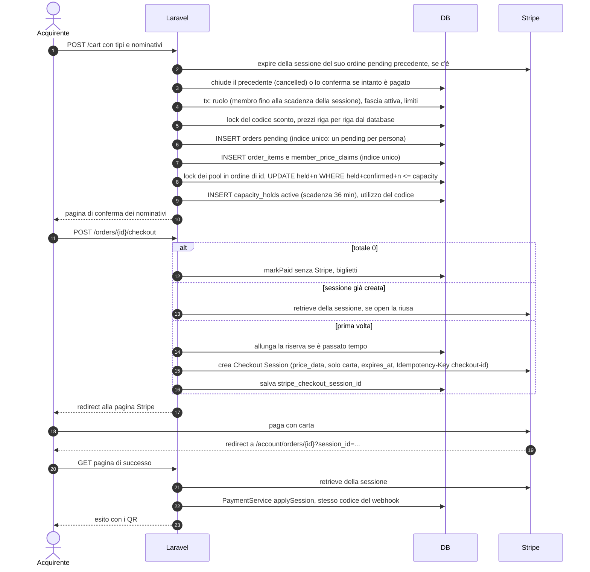
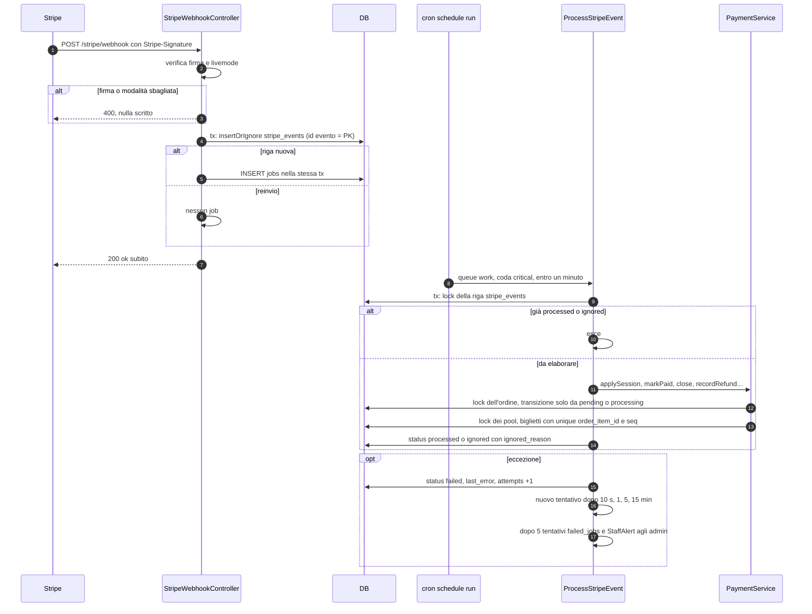
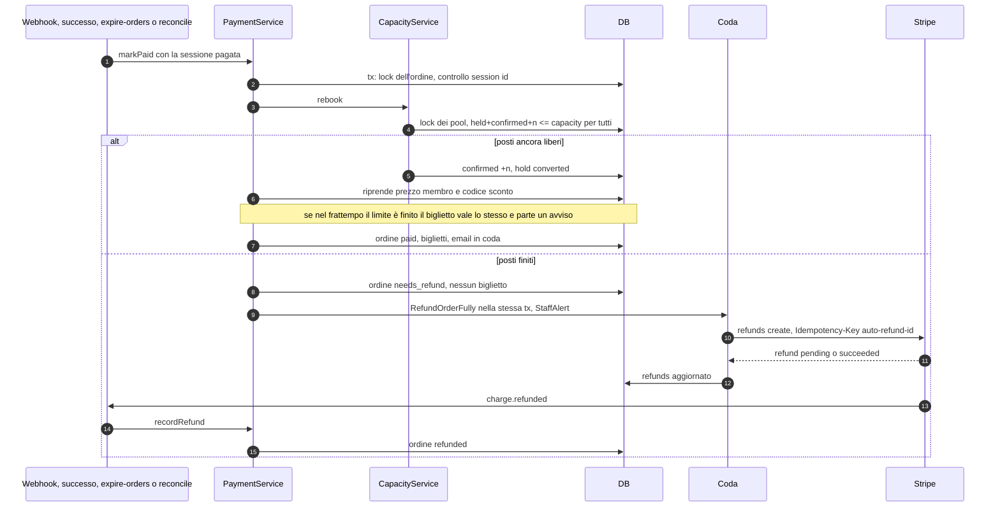
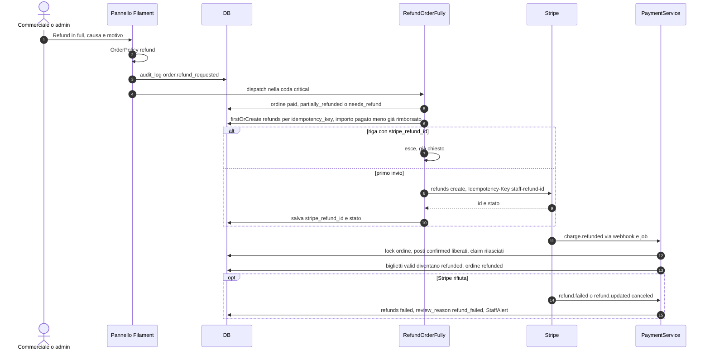
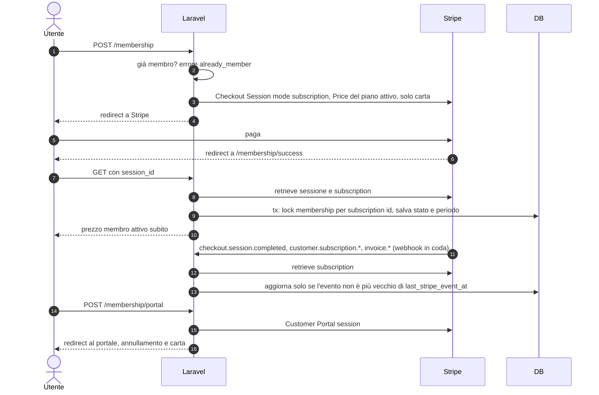
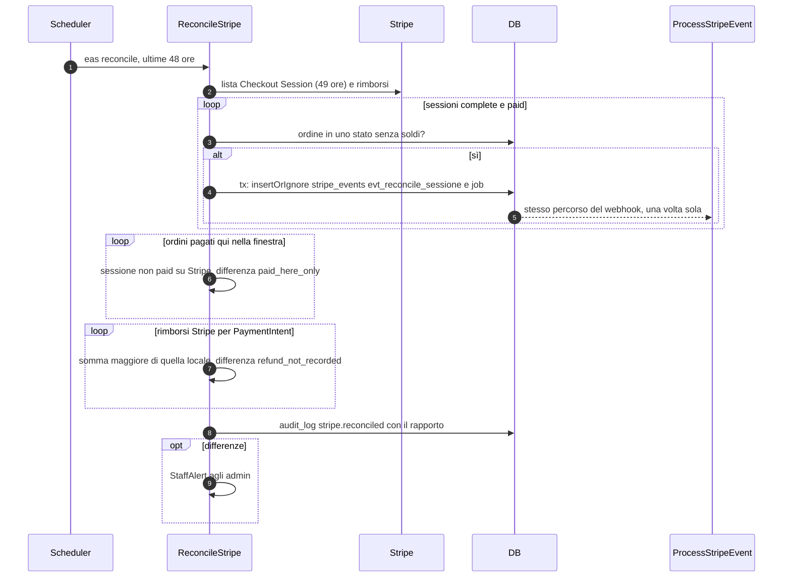
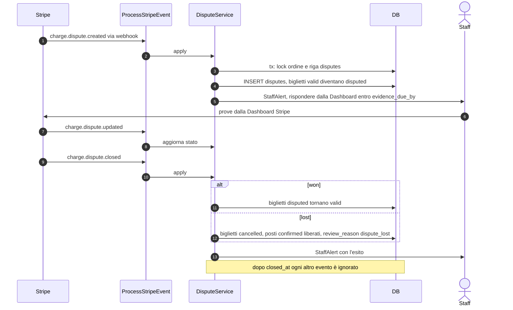
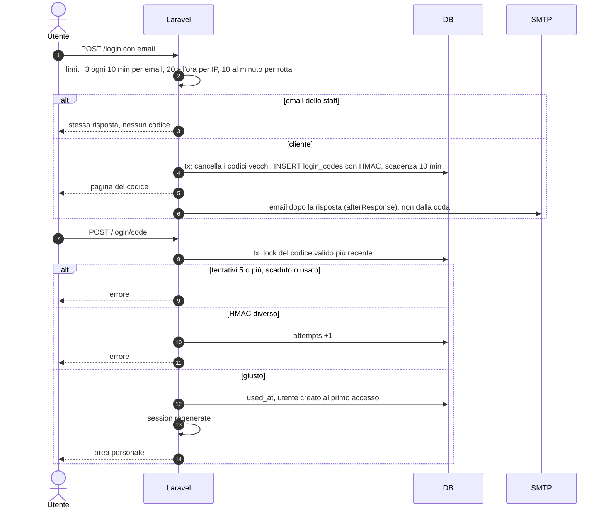

# Flussi principali

Autore: Giulio Occhipinti. Aggiornato al 07/11/2026, dal codice di `sito/`. Gli stati sono in [stati.md](stati.md),
le regole e i test in [regole.md](regole.md).

Convenzioni: `DB` è MySQL/MariaDB; «tx» è una `DB::transaction` (con 3 tentativi sui deadlock); «lock» è
`SELECT … FOR UPDATE`. La coda è il driver `database` (tabella `jobs`), vuotata dal cron ogni minuto.

## 1. Acquisto con Checkout Stripe

`ShopController::reserve` → `CheckoutService::reserve()`, poi `ShopController::checkout` →
`CheckoutService::startCheckout()`, poi la pagina di successo `AccountController::order`.

## 2. Webhook in coda con idempotenza e lock

`StripeWebhookController` e `ProcessStripeEvent`.

## 3. Pagamento tardivo: riprenotazione o rimborso

Il pagamento arriva quando l'ordine è già `expired`, `failed` o `cancelled` (`PaymentService::markPaid`).

## 4. Rimborso dal pannello

`OrderResource::refundAction` (permesso `orders.refund`) → `RefundOrderFully` → webhook `charge.refunded`.

## 5. Membership

`MembershipController` → `MembershipService`.

## 6. Riconciliazione notturna

`eas:reconcile` alle 3:30 (Europe/Lisbon), o dal pannello in coda (permesso `reconciliation.run`).

Le differenze `paid_here_only` e `refund_not_recorded` sono solo segnalate: si correggono a mano (vedi
[esercizio.md](esercizio.md)).

## 7. Contestazione

`charge.dispute.created`, `updated`, `closed` → `DisputeService::apply()`.

## 8. Login con codice

`LoginController` → `LoginCodeService`. Lo staff entra solo da `/admin` con password argon2id e TOTP.

