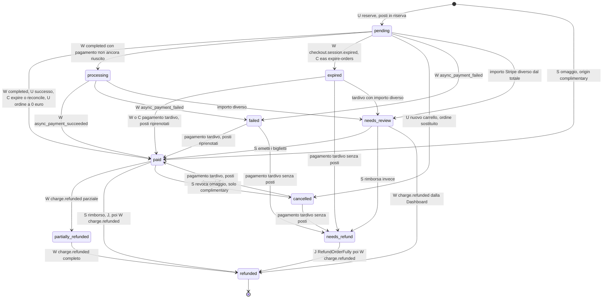
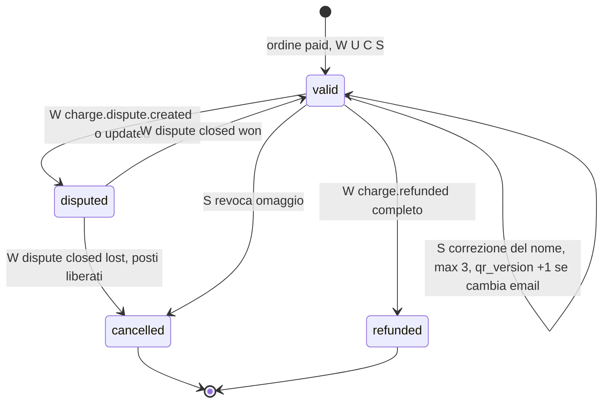
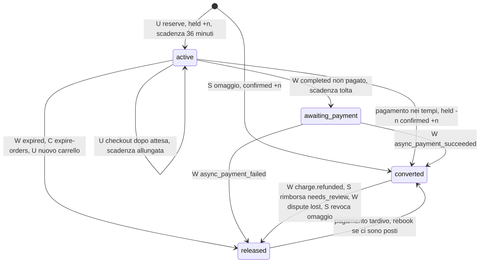
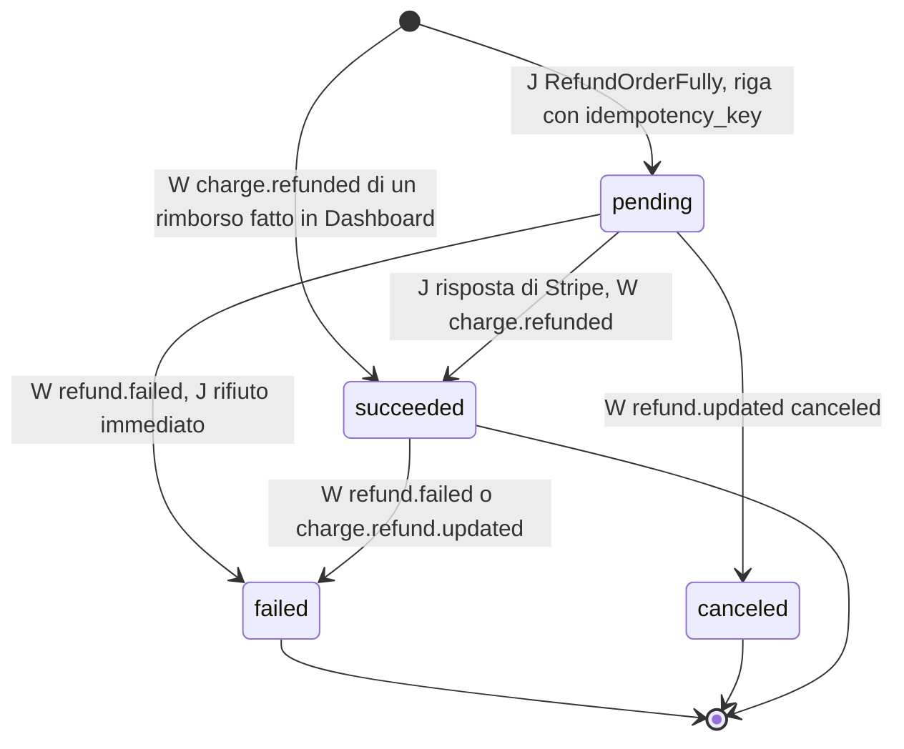
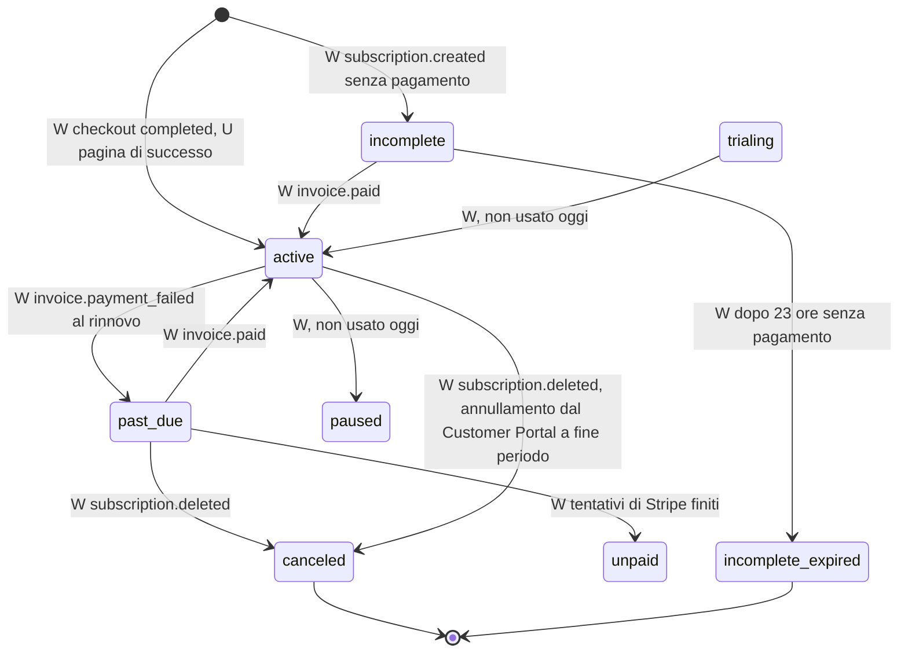
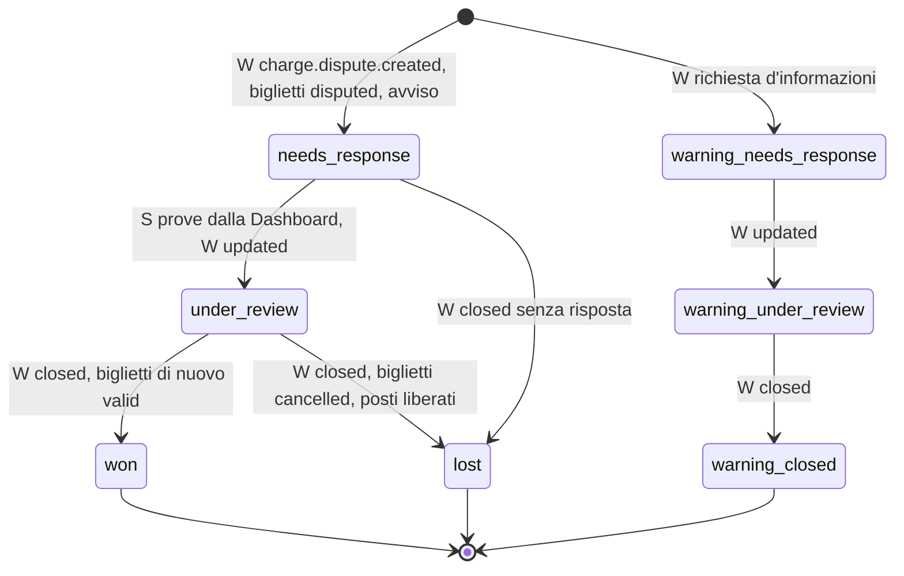
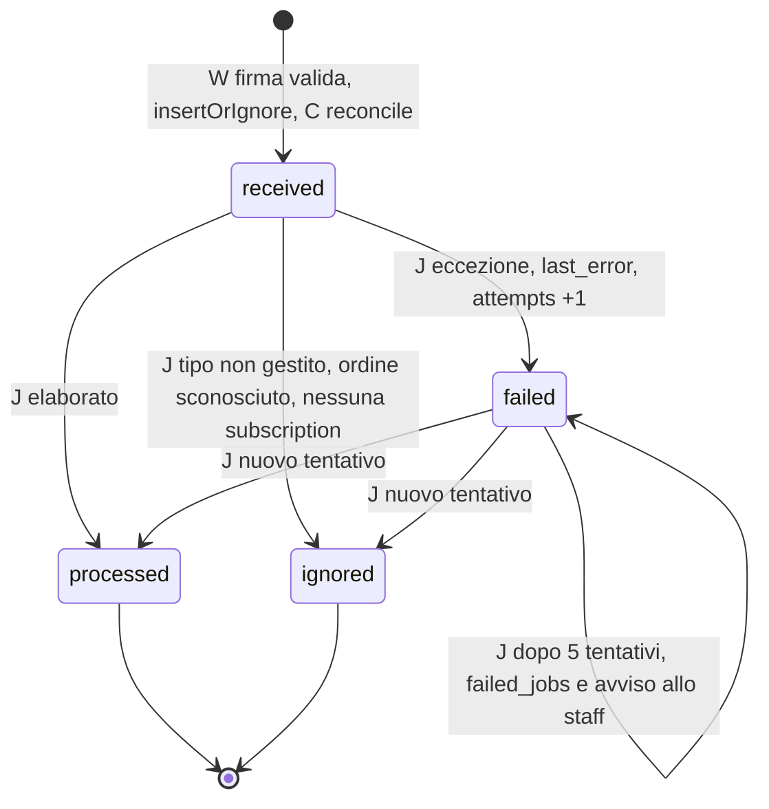

# Macchine a stati

Autore: Giulio Occhipinti. Aggiornato al 07/11/2026, dal codice di `sito/` (enum in `app/Enums/`, servizi in
`app/Services/`, job in `app/Jobs/`, comandi in `app/Console/Commands/`, trigger nelle migrazioni).

Chi provoca il passaggio, nelle etichette:

| Sigla | Chi | Esempi |
|---|---|---|
| **U** | utente (richiesta HTTP) | carrello, pagina di successo `/account/orders/{id}?session_id=…`, `/membership/success` |
| **W** | webhook Stripe, elaborato dal job `ProcessStripeEvent` in coda | `checkout.session.completed`, `charge.refunded` |
| **J** | job in coda | `RefundOrderFully`, `SendTicketsEmail` |
| **S** | staff dal pannello Filament | rimborso, decisione su `needs_review`, omaggio, correzione del nome |
| **C** | comando o scheduler | `eventals:expire-orders` (ogni minuto), `eventals:reconcile` (ogni notte) |

La pagina di successo, `eventals:expire-orders` ed `eventals:reconcile` chiamano lo stesso `PaymentService` del webhook: un
pagamento si conferma da qualunque delle quattro strade arrivi prima, una volta sola (lock sull'ordine).

## Ordine (`orders.status`)

Enum `App\Enums\OrderStatus`; le transizioni ammesse sono in `OrderStatus::canTransitionTo()` e, identiche, nel
trigger `orders_guard` (migrazioni `2026_11_06_100000` e `2026_11_08_090000`). `PaymentService::transition()` le
ricontrolla anche sugli hosting senza trigger.

- Anche `failed` e `cancelled` vanno in `needs_review` come `expired` (stessa regola, omesso per leggibilità).
- Ammesse dal trigger ma mai usate dal codice: `pending → needs_refund`.
- Immutabili dopo la riserva (trigger `orders_guard`, errore `order_snapshot_immutable`): `origin`, `price_role`,
  `price_tier_id`, `user_id`, `event_id`, `subtotal_cents`, `discount_cents`, `total_cents`.
- `review_reason` non è uno stato: segnala `amount_mismatch`, `refund_failed`, `dispute_lost` senza cambiare
  `status`. Una contestazione non cambia lo stato dell'ordine, solo quello dei biglietti.
- `OrderStatus::moneyTaken()`: `paid`, `partially_refunded`, `refunded`, `needs_refund`, `needs_review`.

## Biglietto (`tickets.status`)

Enum `App\Enums\TicketStatus`. Emissione in `TicketService::issue()` (idempotente: `unique (order_item_id, seq)`).
Trigger `tickets_guard`: da `cancelled` e `refunded` non si esce; nominativo immutabile salvo correzione firmata;
`tickets_no_delete` impedisce la cancellazione.

- Un rimborso parziale non tocca i biglietti: restano `valid`.
- Solo i biglietti `valid` hanno QR nell'area personale, ricevono email e finiscono nell'export del check-in.

## Riserva di capienza (`capacity_holds.status`)

Enum `App\Enums\CapacityHoldStatus`, metodi in `CapacityService`. Ogni passaggio aggiorna nella stessa transazione
`capacity_pools.held` e `confirmed` (CHECK `capacity_pools_no_oversell`: `held + confirmed <= capacity`).

- I posti di una riserva scaduta si liberano **solo dopo** che Stripe conferma la scadenza (webhook `expired` o
  `eventals:expire-orders`, che prima chiama `expire` sulla sessione): un job fermo fa vendere meno, mai due volte.
- CHECK: `active` ha sempre `expires_at`, `released` ha sempre `released_at`.

## Rimborso (`refunds.status`)

Stati di Stripe salvati come testo: `pending`, `succeeded`, `failed`, `canceled` (`Refund::NOT_MONEY` = `failed`,
`canceled`). `source`: `auto` (pagato senza posti), `staff` (pannello), `dashboard` (fatto in Stripe, registrato
dal webhook con `needs_review = 1`).

- Dopo un `failed` o `canceled` l'ordine riceve `review_reason = refund_failed` e lo staff un avviso; ordine e
  biglietti **non** cambiano stato. Il nuovo tentativo usa la chiave `…-retry-N` e crea una riga nuova.
- Lo stato `refunded` dell'ordine arriva solo da `charge.refunded`, mai dal job.

## Membership (`memberships.status`)

Copia degli stati della subscription Stripe (enum `App\Enums\MembershipStatus`). Il codice non decide transizioni:
`MembershipService::sync()` rilegge la subscription da Stripe e la salva, ignorando gli eventi più vecchi di
`last_stripe_event_at`. Chiamata da W `checkout.session.completed` (mode subscription), `customer.subscription.*`,
`invoice.*`, e da U `/membership/success`.

- **Prezzo membro** se esiste una membership `active` o `trialing` con `current_period_end` successivo alla
  scadenza della Checkout Session (`User::isMemberUntil`), così chi scade durante il pagamento non lo ottiene.
- L'annullamento dal Customer Portal mette `cancel_at_period_end = 1`: resta `active` fino a fine periodo.

## Contestazione (`disputes.status`)

Stati di Stripe salvati come testo; chiusi (`Dispute::CLOSED`): `won`, `lost`, `prevented`, `warning_closed`. Logica in
`DisputeService::apply()`. La risposta con le prove si dà dalla Dashboard Stripe (S fuori dal pannello).

- Una volta `closed_at` valorizzato, ogni evento successivo è ignorato (`already_closed`): Stripe non garantisce
  l'ordine di consegna.

## Evento Stripe (`stripe_events.status`)

Enum `App\Enums\StripeEventStatus`; righe scritte da `StripeWebhookController` e da `eventals:reconcile`
(`evt_reconcile_<session>`), elaborate da `ProcessStripeEvent` (5 tentativi, attese 10 s, 1, 5, 15 minuti).

- `processing` esiste nell'enum e nel CHECK ma il codice non lo usa: l'esclusione reciproca la dà il lock sulla riga
  (`lockForUpdate`) dentro la transazione del job.
- Un evento `processed` o `ignored` rielaborato non fa nulla.
